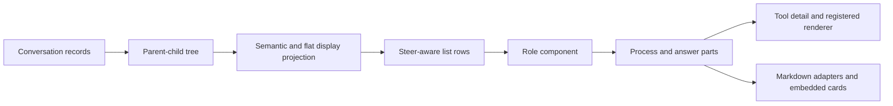

# LobeHub transcript reference

## Overview

This reference describes the local LobeHub v2.3.0 checkout at commit `700c8349e35477cb602975f8089c942e96bc9601`. It covers the core conversation dispatcher, its registered result renderers, and the conversation Markdown adapters. It does not claim that this is the latest release or that it covers every screen in the application.

**Executive findings.** The normal reading column has a 960px maximum and 16px inline padding, while wide mode removes the maximum. A transcript row is not necessarily one stored message: projection groups tool calls, continuations, and tasks. Card-specific state and the surrounding tool row's state are separate. Text hierarchy, syntax colours, status colours, and surfaces are separate visual dimensions. Many controls are quiet until hover, and some open a portal rather than expanding inline.

**Evidence labels.** [SOURCE] means the cited local source specifies the behaviour. It does not establish a runtime rendering. [INFERENCE] identifies a conclusion drawn from source rather than an explicit rule. [SCREENSHOT] identifies the user-provided visual references and is not a claim about source internals. This document does not report a live LobeHub run. Exact installed `@lobehub/ui` implementation, syntax palette, font metrics, and ordinary `@lobehub/editor/react` shell styling were unavailable in the local checkout.

## Contents

- [Key concepts](#key-concepts)
- [How it works](#how-it-works)
- [Layout and scrolling](#layout-and-scrolling)
- [Role inventory](#role-inventory)
- [Actions and composer](#actions-and-composer)
- [Visual hierarchy](#visual-hierarchy)
- [Tool registry](#tool-registry)
- [Tool card bodies](#tool-card-bodies)
- [Markdown adapters](#markdown-adapters)
- [Screenshot observations](#screenshot-observations)
- [Where things live](#where-things-live)
- [Gotchas and specification dimensions](#gotchas-and-specification-dimensions)

## Key concepts

[SOURCE] A **display role** selects a message component. A **process block** contains intermediate reasoning, tool calls, or narration within an assistant group. A **final answer** can remain visible while that process is folded. A **tool result renderer** is compiled application code selected by tool identifier and API member. An **inspector**, **streaming renderer**, **intervention**, and **portal** are separate registrations. A Markdown adapter can create an embedded card or inline element without adding a message role.

## How it works

[SOURCE] The inspected path starts with conversation records. The upstream network and stream-event protocol was not fully traced. `parse` indexes and builds a parent-child tree, transforms it into semantic nodes, then produces a display projection. `FlatListBuilder` selects branches, hides standalone internal dispatch while traversing its children, matches tool results to calls, and folds assistant and tool sequences. Sibling tasks can become `tasks` or `groupTasks`. Hidden task callbacks can be recovered in chronological order. The list can further combine steer continuations. Custom portal renderers can bypass the default row folding. A record, tree node, virtual row, and visible card are therefore not interchangeable. Sources: [packages/conversation-flow/src/parse.ts lines 24-56](<https://github.com/lobehub/lobehub/blob/700c8349e35477cb602975f8089c942e96bc9601/packages/conversation-flow/src/parse.ts#L24-L56>); [packages/conversation-flow/src/parse.ts lines 126-170](<https://github.com/lobehub/lobehub/blob/700c8349e35477cb602975f8089c942e96bc9601/packages/conversation-flow/src/parse.ts#L126-L170>); [packages/conversation-flow/src/transformation/FlatListBuilder.ts lines 143-177](<https://github.com/lobehub/lobehub/blob/700c8349e35477cb602975f8089c942e96bc9601/packages/conversation-flow/src/transformation/FlatListBuilder.ts#L143-L177>); [packages/conversation-flow/src/transformation/FlatListBuilder.ts lines 303-380](<https://github.com/lobehub/lobehub/blob/700c8349e35477cb602975f8089c942e96bc9601/packages/conversation-flow/src/transformation/FlatListBuilder.ts#L303-L380>); [src/features/Conversation/ChatList/index.tsx lines 209-230](<https://github.com/lobehub/lobehub/blob/700c8349e35477cb602975f8089c942e96bc9601/src/features/Conversation/ChatList/index.tsx#L209-L230>).

[SOURCE] A group separates workflow from final content. The actual default is full process while streaming and collapsed after completion, subject to overrides. An intervention forces the process open. A stale list comment describing a different streaming default is not the implementation. Finished process folding leaves the final answer visible when the applicable conditions hold. Error before content can replace a block; error after content follows it. Retry identifies the group and failed step. Sources: [src/features/Conversation/Messages/AssistantGroup/components/WorkflowCollapse.tsx lines 42-60](<https://github.com/lobehub/lobehub/blob/700c8349e35477cb602975f8089c942e96bc9601/src/features/Conversation/Messages/AssistantGroup/components/WorkflowCollapse.tsx#L42-L60>); [src/features/Conversation/Messages/AssistantGroup/components/WorkflowCollapse.tsx lines 144-159](<https://github.com/lobehub/lobehub/blob/700c8349e35477cb602975f8089c942e96bc9601/src/features/Conversation/Messages/AssistantGroup/components/WorkflowCollapse.tsx#L144-L159>); [src/features/Conversation/Messages/AssistantGroup/components/Group.tsx lines 176-230](<https://github.com/lobehub/lobehub/blob/700c8349e35477cb602975f8089c942e96bc9601/src/features/Conversation/Messages/AssistantGroup/components/Group.tsx#L176-L230>); [src/features/Conversation/Messages/AssistantGroup/components/ContentBlock.tsx lines 86-141](<https://github.com/lobehub/lobehub/blob/700c8349e35477cb602975f8089c942e96bc9601/src/features/Conversation/Messages/AssistantGroup/components/ContentBlock.tsx#L86-L141>).

### State ownership

[SOURCE] Local React state owns many tool-row expansions, raw/custom selection, workflow folds, individual card controls, council tabs, and edited-file diff toggles. `ConversationStore` owns conversation-scoped generation, editing, selection, per-message collapse, virtualizer and scrolling state. `ChatStore` owns global messages, operations, uploads, and portal targets. `GlobalStore` owns `wideScreen` via `systemStatusSelectors`. `UserStore` owns font and highlighter preferences. Compressed history is an explicit exception: it reads and writes expanded and tab preferences in browser `localStorage`, falling back if storage fails. [INFERENCE] Local React state can reset on remount; persistence is not implied. Sources: [src/features/Conversation/Messages/AssistantGroup/Tool/index.tsx lines 32-106](<https://github.com/lobehub/lobehub/blob/700c8349e35477cb602975f8089c942e96bc9601/src/features/Conversation/Messages/AssistantGroup/Tool/index.tsx#L32-L106>); [src/features/Conversation/Messages/CompressedGroup/useGroupPreferences.ts lines 19-66](<https://github.com/lobehub/lobehub/blob/700c8349e35477cb602975f8089c942e96bc9601/src/features/Conversation/Messages/CompressedGroup/useGroupPreferences.ts#L19-L66>); [src/features/Conversation/ChatList/index.tsx lines 164-170](<https://github.com/lobehub/lobehub/blob/700c8349e35477cb602975f8089c942e96bc9601/src/features/Conversation/ChatList/index.tsx#L164-L170>); [src/features/WideScreenContainer/index.tsx lines 9-35](<https://github.com/lobehub/lobehub/blob/700c8349e35477cb602975f8089c942e96bc9601/src/features/WideScreenContainer/index.tsx#L9-L35>).

## Layout and scrolling

### Layout comparison

[SOURCE] The following table compares the source-defined cases.

| Case | Behaviour and limits | Sources |
| --- | --- | --- |
| Normal and wide transcript and composer | Outer width 100%; centered inner width min(960px, 100%) normally, 100% in wideScreen; 16px inline padding except fullWidth; width transition 0.25s. 960 is upper cap, not minimum despite token name. | [packages/const/src/layoutTokens.ts lines 10-11](<https://github.com/lobehub/lobehub/blob/700c8349e35477cb602975f8089c942e96bc9601/packages/const/src/layoutTokens.ts#L10-L11>); [src/features/WideScreenContainer/index.tsx lines 13-18](<https://github.com/lobehub/lobehub/blob/700c8349e35477cb602975f8089c942e96bc9601/src/features/WideScreenContainer/index.tsx#L13-L18>), [lines 33-53](<https://github.com/lobehub/lobehub/blob/700c8349e35477cb602975f8089c942e96bc9601/src/features/WideScreenContainer/index.tsx#L33-L53>); [src/features/Conversation/ChatInput/index.tsx lines 481-484](<https://github.com/lobehub/lobehub/blob/700c8349e35477cb602975f8089c942e96bc9601/src/features/Conversation/ChatInput/index.tsx#L481-L484>) |
| Narrow and floating header | Desktop agent region min-width 300px. Header changes at agent-layout container width >=1200px; absolute floating header, title max 220px; synthetic in-list header gets 44px. | [src/routes/(main)/agent/features/Conversation/index.tsx lines 15-20](<https://github.com/lobehub/lobehub/blob/700c8349e35477cb602975f8089c942e96bc9601/src/routes/%28main%29/agent/features/Conversation/index.tsx#L15-L20>), [lines 41-46](<https://github.com/lobehub/lobehub/blob/700c8349e35477cb602975f8089c942e96bc9601/src/routes/%28main%29/agent/features/Conversation/index.tsx#L41-L46>); [src/routes/(main)/agent/features/Conversation/Header/index.tsx lines 23-27](<https://github.com/lobehub/lobehub/blob/700c8349e35477cb602975f8089c942e96bc9601/src/routes/%28main%29/agent/features/Conversation/Header/index.tsx#L23-L27>), [lines 29-53](<https://github.com/lobehub/lobehub/blob/700c8349e35477cb602975f8089c942e96bc9601/src/routes/%28main%29/agent/features/Conversation/Header/index.tsx#L29-L53>), [lines 71-84](<https://github.com/lobehub/lobehub/blob/700c8349e35477cb602975f8089c942e96bc9601/src/routes/%28main%29/agent/features/Conversation/Header/index.tsx#L71-L84>); [src/routes/(main)/agent/features/Conversation/ConversationArea.tsx lines 45-57](<https://github.com/lobehub/lobehub/blob/700c8349e35477cb602975f8089c942e96bc9601/src/routes/%28main%29/agent/features/Conversation/ConversationArea.tsx#L45-L57>), [lines 162-165](<https://github.com/lobehub/lobehub/blob/700c8349e35477cb602975f8089c942e96bc9601/src/routes/%28main%29/agent/features/Conversation/ConversationArea.tsx#L162-L165>) |
| Overlay and scroll bottom | Composer floating overlay left/right 12px, inline padding 12px; optional composer margin-top -12px. Measured rounded overlay height sets virtual list bottom padding max(24px, overlayHeight+12px). | [src/features/Conversation/ChatInput/index.tsx lines 244-261](<https://github.com/lobehub/lobehub/blob/700c8349e35477cb602975f8089c942e96bc9601/src/features/Conversation/ChatInput/index.tsx#L244-L261>), [lines 481-484](<https://github.com/lobehub/lobehub/blob/700c8349e35477cb602975f8089c942e96bc9601/src/features/Conversation/ChatInput/index.tsx#L481-L484>), [lines 500-509](<https://github.com/lobehub/lobehub/blob/700c8349e35477cb602975f8089c942e96bc9601/src/features/Conversation/ChatInput/index.tsx#L500-L509>); [src/features/Conversation/ChatList/components/VirtualizedList.tsx lines 439-446](<https://github.com/lobehub/lobehub/blob/700c8349e35477cb602975f8089c942e96bc9601/src/features/Conversation/ChatList/components/VirtualizedList.tsx#L439-L446>) |
| Selection | Row wrapper full width, zero padding; inner selection lane uses normal width policy and 16px padding; checkbox leading inset 16px; assistant preview clamps to 84px with fade, hides header and action bar and disables inner interactions. | [src/features/Conversation/ChatList/components/VirtualizedList.tsx lines 586-595](<https://github.com/lobehub/lobehub/blob/700c8349e35477cb602975f8089c942e96bc9601/src/features/Conversation/ChatList/components/VirtualizedList.tsx#L586-L595>); [src/features/Conversation/MessageForward/MessageSelectionWrapper.tsx lines 14-47](<https://github.com/lobehub/lobehub/blob/700c8349e35477cb602975f8089c942e96bc9601/src/features/Conversation/MessageForward/MessageSelectionWrapper.tsx#L14-L47>), [lines 57-77](<https://github.com/lobehub/lobehub/blob/700c8349e35477cb602975f8089c942e96bc9601/src/features/Conversation/MessageForward/MessageSelectionWrapper.tsx#L57-L77>), [lines 84-88](<https://github.com/lobehub/lobehub/blob/700c8349e35477cb602975f8089c942e96bc9601/src/features/Conversation/MessageForward/MessageSelectionWrapper.tsx#L84-L88>), [lines 103-163](<https://github.com/lobehub/lobehub/blob/700c8349e35477cb602975f8089c942e96bc9601/src/features/Conversation/MessageForward/MessageSelectionWrapper.tsx#L103-L163>) |
| Portal panels | Side conversation default/min 400px and max 560px; tool/thread min 600px max 1280px; task default 640px, wide work views 840px. These are panel constraints, not transcript maximum. | [packages/const/src/layoutTokens.ts lines 13-25](<https://github.com/lobehub/lobehub/blob/700c8349e35477cb602975f8089c942e96bc9601/packages/const/src/layoutTokens.ts#L13-L25>); [src/features/Portal/portalWidth.ts lines 27-48](<https://github.com/lobehub/lobehub/blob/700c8349e35477cb602975f8089c942e96bc9601/src/features/Portal/portalWidth.ts#L27-L48>), [lines 55-73](<https://github.com/lobehub/lobehub/blob/700c8349e35477cb602975f8089c942e96bc9601/src/features/Portal/portalWidth.ts#L55-L73>), [lines 90-107](<https://github.com/lobehub/lobehub/blob/700c8349e35477cb602975f8089c942e96bc9601/src/features/Portal/portalWidth.ts#L90-L107>), [lines 121-138](<https://github.com/lobehub/lobehub/blob/700c8349e35477cb602975f8089c942e96bc9601/src/features/Portal/portalWidth.ts#L121-L138>) |
| Exceptions | Agent council bypasses width wrapper for horizontal scrolling. Portal thread uses custom item renderer and disables default folding; separate group thread calls virtualized list directly. Print uses normal flow with full-width containers; share-image uses nonvirtualized list, 24px padding and disabled pointer events. Mobile route reuses agent conversation area; do not assume desktop editor implementation applies everywhere. | [src/features/Conversation/ChatList/components/VirtualizedList.tsx lines 570-583](<https://github.com/lobehub/lobehub/blob/700c8349e35477cb602975f8089c942e96bc9601/src/features/Conversation/ChatList/components/VirtualizedList.tsx#L570-L583>); [src/features/Portal/Thread/Chat/index.tsx lines 46-83](<https://github.com/lobehub/lobehub/blob/700c8349e35477cb602975f8089c942e96bc9601/src/features/Portal/Thread/Chat/index.tsx#L46-L83>), [lines 175-191](<https://github.com/lobehub/lobehub/blob/700c8349e35477cb602975f8089c942e96bc9601/src/features/Portal/Thread/Chat/index.tsx#L175-L191>), [lines 269-285](<https://github.com/lobehub/lobehub/blob/700c8349e35477cb602975f8089c942e96bc9601/src/features/Portal/Thread/Chat/index.tsx#L269-L285>); [src/features/Conversation/ChatList/index.tsx lines 217-230](<https://github.com/lobehub/lobehub/blob/700c8349e35477cb602975f8089c942e96bc9601/src/features/Conversation/ChatList/index.tsx#L217-L230>); [src/features/Portal/GroupThread/Body/ThreadChatList.tsx lines 7-36](<https://github.com/lobehub/lobehub/blob/700c8349e35477cb602975f8089c942e96bc9601/src/features/Portal/GroupThread/Body/ThreadChatList.tsx#L7-L36>), [lines 53-56](<https://github.com/lobehub/lobehub/blob/700c8349e35477cb602975f8089c942e96bc9601/src/features/Portal/GroupThread/Body/ThreadChatList.tsx#L53-L56>); [src/features/Conversation/ChatList/components/PrintTranscript.tsx lines 16-42](<https://github.com/lobehub/lobehub/blob/700c8349e35477cb602975f8089c942e96bc9601/src/features/Conversation/ChatList/components/PrintTranscript.tsx#L16-L42>); [src/features/ShareModal/ShareImage/ChatList/index.tsx lines 13-25](<https://github.com/lobehub/lobehub/blob/700c8349e35477cb602975f8089c942e96bc9601/src/features/ShareModal/ShareImage/ChatList/index.tsx#L13-L25>); [src/routes/(mobile)/chat/index.tsx lines 5-18](<https://github.com/lobehub/lobehub/blob/700c8349e35477cb602975f8089c942e96bc9601/src/routes/%28mobile%29/chat/index.tsx#L5-L18>) |

[INFERENCE] A preference for 80–120 characters per line is a user target, not a measurement of this implementation. Characters do not map to a fixed pixel width: font family, font size, glyph widths, and the CSS `ch` metric affect the conversion. The 960px cap is not an 80–120 character rule.

### Virtual rows and scrolling

[SOURCE] Synthetic leading row offsets message indices by 1. Returned wrappers have message keys, but Virtua keys rows by index; message React key alone does not establish stable virtualizer identity. Streaming and selection-endpoint host rows remain mounted to avoid animation replay and dropped selection; header and forward footer also pinned. Prepending keeps viewport via shift only if old first message remains. Buffer window.innerHeight, overflowAnchor none. Expanded content affects measured row height; auto-follow observes last-row changes, but no evidence of blanket manual remeasurement of every fold. Source [src/features/Conversation/ChatList/components/VirtualizedList.tsx lines 52-62](<https://github.com/lobehub/lobehub/blob/700c8349e35477cb602975f8089c942e96bc9601/src/features/Conversation/ChatList/components/VirtualizedList.tsx#L52-L62>), [lines 402-432](<https://github.com/lobehub/lobehub/blob/700c8349e35477cb602975f8089c942e96bc9601/src/features/Conversation/ChatList/components/VirtualizedList.tsx#L402-L432>), [lines 460-485](<https://github.com/lobehub/lobehub/blob/700c8349e35477cb602975f8089c942e96bc9601/src/features/Conversation/ChatList/components/VirtualizedList.tsx#L460-L485>), [lines 515-525](<https://github.com/lobehub/lobehub/blob/700c8349e35477cb602975f8089c942e96bc9601/src/features/Conversation/ChatList/components/VirtualizedList.tsx#L515-L525>), [lines 570-595](<https://github.com/lobehub/lobehub/blob/700c8349e35477cb602975f8089c942e96bc9601/src/features/Conversation/ChatList/components/VirtualizedList.tsx#L570-L595>); [src/features/Conversation/ChatList/components/AutoScroll/index.tsx lines 20-66](<https://github.com/lobehub/lobehub/blob/700c8349e35477cb602975f8089c942e96bc9601/src/features/Conversation/ChatList/components/AutoScroll/index.tsx#L20-L66>). [INFERENCE] ProcessFold local expanded state can reset on unmount and remount, based on [src/features/Conversation/Messages/AssistantGroup/components/ProcessFold.tsx lines 46-56](<https://github.com/lobehub/lobehub/blob/700c8349e35477cb602975f8089c942e96bc9601/src/features/Conversation/Messages/AssistantGroup/components/ProcessFold.tsx#L46-L56>) and virtualizer.

Sources: [src/features/Conversation/ChatList/components/VirtualizedList.tsx lines 52-62](<https://github.com/lobehub/lobehub/blob/700c8349e35477cb602975f8089c942e96bc9601/src/features/Conversation/ChatList/components/VirtualizedList.tsx#L52-L62>); [src/features/Conversation/ChatList/components/VirtualizedList.tsx lines 402-432](<https://github.com/lobehub/lobehub/blob/700c8349e35477cb602975f8089c942e96bc9601/src/features/Conversation/ChatList/components/VirtualizedList.tsx#L402-L432>); [src/features/Conversation/ChatList/components/VirtualizedList.tsx lines 460-485](<https://github.com/lobehub/lobehub/blob/700c8349e35477cb602975f8089c942e96bc9601/src/features/Conversation/ChatList/components/VirtualizedList.tsx#L460-L485>); [src/features/Conversation/ChatList/components/VirtualizedList.tsx lines 515-525](<https://github.com/lobehub/lobehub/blob/700c8349e35477cb602975f8089c942e96bc9601/src/features/Conversation/ChatList/components/VirtualizedList.tsx#L515-L525>); [src/features/Conversation/ChatList/components/VirtualizedList.tsx lines 570-595](<https://github.com/lobehub/lobehub/blob/700c8349e35477cb602975f8089c942e96bc9601/src/features/Conversation/ChatList/components/VirtualizedList.tsx#L570-L595>)

### Follow streaming

[SOURCE] AutoScroll mounts only in last row when enabled and no send spacer. Agent preference overrides global setting (`VirtualizedList.tsx:570-595`; `AutoScroll/useAutoScrollEnabled.ts:12-25`). Requires atBottom, not detached, generating, not user scrolling. Layout effect tracks last database message content length; ResizeObserver watches rendered list content and children for later growth (`AutoScroll/index.tsx:20-66`).

### At bottom versus detached

[SOURCE] At-bottom threshold 300px; actual follow detaches on user upward input unless within 1px of true bottom, reattaches <=24px. They are distinct thresholds (`AutoScroll/const.ts:1-5`; `utils/autoScrollFollow.ts:1-14,41-54`). User wheel, touch, scroll keys, and pointer drag mark activity; 500ms intent window and 150ms scrolling debounce. Mere content click does not count as active scroll input for detach (`VirtualizedList.tsx:63-64,100-105,186-259,268-315`).

### Send pin and height

[SOURCE] Send detection requires exactly two appended rows, previous last row at position -3, penultimate user row, no unread later page. Pin targets user row ID; synthetic spacer fills viewport minus distance from user top to assistant bottom, clamped >=0. ResizeObserver tracks user/assistant heights and spacer, pin retries when layout settles; initial 800ms corrections smooth. User scroll-up cancels pin, and after generation shrinks spacer. Context switch clears pin (`useConversationScroll.ts:18-36,203-221,241-268,302-333,375-395,551-608,627-669`). This scoped observer is specific to tracked send pair, not evidence of explicit manual remeasurement of every expanded row; Virtua is measured and AutoScroll observes visible growth (`AutoScroll/index.tsx:45-65`).

### History and reading

[SOURCE] Upward wheel, touch pull or key within 200px of top requests history even when list too short to scroll. Programmatic restore is not fetch intent (`hooks/useEarlierHistoryTrigger.ts:5-11,20-38,43-67`; `VirtualizedList.tsx:291-298`). Optional durable reading anchor records message ID and offset, pages until target exists, and user input cancels restoration (`hooks/useReadingAnchor.ts:46-49,90-98,100-135,149-189`).

### Topic snapshot

[SOURCE] localStorage snapshot retains anchor ID, offset and bottom state for 5 minutes, cap 500 entries; writes throttle 200ms and departure refreshes timestamp (`utils/scrollSnapshotStore.ts:1-19`; `hooks/useTopicScrollPersist.ts:175-216`). Cached context switches restore; draft-to-real ID promotion migrates snapshot without yanking viewport. Default bottom restore writes scrollTop directly, settles until height quiet 150ms or max 1000ms, stops on user input; anchor restore re-aims as measurements settle (`useTopicScrollPersist.ts:108-117,219-246,350-418,421-480`).

### Back to bottom

[SOURCE] Button is outside VList, visible when not atBottom and no later messages. Explicit action reattaches and jumps while generating, smooth-scrolls otherwise (`VirtualizedList.tsx:344-350,434-437,598-605`).

## Role inventory

[SOURCE] The switch contains 12 cases. Unknown roles return null. A boundary catches errors and Suspense shows a loading fallback. Creating non-user messages are dimmed to 0.6 opacity. Selection wrapping is restricted to eligible roles. [src/features/Conversation/Messages/index.tsx lines 139-249](<https://github.com/lobehub/lobehub/blob/700c8349e35477cb602975f8089c942e96bc9601/src/features/Conversation/Messages/index.tsx#L139-L249>); [src/features/Conversation/Messages/index.tsx lines 261-291](<https://github.com/lobehub/lobehub/blob/700c8349e35477cb602975f8089c942e96bc9601/src/features/Conversation/Messages/index.tsx#L261-L291>)

### role user, including steer, inbound agent and sub-agent callback metadata

[SOURCE] Right ChatItem; contextual sender avatar/title, target or source tags; body page selections, quoted reference, rich editor OR markdown, image/video/audio/file viewers; actions, comments, sub-agent thread link, scheduled footer. ConversationStore controls editing and row; text wrapped CollapsibleContent, attachment details appear below. Subagent callbacks disable editing. Sender avatar visibility varies by workspace, bot, SCM, agent or subagent. Rich editor data takes precedence over markdown; speaker tag stripped and reference parsed. metadata.steer adds tag. Empty attachment groups suppressed. See [user attachments and quotes](#user-attachments-and-quotes) for viewer ordering and behavior.

Sources: [src/features/Conversation/Messages/User/index.tsx lines 44-58](<https://github.com/lobehub/lobehub/blob/700c8349e35477cb602975f8089c942e96bc9601/src/features/Conversation/Messages/User/index.tsx#L44-L58>), [lines 127-183](<https://github.com/lobehub/lobehub/blob/700c8349e35477cb602975f8089c942e96bc9601/src/features/Conversation/Messages/User/index.tsx#L127-L183>); User/components/MessageContent.tsx:22-61

### role assistant, no continuations

[SOURCE] The left ChatItem has an agent avatar and title, timestamp, refresh indicator, and execution summary above the message. ConversationStore supplies editing, generating, creating, interruption, and reactions. Hover registers the assistant action portal; the action holder is omitted when editing is disabled, and branch controls appear in developer mode. Reactions and comments appear beside actions; a work card follows actions when a root operation exists. The message extra contains interruption and finish notices, usage-related extra, and the supplied footer. For an empty error the footer is also passed as belowMessage. Assistant content combines search citations/images, file chunks, reasoning, markdown or multimodal parts, and image list. CollapsedMessage replaces the full body. NO_REPLY resolves only after generation and without other output; the loading sentinel is suppressed when a tool call is generating. Multimodal content uses deserializeParts and RichContentRenderer; otherwise it uses markdown.

Sources: [Assistant wrapper](<https://github.com/lobehub/lobehub/blob/700c8349e35477cb602975f8089c942e96bc9601/src/features/Conversation/Messages/Assistant/index.tsx#L46-L105>), [wrapper rendering and actions](<https://github.com/lobehub/lobehub/blob/700c8349e35477cb602975f8089c942e96bc9601/src/features/Conversation/Messages/Assistant/index.tsx#L107-L202>); [assistant content](<https://github.com/lobehub/lobehub/blob/700c8349e35477cb602975f8089c942e96bc9601/src/features/Conversation/Messages/Assistant/components/MessageContent.tsx#L16-L74>); Messages/index.tsx:153-175

### role assistantGroup or supervisor, and assistant with steer continuations

[SOURCE] Left ChatItem with agent or supervisor group avatar, title, timestamp, supervisor badge, actions, dev-only branch/usage, reactions/comments; body chain, signal callbacks, task-completion notices and groups, aggregated files, interrupted hint; below body edited-files, goal and work cards. ConversationStore message editing/collapse/generation and ChatStore operations; Group and WorkflowCollapse hold local workflow open state; supervisor identity uses group metadata. Group handles collapsed preview and process/final split. Footer injected into wrapper once. File, work and goal cards conditional on derived data. Specialized cards appear in the card body inventory.

Sources: [src/features/Conversation/Messages/AssistantGroup/index.tsx lines 91-150](<https://github.com/lobehub/lobehub/blob/700c8349e35477cb602975f8089c942e96bc9601/src/features/Conversation/Messages/AssistantGroup/index.tsx#L91-L150>), [lines 299-439](<https://github.com/lobehub/lobehub/blob/700c8349e35477cb602975f8089c942e96bc9601/src/features/Conversation/Messages/AssistantGroup/index.tsx#L299-L439>)

### AssistantContentBlock with reasoning, content, tools, imageList, error, metadata.finishType

[SOURCE] Ordered reasoning, content, finish notice, images, tools, error. If failure precedes content error replaces whole block. If content already exists error follows it. ConversationStore selectors subscribe per block; error retry routes group id and failed block id to retryFailedAssistantStep. Markdown streaming disabled for settled tool-preceding prose. Empty non-generating block is absent; loading sentinel produces loader unless tools exist; multimodal uses deserializeParts; short tool-adjacent prose uses colorTextTertiary. Finish types can arrive from persisted dbMessages.

Sources: [src/features/Conversation/Messages/AssistantGroup/components/ContentBlock.tsx lines 38-57](<https://github.com/lobehub/lobehub/blob/700c8349e35477cb602975f8089c942e96bc9601/src/features/Conversation/Messages/AssistantGroup/components/ContentBlock.tsx#L38-L57>), [lines 86-141](<https://github.com/lobehub/lobehub/blob/700c8349e35477cb602975f8089c942e96bc9601/src/features/Conversation/Messages/AssistantGroup/components/ContentBlock.tsx#L86-L141>); MessageContent.tsx:27-98

### ModelReasoning content, duration, isMultimodal, tempDisplayContent; signature-only state

[SOURCE] Thinking component receives content, duration, in-progress flag and fade-in flag. Multimodal reasoning renders rich parts. ConversationStore reasoning flag; user transition setting controls animation. The shared Thinking component opens while thinking, closes on completion, and allows manual toggling. Whitespace or signature-only reasoning is suppressed. tempDisplayContent makes reasoning renderable without text. See the Thinking adapter and shared Thinking entries below.

Sources: [packages/types/src/message/common/base.ts lines 138-170](<https://github.com/lobehub/lobehub/blob/700c8349e35477cb602975f8089c942e96bc9601/packages/types/src/message/common/base.ts#L138-L170>); [src/features/Conversation/Messages/components/Reasoning.tsx lines 12-46](<https://github.com/lobehub/lobehub/blob/700c8349e35477cb602975f8089c942e96bc9601/src/features/Conversation/Messages/components/Reasoning.tsx#L12-L46>); [Thinking expansion](<https://github.com/lobehub/lobehub/blob/700c8349e35477cb602975f8089c942e96bc9601/src/features/Conversation/components/Thinking/index.tsx#L37-L90>)

### MessageContentPart type text or image

[SOURCE] Vertical stack; text uses Markdown variant chat; image uses Image with radius 8 and max width 100%. Stateless renderer; no local collapse. Source parts controlled by message or reasoning caller. Only text/image union supported here; unknown runtime types return null. Video/audio/documents are separate user attachment lists, not MessageContentPart types.

Sources: [packages/types/src/message/common/base.ts lines 121-136](<https://github.com/lobehub/lobehub/blob/700c8349e35477cb602975f8089c942e96bc9601/packages/types/src/message/common/base.ts#L121-L136>); [src/features/Conversation/Messages/components/RichContentRenderer.tsx lines 10-29](<https://github.com/lobehub/lobehub/blob/700c8349e35477cb602975f8089c942e96bc9601/src/features/Conversation/Messages/components/RichContentRenderer.tsx#L10-L29>)

### role tool, tool-call payload plus result

[SOURCE] Accordion title inspector, actions; expanded body optional debug and Detail. Dynamically loaded debug and detail show skeleton fallbacks. Local state defaults expanded, custom rendering enabled, debug hidden. ConversationStore supplies tool result and streaming flag. Streaming without tool message returns null. getBuiltinRender(identifier, apiName) checks custom rendering; Detail handles actual dispatch. Error and plugin state propagate in result. See [Tool registry](#tool-registry) for specialized dispatch.

Sources: [src/features/Conversation/Messages/Tool/Tool/index.tsx lines 34-137](<https://github.com/lobehub/lobehub/blob/700c8349e35477cb602975f8089c942e96bc9601/src/features/Conversation/Messages/Tool/Tool/index.tsx#L34-L137>)

### Workflow segment; answer segment; council block

[SOURCE] Standalone or inline workflow maps blocks directly; otherwise accordion wraps workflow blocks. Council renders member list horizontally. Other answer block renders GroupItem. WorkflowCollapse local expanded level; built-in streaming full, completion collapsed, explicit per-phase override allowed, pending intervention forces open. User preference can supply streaming setting in segments.ts:81-94. Empty finished items omitted. Process fold only once operation ended, not generating, workflow exists, latest answer exists if latest item, and no produced-image tool. Final answer remains visible. segments.ts:28-79; Group.tsx:176-230. ChatList/index.tsx:65-73 has stale comment claiming streaming semi; implementation says full before setting override.

Sources: [src/features/Conversation/Messages/AssistantGroup/components/renderChainSegment.tsx lines 23-104](<https://github.com/lobehub/lobehub/blob/700c8349e35477cb602975f8089c942e96bc9601/src/features/Conversation/Messages/AssistantGroup/components/renderChainSegment.tsx#L23-L104>); WorkflowCollapse.tsx:42-60,144-159,181-215

### role task

[SOURCE] Left ChatItem with task avatar, title and subtask tag, timestamp, actions and optional comments. ConversationStore controls editing and generating. An error is shown in ChatItem when content is empty or the loading sentinel. taskDetail.clientMode selects ClientTaskDetail or TaskDetailPanel; their loading, polling, message and error behavior is described under [task details](#task-details).

Sources: [src/features/Conversation/Messages/Task/index.tsx lines 33-113](<https://github.com/lobehub/lobehub/blob/700c8349e35477cb602975f8089c942e96bc9601/src/features/Conversation/Messages/Task/index.tsx#L33-L113>)

### virtual roles tasks and groupTasks

[SOURCE] One left ChatItem has a task/group avatar, title, count tag, actions, and multiple TaskItem children. No tasks means null. GroupTasks uses distinct task-agent avatars and names at most two agents; same-agent aggregation uses the first task's agent identity. Unlike the single task row, each aggregate child has its own initially closed accordion. Its header shows status, title and available LLM-call, tool-call and time metrics; GroupTasks also shows the child's agent avatar when available. The server child mounts TaskContent only when expanded. It polls and shows initialization or fetching details when messages are absent, otherwise TaskMessages and, for failure or cancellation, ErrorState. The client child fetches scoped thread messages except while processing; its expanded body includes an optional instruction, initialization, TaskMessages for processing/completed blocks, or ErrorState for failure/cancellation. Processing metrics use live LLM calls or block count; completed/error metrics use taskDetail totals. These accordion rows have no separate footer; TaskMessages contains the nested execution preview and optional usage. The shared message view initially opens its instruction, closes it when more than one child block exists, and for completed tasks places intermediate blocks in a closed accordion while leaving the final block visible. This describes the shared task-message renderer, not every nested tool card body.

Sources: [Tasks parent](<https://github.com/lobehub/lobehub/blob/700c8349e35477cb602975f8089c942e96bc9601/src/features/Conversation/Messages/Tasks/index.tsx#L21-L56>); [GroupTasks parent](<https://github.com/lobehub/lobehub/blob/700c8349e35477cb602975f8089c942e96bc9601/src/features/Conversation/Messages/GroupTasks/index.tsx#L63-L140>); [Tasks client child](<https://github.com/lobehub/lobehub/blob/700c8349e35477cb602975f8089c942e96bc9601/src/features/Conversation/Messages/Tasks/TaskItem/ClientTaskItem.tsx#L20-L175>); [Tasks server child](<https://github.com/lobehub/lobehub/blob/700c8349e35477cb602975f8089c942e96bc9601/src/features/Conversation/Messages/Tasks/TaskItem/ServerTaskItem.tsx#L17-L74>); [GroupTasks client child](<https://github.com/lobehub/lobehub/blob/700c8349e35477cb602975f8089c942e96bc9601/src/features/Conversation/Messages/GroupTasks/TaskItem/ClientTaskItem.tsx#L27-L205>); [GroupTasks server child](<https://github.com/lobehub/lobehub/blob/700c8349e35477cb602975f8089c942e96bc9601/src/features/Conversation/Messages/GroupTasks/TaskItem/ServerTaskItem.tsx#L20-L100>); [task title](<https://github.com/lobehub/lobehub/blob/700c8349e35477cb602975f8089c942e96bc9601/src/features/Conversation/Messages/Tasks/TaskItem/TaskTitle.tsx#L32-L155>); [group task title](<https://github.com/lobehub/lobehub/blob/700c8349e35477cb602975f8089c942e96bc9601/src/features/Conversation/Messages/GroupTasks/TaskItem/TaskTitle.tsx#L154-L171>); [shared task content](<https://github.com/lobehub/lobehub/blob/700c8349e35477cb602975f8089c942e96bc9601/src/features/Conversation/Messages/Tasks/shared/TaskContent.tsx#L24-L60>); [shared task messages](<https://github.com/lobehub/lobehub/blob/700c8349e35477cb602975f8089c942e96bc9601/src/features/Conversation/Messages/Tasks/shared/TaskMessages.tsx#L22-L82>), [processing and completed views](<https://github.com/lobehub/lobehub/blob/700c8349e35477cb602975f8089c942e96bc9601/src/features/Conversation/Messages/Tasks/shared/TaskMessages.tsx#L121-L303>); [FlatListBuilder](<https://github.com/lobehub/lobehub/blob/700c8349e35477cb602975f8089c942e96bc9601/packages/conversation-flow/src/transformation/FlatListBuilder.ts#L152-L177>)

### role taskCallback, metadata.taskCallback.reason done/error/interrupted

[SOURCE] Standalone outlined elevated card, no avatar. Header status icon, translated status, monospaced identifier and View Task button; optional markdown summary body. ConversationStore retrieves message; ChatStore.openTaskDetail opens in-context task portal. No local collapse. Missing metadata returns null. Unknown reason falls back done; colors success/error/warning, respectively. Empty content omits body.

Sources: [src/features/Conversation/Messages/TaskCallback/index.tsx lines 35-89](<https://github.com/lobehub/lobehub/blob/700c8349e35477cb602975f8089c942e96bc9601/src/features/Conversation/Messages/TaskCallback/index.tsx#L35-L89>)

### UISignalCallbacksBlock embedded in assistant group

[SOURCE] Accordion title radio icon, source tool and count; outlined scrolling body has numbered optional sequence and markdown per callback, or empty notice. Local expandedKeys starts empty, so default collapsed. Body max height 360px and scrolls. Zero callbacks has explicit empty state; no streaming/error-specific state shown in component.

Sources: [src/features/Conversation/Messages/SignalCallbacks/index.tsx lines 28-97](<https://github.com/lobehub/lobehub/blob/700c8349e35477cb602975f8089c942e96bc9601/src/features/Conversation/Messages/SignalCallbacks/index.tsx#L28-L97>)

### role compressedGroup, verify, agentCouncil

[SOURCE] Top-level dispatch identifies distinct renderers; embedded council uses horizontal CouncilList. See the individual role details below. [SOURCE] Broadcast councils generally embed in supervisor bubble rather than standalone, and server barrier tool anchors are suppressed. FlatListBuilder.ts:145-148,795-812.

Sources: [src/features/Conversation/Messages/index.tsx lines 228-245](<https://github.com/lobehub/lobehub/blob/700c8349e35477cb602975f8089c942e96bc9601/src/features/Conversation/Messages/index.tsx#L228-L245>); AssistantGroup/components/renderChainSegment.tsx:79-89

### compressedGroup details

[SOURCE] Standalone compressed-history divider, not ChatItem bubble. Default folded button shows count or unknown count. Expanded panel has summary/history tabs, cancel-compression confirmation, collapse control; summary uses Markdown, history maps CompressedMessageItem. Summary-generation operation replaces panel with shiny label and StreamingMarkdown. Last empty assistant placeholder '...' without tools/children removed. expanded=false, tab=summary initially; browser localStorage keys compressed-group-expanded:`<id>` and compressed-group-tab:`<id>` read synchronously on mount and written on changes. Storage failure silently falls back; unlike local React-only state survives remount when storage available.

Sources: [src/features/Conversation/Messages/CompressedGroup/index.tsx lines 53-93](<https://github.com/lobehub/lobehub/blob/700c8349e35477cb602975f8089c942e96bc9601/src/features/Conversation/Messages/CompressedGroup/index.tsx#L53-L93>); [src/features/Conversation/Messages/CompressedGroup/index.tsx lines 108-183](<https://github.com/lobehub/lobehub/blob/700c8349e35477cb602975f8089c942e96bc9601/src/features/Conversation/Messages/CompressedGroup/index.tsx#L108-L183>); [src/features/Conversation/Messages/CompressedGroup/useGroupPreferences.ts lines 3-17](<https://github.com/lobehub/lobehub/blob/700c8349e35477cb602975f8089c942e96bc9601/src/features/Conversation/Messages/CompressedGroup/useGroupPreferences.ts#L3-L17>); [src/features/Conversation/Messages/CompressedGroup/useGroupPreferences.ts lines 19-66](<https://github.com/lobehub/lobehub/blob/700c8349e35477cb602975f8089c942e96bc9601/src/features/Conversation/Messages/CompressedGroup/useGroupPreferences.ts#L19-L66>)

### verify details

[SOURCE] Standalone elevated, bordered 16px-radius Agent Run checker card, no avatar bubble. RunResult header plus CheckerDock both embedded, background derived from phaseFromStatus. Hidden entirely without metadata.verifyOperationId or on share page; verify hook receives null on shares to avoid owner-scoped reads and writes. 

Sources: [src/features/Conversation/Messages/Verify/index.tsx lines 15-24](<https://github.com/lobehub/lobehub/blob/700c8349e35477cb602975f8089c942e96bc9601/src/features/Conversation/Messages/Verify/index.tsx#L15-L24>); [src/features/Conversation/Messages/Verify/index.tsx lines 32-64](<https://github.com/lobehub/lobehub/blob/700c8349e35477cb602975f8089c942e96bc9601/src/features/Conversation/Messages/Verify/index.tsx#L32-L64>)

### agentCouncil details

[SOURCE] Standalone wide-screen control bar plus CouncilList; no members means null. Local displayMode defaults horizontal, activeTab defaults 0. Horizontal with multiple members uses horizontally scrollable columns and dashed separators; tab mode renders selected member. Separately council blocks can be embedded inside an AssistantGroup, so do not treat each council member as a top-level role card. 

Sources: [src/features/Conversation/Messages/AgentCouncil/index.tsx lines 22-68](<https://github.com/lobehub/lobehub/blob/700c8349e35477cb602975f8089c942e96bc9601/src/features/Conversation/Messages/AgentCouncil/index.tsx#L22-L68>); [src/features/Conversation/Messages/AgentCouncil/components/CouncilList.tsx lines 24-93](<https://github.com/lobehub/lobehub/blob/700c8349e35477cb602975f8089c942e96bc9601/src/features/Conversation/Messages/AgentCouncil/components/CouncilList.tsx#L24-L93>); [src/features/Conversation/Messages/AssistantGroup/components/renderChainSegment.tsx lines 79-89](<https://github.com/lobehub/lobehub/blob/700c8349e35477cb602975f8089c942e96bc9601/src/features/Conversation/Messages/AssistantGroup/components/renderChainSegment.tsx#L79-L89>)

### task details

[SOURCE] Left ChatItem with task avatar, metadata taskTitle fallback agent title, subtask tag, actions and optional comment badge. Error occupies ChatItem error only if text missing or loading sentinel. taskDetail.clientMode selects client detail; otherwise server status panel. Server status missing gives initializing; with fetched task messages shows TaskMessages and failed/cancelled error; with no messages still initializing, even if status exists. Poll only with threadId and no running execAgentRuntime poller for message. Client fetches scoped thread except during processing, uses live store then first assistantGroup children; no thread data gives bubbles, no children gives initializing.

Sources: [src/features/Conversation/Messages/Task/index.tsx lines 33-113](<https://github.com/lobehub/lobehub/blob/700c8349e35477cb602975f8089c942e96bc9601/src/features/Conversation/Messages/Task/index.tsx#L33-L113>); [src/features/Conversation/Messages/Task/TaskDetailPanel/StatusContent.tsx lines 22-75](<https://github.com/lobehub/lobehub/blob/700c8349e35477cb602975f8089c942e96bc9601/src/features/Conversation/Messages/Task/TaskDetailPanel/StatusContent.tsx#L22-L75>); [src/features/Conversation/Messages/Task/ClientTaskDetail/index.tsx lines 25-90](<https://github.com/lobehub/lobehub/blob/700c8349e35477cb602975f8089c942e96bc9601/src/features/Conversation/Messages/Task/ClientTaskDetail/index.tsx#L25-L90>)

### user attachments and quotes

[SOURCE] Content ordering: page/context selections, referenced-message quote, rich editor or Markdown in CollapsibleContent, images, videos, audio, files. contextSelections preferred over legacy pageSelections. Inbound speaker tag stripped; referenced_message parsed. Rich editor wins if renderable. Images grid inside PreviewGroup with download; video native controls, radius 8, max height 400; audio player receives ChatStore upload state and cancel/retry callbacks. Files show icon/name/secondary size, clicking opens file preview unless overridden; inaccessible item is static outlined lock tombstone with secondary text and icon opacity .45.

Sources: [src/features/Conversation/Messages/User/components/MessageContent.tsx lines 22-60](<https://github.com/lobehub/lobehub/blob/700c8349e35477cb602975f8089c942e96bc9601/src/features/Conversation/Messages/User/components/MessageContent.tsx#L22-L60>); [src/features/Conversation/Messages/User/components/ImageFileListViewer.tsx lines 14-18](<https://github.com/lobehub/lobehub/blob/700c8349e35477cb602975f8089c942e96bc9601/src/features/Conversation/Messages/User/components/ImageFileListViewer.tsx#L14-L18>); [src/features/Conversation/Messages/User/components/VideoFileListViewer.tsx lines 10-25](<https://github.com/lobehub/lobehub/blob/700c8349e35477cb602975f8089c942e96bc9601/src/features/Conversation/Messages/User/components/VideoFileListViewer.tsx#L10-L25>); [src/features/Conversation/Messages/User/components/AudioFileListViewer.tsx lines 13-31](<https://github.com/lobehub/lobehub/blob/700c8349e35477cb602975f8089c942e96bc9601/src/features/Conversation/Messages/User/components/AudioFileListViewer.tsx#L13-L31>); [src/features/Conversation/Messages/User/components/FileListViewer/Item.tsx lines 11-35](<https://github.com/lobehub/lobehub/blob/700c8349e35477cb602975f8089c942e96bc9601/src/features/Conversation/Messages/User/components/FileListViewer/Item.tsx#L11-L35>); [src/features/Conversation/Messages/User/components/FileListViewer/Item.tsx lines 41-69](<https://github.com/lobehub/lobehub/blob/700c8349e35477cb602975f8089c942e96bc9601/src/features/Conversation/Messages/User/components/FileListViewer/Item.tsx#L41-L69>)

### assistant content

[SOURCE] Order is HTML preview drawer, search grounding when citations or images exist, file chunks, reasoning, answer or no-reply notice, image list. ConversationStore owns generating, creating, collapsed and reasoning state; collapsed preview replaces body. No-reply only resolved after loading and absent other output. Multimodal content routes DisplayContent to rich text/image parts, not user video/audio attachment handlers.

Sources: [src/features/Conversation/Messages/Assistant/components/MessageContent.tsx lines 16-74](<https://github.com/lobehub/lobehub/blob/700c8349e35477cb602975f8089c942e96bc9601/src/features/Conversation/Messages/Assistant/components/MessageContent.tsx#L16-L74>); [src/features/Conversation/Messages/components/RichContentRenderer.tsx lines 10-29](<https://github.com/lobehub/lobehub/blob/700c8349e35477cb602975f8089c942e96bc9601/src/features/Conversation/Messages/components/RichContentRenderer.tsx#L10-L29>); [src/features/Conversation/Messages/components/NoReplyNotice.tsx lines 17-36](<https://github.com/lobehub/lobehub/blob/700c8349e35477cb602975f8089c942e96bc9601/src/features/Conversation/Messages/components/NoReplyNotice.tsx#L17-L36>)

### post-turn artifacts

[SOURCE] AssistantGroup derives edited files from all child/continuation blocks only once generation ends; goal cards are derived too, but command-sourced goals remain visible during generation. Work root sourced from metadata and blocks. These are belowMessage artifacts, not roles or necessarily tool rows. Edited files hidden for zero, single file distinct card, multiple files aggregate counts and line stats, first items shown with show more, each diff local collapsed by default; file action opens preview if reachable or toggles diff fallback. Goal cards show phase/status, elapsed for active phases, optional requirement, stage/plan and metrics; click or Enter/Space opens goal portal. Work summaries read ConversationStore's root-operation index; visitor work uses separate handler.

Sources: [src/features/Conversation/Messages/AssistantGroup/index.tsx lines 174-207](<https://github.com/lobehub/lobehub/blob/700c8349e35477cb602975f8089c942e96bc9601/src/features/Conversation/Messages/AssistantGroup/index.tsx#L174-L207>); [src/features/Conversation/Messages/AssistantGroup/index.tsx lines 349-364](<https://github.com/lobehub/lobehub/blob/700c8349e35477cb602975f8089c942e96bc9601/src/features/Conversation/Messages/AssistantGroup/index.tsx#L349-L364>); [src/features/Conversation/Messages/EditedFilesCard/index.tsx lines 185-265](<https://github.com/lobehub/lobehub/blob/700c8349e35477cb602975f8089c942e96bc9601/src/features/Conversation/Messages/EditedFilesCard/index.tsx#L185-L265>); [src/features/Conversation/Messages/EditedFilesCard/index.tsx lines 284-295](<https://github.com/lobehub/lobehub/blob/700c8349e35477cb602975f8089c942e96bc9601/src/features/Conversation/Messages/EditedFilesCard/index.tsx#L284-L295>); [src/features/Conversation/Messages/EditedFilesCard/index.tsx lines 385-449](<https://github.com/lobehub/lobehub/blob/700c8349e35477cb602975f8089c942e96bc9601/src/features/Conversation/Messages/EditedFilesCard/index.tsx#L385-L449>); [src/features/Conversation/Messages/GoalTaskCard/index.tsx lines 23-45](<https://github.com/lobehub/lobehub/blob/700c8349e35477cb602975f8089c942e96bc9601/src/features/Conversation/Messages/GoalTaskCard/index.tsx#L23-L45>); [src/features/Conversation/Messages/GoalTaskCard/index.tsx lines 48-129](<https://github.com/lobehub/lobehub/blob/700c8349e35477cb602975f8089c942e96bc9601/src/features/Conversation/Messages/GoalTaskCard/index.tsx#L48-L129>); [src/features/Conversation/Messages/MessageWorks/index.tsx lines 22-53](<https://github.com/lobehub/lobehub/blob/700c8349e35477cb602975f8089c942e96bc9601/src/features/Conversation/Messages/MessageWorks/index.tsx#L22-L53>)

### callbacks and completion

[SOURCE] AssistantGroup combines callbacks across original and continuation messages, maps source-keyed SignalCallbacks accordions and per-task completion notices/groups after main process; aggregated files and interruption hint follow. Standalone taskCallback is distinct from embedded signal callbacks. Group interruption checks both tail group and active content block due to continuation operation attachment.

Sources: [src/features/Conversation/Messages/AssistantGroup/index.tsx lines 113-150](<https://github.com/lobehub/lobehub/blob/700c8349e35477cb602975f8089c942e96bc9601/src/features/Conversation/Messages/AssistantGroup/index.tsx#L113-L150>); [src/features/Conversation/Messages/AssistantGroup/index.tsx lines 230-241](<https://github.com/lobehub/lobehub/blob/700c8349e35477cb602975f8089c942e96bc9601/src/features/Conversation/Messages/AssistantGroup/index.tsx#L230-L241>); [src/features/Conversation/Messages/AssistantGroup/index.tsx lines 394-435](<https://github.com/lobehub/lobehub/blob/700c8349e35477cb602975f8089c942e96bc9601/src/features/Conversation/Messages/AssistantGroup/index.tsx#L394-L435>); [src/features/Conversation/Messages/SignalCallbacks/index.tsx lines 28-97](<https://github.com/lobehub/lobehub/blob/700c8349e35477cb602975f8089c942e96bc9601/src/features/Conversation/Messages/SignalCallbacks/index.tsx#L28-L97>); [src/features/Conversation/Messages/TaskCallback/index.tsx lines 35-89](<https://github.com/lobehub/lobehub/blob/700c8349e35477cb602975f8089c942e96bc9601/src/features/Conversation/Messages/TaskCallback/index.tsx#L35-L89>)

## Actions and composer

[SOURCE] Compact strips, overflow menus, and right-click menus have different role and permission gates. Menu entries below describe configured choices, not a guarantee that every action is available in every conversation.

### User

[SOURCE] Bar regenerate/edit/copy. Menu edit/copy/comments/branching/translate/select/regenerate/delete. Local-only suppresses actions; disableEditing suppresses holder; dev branch navigation conditional.

Sources: [src/features/Conversation/Messages/User/Actions/index.tsx lines 18-30](<https://github.com/lobehub/lobehub/blob/700c8349e35477cb602975f8089c942e96bc9601/src/features/Conversation/Messages/User/Actions/index.tsx#L18-L30>), [lines 39-49](<https://github.com/lobehub/lobehub/blob/700c8349e35477cb602975f8089c942e96bc9601/src/features/Conversation/Messages/User/Actions/index.tsx#L39-L49>), [lines 61-84](<https://github.com/lobehub/lobehub/blob/700c8349e35477cb602975f8089c942e96bc9601/src/features/Conversation/Messages/User/Actions/index.tsx#L61-L84>); [src/features/Conversation/Messages/User/Actions/visibility.ts lines 3-5](<https://github.com/lobehub/lobehub/blob/700c8349e35477cb602975f8089c942e96bc9601/src/features/Conversation/Messages/User/Actions/visibility.ts#L3-L5>)

### Assistant

[SOURCE] Normal bar edit/copy; tool-bearing bar delete-and-regenerate/copy; reaction picker before bar. Menu edit/copy/comments/fork/branching/collapse/translate/share/select/advanced/regenerate/delete-and-regenerate/delete; advanced copy message ID, operation ID, save eval case. Error bar regenerate/delete; empty-error menu operation ID only; partial-error menu edit/copy/operation ID/comments/delete.

Sources: [src/features/Conversation/Messages/Assistant/Actions/index.tsx lines 13-44](<https://github.com/lobehub/lobehub/blob/700c8349e35477cb602975f8089c942e96bc9601/src/features/Conversation/Messages/Assistant/Actions/index.tsx#L13-L44>), [lines 60-89](<https://github.com/lobehub/lobehub/blob/700c8349e35477cb602975f8089c942e96bc9601/src/features/Conversation/Messages/Assistant/Actions/index.tsx#L60-L89>)

### Assistant group

[SOURCE] Normal bar edit/copy or delete-and-regenerate/copy with tools. Menu edit/copy/operation ID/comments/fork/branching/collapse/share/select/regenerate/delete. No finalized content ID while generating yields delete only; finished without text gives delete-and-regenerate bar and comments/share/select/delete/operation ID menu.

Sources: [src/features/Conversation/Messages/AssistantGroup/Actions/index.tsx lines 13-45](<https://github.com/lobehub/lobehub/blob/700c8349e35477cb602975f8089c942e96bc9601/src/features/Conversation/Messages/AssistantGroup/Actions/index.tsx#L13-L45>), [lines 55-85](<https://github.com/lobehub/lobehub/blob/700c8349e35477cb602975f8089c942e96bc9601/src/features/Conversation/Messages/AssistantGroup/Actions/index.tsx#L55-L85>)

### Task

[SOURCE] Assistant-role task bar edit/copy, or copy only with tools; menu edit/copy/operation ID/comments/collapse/share/regenerate/delete. Error bar regenerate/delete, partial-content menu edit/copy/operation ID/comments/delete, empty error operation ID only.

Sources: [src/features/Conversation/Messages/Task/Actions/index.tsx lines 12-34](<https://github.com/lobehub/lobehub/blob/700c8349e35477cb602975f8089c942e96bc9601/src/features/Conversation/Messages/Task/Actions/index.tsx#L12-L34>), [lines 43-75](<https://github.com/lobehub/lobehub/blob/700c8349e35477cb602975f8089c942e96bc9601/src/features/Conversation/Messages/Task/Actions/index.tsx#L43-L75>)

### Permission and contextual menus

[SOURCE] No edit_own_content replaces bar with copy/comments and removes overflow. Available comments move into bar; disabled bar actions removed; empty menus omitted. Without use-level resource access branching, continue, delete, delete-and-regenerate, edit, fork, regenerate, translate removed. Right-click menu separate, varies by role, no edit permission leaves copy, create permission gates generation/mutations, fork/branch require saved topic, disabled while editing or contextMenuMode disabled. Actual selection condition leaves native context menu for selection anchored within current item, contrary to adjacent comment.

Sources: [src/features/Conversation/Messages/components/MessageActionBar/index.tsx lines 67-99](<https://github.com/lobehub/lobehub/blob/700c8349e35477cb602975f8089c942e96bc9601/src/features/Conversation/Messages/components/MessageActionBar/index.tsx#L67-L99>), [lines 117-133](<https://github.com/lobehub/lobehub/blob/700c8349e35477cb602975f8089c942e96bc9601/src/features/Conversation/Messages/components/MessageActionBar/index.tsx#L117-L133>); [src/features/Conversation/Messages/components/MessageActionBar/useBuildActions.ts lines 29-38](<https://github.com/lobehub/lobehub/blob/700c8349e35477cb602975f8089c942e96bc9601/src/features/Conversation/Messages/components/MessageActionBar/useBuildActions.ts#L29-L38>), [lines 61-73](<https://github.com/lobehub/lobehub/blob/700c8349e35477cb602975f8089c942e96bc9601/src/features/Conversation/Messages/components/MessageActionBar/useBuildActions.ts#L61-L73>); [src/features/Conversation/hooks/useChatItemContextMenu.tsx lines 58-67](<https://github.com/lobehub/lobehub/blob/700c8349e35477cb602975f8089c942e96bc9601/src/features/Conversation/hooks/useChatItemContextMenu.tsx#L58-L67>), [lines 124-210](<https://github.com/lobehub/lobehub/blob/700c8349e35477cb602975f8089c942e96bc9601/src/features/Conversation/hooks/useChatItemContextMenu.tsx#L124-L210>), [lines 237-319](<https://github.com/lobehub/lobehub/blob/700c8349e35477cb602975f8089c942e96bc9601/src/features/Conversation/hooks/useChatItemContextMenu.tsx#L237-L319>), [lines 385-426](<https://github.com/lobehub/lobehub/blob/700c8349e35477cb602975f8089c942e96bc9601/src/features/Conversation/hooks/useChatItemContextMenu.tsx#L385-L426>)

### Desktop shell

[SOURCE] ChatInput imported from @lobehub/editor/react. Its local props specify minHeight 36px, maxHeight 320px, persisted default height or 32, resizable; footer contains left action cluster then right SendArea, header contains optional extent content, typography bar and attachments/context. Outer gap 8px; bottom padding 8px or 12px with disclaimer. Compact drops footer, not independently gated control row/footnote. Expand fills layout via portal, removes border and radius, container colorBgContainer; expand control stays in layout even when opacity zero. Source [src/features/ChatInput/Desktop/index.tsx lines 33-76](<https://github.com/lobehub/lobehub/blob/700c8349e35477cb602975f8089c942e96bc9601/src/features/ChatInput/Desktop/index.tsx#L33-L76>), [lines 153-155](<https://github.com/lobehub/lobehub/blob/700c8349e35477cb602975f8089c942e96bc9601/src/features/ChatInput/Desktop/index.tsx#L153-L155>), [lines 180-215](<https://github.com/lobehub/lobehub/blob/700c8349e35477cb602975f8089c942e96bc9601/src/features/ChatInput/Desktop/index.tsx#L180-L215>), [lines 225-295](<https://github.com/lobehub/lobehub/blob/700c8349e35477cb602975f8089c942e96bc9601/src/features/ChatInput/Desktop/index.tsx#L225-L295>). Exact ordinary shell border, shadow, radius are upstream editor component implementation, not established by this source.

### Footer positioning and model

[SOURCE] Left ActionBar followed by notice and expand; SendArea on right. Model is not universally right merely because screenshot shows it; inspect configured rightActions/SendArea for active surface. SelectorTrigger is text-first, not provider icon by default; 28px high, 8px horizontal padding, 6px radius/gap, 12px font, 200px max label, downward chevron 12px, optional fast Zap. colorTextSecondary to colorText on hover, secondary effort colorTextTertiary. Source [src/features/ChatInput/Desktop/index.tsx lines 201-215](<https://github.com/lobehub/lobehub/blob/700c8349e35477cb602975f8089c942e96bc9601/src/features/ChatInput/Desktop/index.tsx#L201-L215>), [lines 243-260](<https://github.com/lobehub/lobehub/blob/700c8349e35477cb602975f8089c942e96bc9601/src/features/ChatInput/Desktop/index.tsx#L243-L260>); [src/features/ChatInput/components/SelectorTrigger.tsx lines 6-49](<https://github.com/lobehub/lobehub/blob/700c8349e35477cb602975f8089c942e96bc9601/src/features/ChatInput/components/SelectorTrigger.tsx#L6-L49>), [lines 76-87](<https://github.com/lobehub/lobehub/blob/700c8349e35477cb602975f8089c942e96bc9601/src/features/ChatInput/components/SelectorTrigger.tsx#L76-L87>).

### Model picker

[SOURCE] Model and optional reasoning effort share trigger. Topic-pinned selection switches topic model, otherwise agent selection; share provider restrictions apply only without topic and when shared. No display permission hides trigger; locked without reasoning gives tooltip; locked with reasoning retains menu with disabled model row. Menu defaults topRight, width 240px and offset 8px, model icon 16px and model label up to 150px; model submenu plus reasoning effort and optional reasoning mode. Model panel includes clearable borderless search and optional model/provider tabs; nested popup appears right with 8px offset. Sources [src/features/ChatInput/ActionBar/Model/index.tsx lines 20-113](<https://github.com/lobehub/lobehub/blob/700c8349e35477cb602975f8089c942e96bc9601/src/features/ChatInput/ActionBar/Model/index.tsx#L20-L113>); [src/features/ChatInput/ActionBar/Model/SelectorMenu.tsx lines 31-54](<https://github.com/lobehub/lobehub/blob/700c8349e35477cb602975f8089c942e96bc9601/src/features/ChatInput/ActionBar/Model/SelectorMenu.tsx#L31-L54>), [lines 95-213](<https://github.com/lobehub/lobehub/blob/700c8349e35477cb602975f8089c942e96bc9601/src/features/ChatInput/ActionBar/Model/SelectorMenu.tsx#L95-L213>); [src/features/ModelSwitchPanel/components/Toolbar.tsx lines 18-71](<https://github.com/lobehub/lobehub/blob/700c8349e35477cb602975f8089c942e96bc9601/src/features/ModelSwitchPanel/components/Toolbar.tsx#L18-L71>); [src/features/ModelSwitchPanel/SubmenuPopup.tsx lines 31-45](<https://github.com/lobehub/lobehub/blob/700c8349e35477cb602975f8089c942e96bc9601/src/features/ModelSwitchPanel/SubmenuPopup.tsx#L31-L45>).

### External control row

[SOURCE] Separate sibling after ChatInput, not inner footer. Default 28px high and 4px horizontal padding, left horizontally scrolls with hidden scrollbar, right pinned. Left mode selector and runtime-only workspace controls; right credits, runtime-only approval mode and configured context window. Access/loading may hide or skeletonize; custom slot replaces default. Source [src/features/ChatInput/Desktop/index.tsx lines 281-285](<https://github.com/lobehub/lobehub/blob/700c8349e35477cb602975f8089c942e96bc9601/src/features/ChatInput/Desktop/index.tsx#L281-L285>); [src/features/ChatInput/ControlBar/index.tsx lines 20-37](<https://github.com/lobehub/lobehub/blob/700c8349e35477cb602975f8089c942e96bc9601/src/features/ChatInput/ControlBar/index.tsx#L20-L37>), [lines 64-115](<https://github.com/lobehub/lobehub/blob/700c8349e35477cb602975f8089c942e96bc9601/src/features/ChatInput/ControlBar/index.tsx#L64-L115>).

### Context window

[SOURCE] When ControlBar or custom slot present, SendArea hides its copy. ContextWindow dynamically loads client-side, gated by useShowContextWindow; non-dev suppresses tag at <=50% when maxTokens>0, dev always shows. Tag uses 28px block, 18px size, used/max. Popover >=200px wide, title colorTextDescription, 20px TOKEN badge colorFillTertiary/colorTextSecondary/code font 11px; 6px progress and optional breakdown. Dev breakdown system magenta, tools geekblue, history orange, chats gold; used colorSuccess, remaining colorFill; labels secondary, values 500. Sources [src/features/ChatInput/Desktop/index.tsx lines 153-155](<https://github.com/lobehub/lobehub/blob/700c8349e35477cb602975f8089c942e96bc9601/src/features/ChatInput/Desktop/index.tsx#L153-L155>), [lines 250-257](<https://github.com/lobehub/lobehub/blob/700c8349e35477cb602975f8089c942e96bc9601/src/features/ChatInput/Desktop/index.tsx#L250-L257>); [src/features/ChatInput/ControlBar/index.tsx lines 64-69](<https://github.com/lobehub/lobehub/blob/700c8349e35477cb602975f8089c942e96bc9601/src/features/ChatInput/ControlBar/index.tsx#L64-L69>), [lines 103-112](<https://github.com/lobehub/lobehub/blob/700c8349e35477cb602975f8089c942e96bc9601/src/features/ChatInput/ControlBar/index.tsx#L103-L112>); [src/features/ChatInput/ActionBar/Token/index.tsx lines 6-22](<https://github.com/lobehub/lobehub/blob/700c8349e35477cb602975f8089c942e96bc9601/src/features/ChatInput/ActionBar/Token/index.tsx#L6-L22>); [src/features/ChatInput/ActionBar/Token/TokenTag.tsx lines 34-54](<https://github.com/lobehub/lobehub/blob/700c8349e35477cb602975f8089c942e96bc9601/src/features/ChatInput/ActionBar/Token/TokenTag.tsx#L34-L54>); [src/features/ChatInput/ActionBar/Token/TokenDetails.tsx lines 19-98](<https://github.com/lobehub/lobehub/blob/700c8349e35477cb602975f8089c942e96bc9601/src/features/ChatInput/ActionBar/Token/TokenDetails.tsx#L19-L98>); [src/features/ChatInput/ActionBar/Token/TokenProgress.tsx lines 18-67](<https://github.com/lobehub/lobehub/blob/700c8349e35477cb602975f8089c942e96bc9601/src/features/ChatInput/ActionBar/Token/TokenProgress.tsx#L18-L67>).

### Action configuration

[SOURCE] ActionBar maps configured action keys into components or collapsible groups; desktop explicitly disables collapse. Rich-render preference removes typo; resource configuration restriction filters to chat-only actions; no show-controls permission hides bar; extras appended. [src/features/ChatInput/ActionBar/index.tsx lines 18-50](<https://github.com/lobehub/lobehub/blob/700c8349e35477cb602975f8089c942e96bc9601/src/features/ChatInput/ActionBar/index.tsx#L18-L50>), [lines 60-105](<https://github.com/lobehub/lobehub/blob/700c8349e35477cb602975f8089c942e96bc9601/src/features/ChatInput/ActionBar/index.tsx#L60-L105>); [src/features/ChatInput/Desktop/index.tsx lines 201-211](<https://github.com/lobehub/lobehub/blob/700c8349e35477cb602975f8089c942e96bc9601/src/features/ChatInput/Desktop/index.tsx#L201-L211>).

## Visual hierarchy

The table describes text hierarchy, syntax tokens, status colours, and backgrounds or borders as separate visual axes. These roles do not establish a luminance order or a fixed hexadecimal palette.

### Visual roles and states

[SOURCE] The following table compares the source-defined cases.

| Case | Behaviour and limits | Sources |
| --- | --- | --- |
| Body, heading, strong, links, inline code, fences | Markdown delegates to @lobehub/ui Markdown variant chat, user fontSize, fullFeatured highlighter and selected highlighter theme. Local source does not prove numeric colors or element-specific typography/backgrounds, nor auto language detection. [SCREENSHOT] The supplied dark screenshot shows unboxed prose, stronger headings, an inline-code chip and multicolour fenced syntax. It does not establish dependency implementation or measured colour. | [src/features/Conversation/Markdown/index.tsx lines 8-29](<https://github.com/lobehub/lobehub/blob/700c8349e35477cb602975f8089c942e96bc9601/src/features/Conversation/Markdown/index.tsx#L8-L29>); [src/layout/GlobalProvider/AppTheme.tsx lines 3-6](<https://github.com/lobehub/lobehub/blob/700c8349e35477cb602975f8089c942e96bc9601/src/layout/GlobalProvider/AppTheme.tsx#L3-L6>), [lines 63-80](<https://github.com/lobehub/lobehub/blob/700c8349e35477cb602975f8089c942e96bc9601/src/layout/GlobalProvider/AppTheme.tsx#L63-L80>), [lines 103-112](<https://github.com/lobehub/lobehub/blob/700c8349e35477cb602975f8089c942e96bc9601/src/layout/GlobalProvider/AppTheme.tsx#L103-L112>) |
| Disabled message | colorTextSecondary and user-select none; optional bubble uses colorFillTertiary, borderRadiusLG, 8px block / 12px inline padding. Default wrapper has no bubble styling. | [src/features/Conversation/ChatItem/components/MessageContent/index.tsx lines 16-27](<https://github.com/lobehub/lobehub/blob/700c8349e35477cb602975f8089c942e96bc9601/src/features/Conversation/ChatItem/components/MessageContent/index.tsx#L16-L27>), [lines 109-122](<https://github.com/lobehub/lobehub/blob/700c8349e35477cb602975f8089c942e96bc9601/src/features/Conversation/ChatItem/components/MessageContent/index.tsx#L109-L122>) |
| Thinking | colorTextDescription on scroll viewport and all article descendants; max-height min(40vh,320px), horizontal padding 8px, transparent scroll root. Accordion opens during thinking and closes on transition to false; manually toggleable. | [src/features/Conversation/components/Thinking/index.tsx lines 11-25](<https://github.com/lobehub/lobehub/blob/700c8349e35477cb602975f8089c942e96bc9601/src/features/Conversation/components/Thinking/index.tsx#L11-L25>), [lines 37-90](<https://github.com/lobehub/lobehub/blob/700c8349e35477cb602975f8089c942e96bc9601/src/features/Conversation/components/Thinking/index.tsx#L37-L90>) |
| Intermediate tool narration and fold | Tool-adjacent group text at most two newline-separated lines uses colorTextTertiary. Fold title colorTextTertiary becomes colorText on hover, 150ms; no fill/border, inherited font; expansion is local, final answer remains visible. | [src/features/Conversation/Messages/AssistantGroup/components/MessageContent.tsx lines 60-65](<https://github.com/lobehub/lobehub/blob/700c8349e35477cb602975f8089c942e96bc9601/src/features/Conversation/Messages/AssistantGroup/components/MessageContent.tsx#L60-L65>), [lines 84-96](<https://github.com/lobehub/lobehub/blob/700c8349e35477cb602975f8089c942e96bc9601/src/features/Conversation/Messages/AssistantGroup/components/MessageContent.tsx#L84-L96>); [src/features/Conversation/Messages/AssistantGroup/components/ProcessFold.tsx lines 10-33](<https://github.com/lobehub/lobehub/blob/700c8349e35477cb602975f8089c942e96bc9601/src/features/Conversation/Messages/AssistantGroup/components/ProcessFold.tsx#L10-L33>), [lines 46-87](<https://github.com/lobehub/lobehub/blob/700c8349e35477cb602975f8089c942e96bc9601/src/features/Conversation/Messages/AssistantGroup/components/ProcessFold.tsx#L46-L87>) |
| Hover and locate | time and menubar opacity 0 and pointer-events none by default, 200ms fade to opacity 1 on hover; open popup retains menubar only. Locate highlight colorPrimaryBg and 1400ms animation; reduced motion solid highlight. Do not infer focus behavior from absent rule. | [src/features/Conversation/ChatItem/style.ts lines 4-12](<https://github.com/lobehub/lobehub/blob/700c8349e35477cb602975f8089c942e96bc9601/src/features/Conversation/ChatItem/style.ts#L4-L12>), [lines 19-59](<https://github.com/lobehub/lobehub/blob/700c8349e35477cb602975f8089c942e96bc9601/src/features/Conversation/ChatItem/style.ts#L19-L59>) |
| Status and syntax | Thinking in-progress spinner colorTextDescription; finished icon purple when open otherwise description. Semantic used-token progress colorSuccess; category colors are magenta/geekblue/orange/gold, not prose shades. Syntax palette is selected highlighter theme; exact mappings unknown. | [src/features/Conversation/components/Thinking/StatusIndicator.tsx lines 10-34](<https://github.com/lobehub/lobehub/blob/700c8349e35477cb602975f8089c942e96bc9601/src/features/Conversation/components/Thinking/StatusIndicator.tsx#L10-L34>); [src/features/ChatInput/ActionBar/Token/TokenDetails.tsx lines 49-95](<https://github.com/lobehub/lobehub/blob/700c8349e35477cb602975f8089c942e96bc9601/src/features/ChatInput/ActionBar/Token/TokenDetails.tsx#L49-L95>); [src/features/Conversation/Markdown/index.tsx lines 8-24](<https://github.com/lobehub/lobehub/blob/700c8349e35477cb602975f8089c942e96bc9601/src/features/Conversation/Markdown/index.tsx#L8-L24>) |

## Tool registry

[SOURCE] API names below are source member names. They are not asserted to be independently verified wire literals. Aliases that map to one component are not additional visual cards. Lookup, enumeration, inspector, streaming, intervention, placeholder, and portal registration are distinct. Central portal registration contains only web browsing. Server result projection is separate from the client renderer registry. [packages/builtin-tools/src/renders.ts lines 13-53](<https://github.com/lobehub/lobehub/blob/700c8349e35477cb602975f8089c942e96bc9601/packages/builtin-tools/src/renders.ts#L13-L53>); [packages/builtin-tools/src/register.ts lines 268-327](<https://github.com/lobehub/lobehub/blob/700c8349e35477cb602975f8089c942e96bc9601/packages/builtin-tools/src/register.ts#L268-L327>); [packages/builtin-tools/src/register.ts lines 329-514](<https://github.com/lobehub/lobehub/blob/700c8349e35477cb602975f8089c942e96bc9601/packages/builtin-tools/src/register.ts#L329-L514>); [packages/tool-view-model/src/registry.ts lines 28-104](<https://github.com/lobehub/lobehub/blob/700c8349e35477cb602975f8089c942e96bc9601/packages/tool-view-model/src/registry.ts#L28-L104>)

### Local filesystem

[SOURCE] lobe-local-system: editFile→EditLocalFile, listFiles→ListFiles, moveFiles→MoveLocalFiles, readFile→ReadLocalFile, runCommand→RunCommand, searchFiles→SearchFiles, writeFile→WriteFile. Legacy editLocalFile/listLocalFiles/moveLocalFiles/readLocalFile/searchLocalFiles/writeLocalFile reuse corresponding cards. [packages/builtin-tool-local-system/src/client/Render/index.ts lines 18-32](<https://github.com/lobehub/lobehub/blob/700c8349e35477cb602975f8089c942e96bc9601/packages/builtin-tool-local-system/src/client/Render/index.ts#L18-L32>).

### Cloud sandbox

[SOURCE] lobe-cloud-sandbox: editFile, listFiles, moveFiles, readFile, searchFiles, writeFile and their six legacy aliases reuse local-system cards; executeCode→ExecuteCode; exportFile→ExportFile; runCommand→shared RunCommand. [packages/builtin-tool-cloud-sandbox/src/client/Render/index.ts lines 8-33](<https://github.com/lobehub/lobehub/blob/700c8349e35477cb602975f8089c942e96bc9601/packages/builtin-tool-cloud-sandbox/src/client/Render/index.ts#L8-L33>).

### Skills

[SOURCE] SkillsApiName execScript→ExecScript, readReference→ReadReference, runCommand→shared RunCommand, activateSkill→RunSkill. [packages/builtin-tool-skills/src/client/Render/index.ts lines 1-13](<https://github.com/lobehub/lobehub/blob/700c8349e35477cb602975f8089c942e96bc9601/packages/builtin-tool-skills/src/client/Render/index.ts#L1-L13>).

### Agent and tasks

[SOURCE] LobeAgentApiName askUserQuestion→AskUserQuestionRender, callSubAgent→CallSubAgentRender, createPlan/updatePlan→CreatePlan, clearTodos/createTodos/updateTodos→TodoListRender. [packages/builtin-tool-lobe-agent/src/client/Render/index.ts lines 15-26](<https://github.com/lobehub/lobehub/blob/700c8349e35477cb602975f8089c942e96bc9601/packages/builtin-tool-lobe-agent/src/client/Render/index.ts#L15-L26>). TaskApiName createTask, createGoal, createTasks, editTask, runTask, runTasks, setTaskVerify each map to same-named focused card. List/view and lightweight status/delete/comment operations use generic fallback. [packages/builtin-tool-task/src/client/Render/index.ts lines 12-26](<https://github.com/lobehub/lobehub/blob/700c8349e35477cb602975f8089c942e96bc9601/packages/builtin-tool-task/src/client/Render/index.ts#L12-L26>).

### Claude Code and aliases

[SOURCE] ClaudeCodeApiName Agent→Agent, AskUserQuestion→AskUserQuestion, Bash→RunCommand, Edit→Edit, Glob→Glob, Grep→Grep, Read→Read, SendMessage→SendMessage, Skill→Skill, TaskList/TaskUpdate→Task, TodoWrite→TodoWrite, WebFetch→WebFetch, WebSearch→WebSearch, Write→Write. TaskCreate and TaskGet intentionally have no task-list card. Browser MCP and Linear MCP maps are spread into fixed registry; proxy also resolves supported dynamic browser/Linear MCP names. [packages/builtin-tool-claude-code/src/client/Render/index.ts lines 21-64](<https://github.com/lobehub/lobehub/blob/700c8349e35477cb602975f8089c942e96bc9601/packages/builtin-tool-claude-code/src/client/Render/index.ts#L21-L64>). Qoder reuses complete Claude map; droid only AskUserQuestion. [packages/builtin-tools/src/register.ts lines 271-285](<https://github.com/lobehub/lobehub/blob/700c8349e35477cb602975f8089c942e96bc9601/packages/builtin-tools/src/register.ts#L271-L285>).

### Other CLI

[SOURCE] opencode and pi bash→shared RunCommand, read→local Read, write→local Write; opencode additionally AskUserQuestion→Claude question. devin exec→RunCommand, read→Read, write→Write, AskUserQuestion→Claude question. Devin edit has inspector but no custom renderer because flattened result is not diffText; grep/glob have no matching inspector due incompatible state. [packages/builtin-tools/src/register.ts lines 213-264](<https://github.com/lobehub/lobehub/blob/700c8349e35477cb602975f8089c942e96bc9601/packages/builtin-tools/src/register.ts#L213-L264>), [lines 277-284](<https://github.com/lobehub/lobehub/blob/700c8349e35477cb602975f8089c942e96bc9601/packages/builtin-tools/src/register.ts#L277-L284>), [lines 315-320](<https://github.com/lobehub/lobehub/blob/700c8349e35477cb602975f8089c942e96bc9601/packages/builtin-tools/src/register.ts#L315-L320>). KimiCodeApiName Agent/Glob/Grep/Skill/WebSearch→TextResult, Bash→RunCommand, Edit→EditRender, FetchURL→MarkdownResult, Read→ReadRender, Write→WriteRender. [packages/builtin-tools/src/kimiCode/index.tsx lines 263-273](<https://github.com/lobehub/lobehub/blob/700c8349e35477cb602975f8089c942e96bc9601/packages/builtin-tools/src/kimiCode/index.tsx#L263-L273>).

### Codex

[SOURCE] codex: collab_tool_call→CollabToolRender, file_change→FileChangeRender, image_output→ImageOutputRender, mcp_tool_call→McpToolRender, todo_list→TodoListRender, web_search→WebSearchRender, command_execution→shared RunCommand. [packages/builtin-tools/src/codex/index.ts lines 30-36](<https://github.com/lobehub/lobehub/blob/700c8349e35477cb602975f8089c942e96bc9601/packages/builtin-tools/src/codex/index.ts#L30-L36>); [packages/builtin-tools/src/register.ts lines 321-324](<https://github.com/lobehub/lobehub/blob/700c8349e35477cb602975f8089c942e96bc9601/packages/builtin-tools/src/register.ts#L321-L324>).

### Activator

[SOURCE] activateSkill→ActivateSkill

Sources: [packages/builtin-tool-activator/src/client/Render/index.ts lines 4-6](<https://github.com/lobehub/lobehub/blob/700c8349e35477cb602975f8089c942e96bc9601/packages/builtin-tool-activator/src/client/Render/index.ts#L4-L6>)

### Agent builder

[SOURCE] getAvailableModels→GetAvailableModels; searchMarketTools→SearchMarketTools; installPlugin→InstallPlugin; updateAgentConfig→UpdateConfig; updatePrompt→UpdatePrompt

Sources: [packages/builtin-tool-agent-builder/src/client/Render/index.ts lines 17-26](<https://github.com/lobehub/lobehub/blob/700c8349e35477cb602975f8089c942e96bc9601/packages/builtin-tool-agent-builder/src/client/Render/index.ts#L17-L26>)

### Agent documents

[SOURCE] createDocument→CreateDocument; createFolder→CreateFolder; moveDocuments→MoveDocuments

Sources: [packages/builtin-tool-agent-documents/src/client/Render/index.ts lines 5-9](<https://github.com/lobehub/lobehub/blob/700c8349e35477cb602975f8089c942e96bc9601/packages/builtin-tool-agent-documents/src/client/Render/index.ts#L5-L9>)

### Agent management

[SOURCE] callAgent→CallAgentRender; createAgent→CreateAgentRender; duplicateAgent→DuplicateAgentRender; getAgentDetail→GetAgentDetailRender; installPlugin→InstallPluginRender; searchAgent→SearchAgentRender; updateAgent→UpdateAgentRender; updatePrompt→UpdatePromptRender

Sources: [packages/builtin-tool-agent-management/src/client/Render/index.ts lines 14-23](<https://github.com/lobehub/lobehub/blob/700c8349e35477cb602975f8089c942e96bc9601/packages/builtin-tool-agent-management/src/client/Render/index.ts#L14-L23>)

### Browser

[SOURCE] click, fill, navigate, press, scroll, setViewport→PageAction; readPage, snapshot→PageDump; screenshot→Screenshot

Sources: [packages/builtin-tool-browser/src/client/Render/index.ts lines 9-19](<https://github.com/lobehub/lobehub/blob/700c8349e35477cb602975f8089c942e96bc9601/packages/builtin-tool-browser/src/client/Render/index.ts#L9-L19>)

### Channel

[SOURCE] readMessage, readMessages→ChannelHistoryRender

Sources: [packages/builtin-tool-channel/src/client/Render/index.tsx lines 63-66](<https://github.com/lobehub/lobehub/blob/700c8349e35477cb602975f8089c942e96bc9601/packages/builtin-tool-channel/src/client/Render/index.tsx#L63-L66>)

### Dashboard and legacy identifier

[SOURCE] addWidgetToDashboard→AddWidgetToDashboardRender; dryRunWidget→DryRunWidgetRender; requestPublish→RequestPublishRender

Sources: [packages/builtin-tool-dashboard/src/client/Render/index.tsx lines 61-65](<https://github.com/lobehub/lobehub/blob/700c8349e35477cb602975f8089c942e96bc9601/packages/builtin-tool-dashboard/src/client/Render/index.tsx#L61-L65>); [packages/builtin-tools/src/register.ts lines 307-309](<https://github.com/lobehub/lobehub/blob/700c8349e35477cb602975f8089c942e96bc9601/packages/builtin-tools/src/register.ts#L307-L309>)

### Group agent builder

[SOURCE] batchCreateAgents→BatchCreateAgents; updateAgentPrompt→UpdateAgentPrompt; updateGroupPrompt→UpdateGroupPrompt

Sources: [packages/builtin-tool-group-agent-builder/src/client/Render/index.ts lines 12-16](<https://github.com/lobehub/lobehub/blob/700c8349e35477cb602975f8089c942e96bc9601/packages/builtin-tool-group-agent-builder/src/client/Render/index.ts#L12-L16>)

### Group management

[SOURCE] broadcast→BroadcastRender; executeAgentTask→ExecuteTaskRender; executeAgentTasks→ExecuteTasksRender; speak→SpeakRender

Sources: [packages/builtin-tool-group-management/src/client/Render/index.ts lines 10-15](<https://github.com/lobehub/lobehub/blob/700c8349e35477cb602975f8089c942e96bc9601/packages/builtin-tool-group-management/src/client/Render/index.ts#L10-L15>)

### Goal and legacy identifier

[SOURCE] createGoal→CreateGoalRender

Sources: [packages/builtin-tool-goal/src/client/index.ts lines 19-21](<https://github.com/lobehub/lobehub/blob/700c8349e35477cb602975f8089c942e96bc9601/packages/builtin-tool-goal/src/client/index.ts#L19-L21>); [packages/builtin-tools/src/register.ts lines 291-293](<https://github.com/lobehub/lobehub/blob/700c8349e35477cb602975f8089c942e96bc9601/packages/builtin-tools/src/register.ts#L291-L293>)

### Image generation

[SOURCE] generateImage→GenerateImageRender; getImageGenerationStatus→GetImageGenerationStatusRender; getImageModelParameters→GetImageModelParametersRender; listImageModels→ListImageModelsRender

Sources: [packages/builtin-tool-image-generation/src/client/Render/index.ts lines 9-15](<https://github.com/lobehub/lobehub/blob/700c8349e35477cb602975f8089c942e96bc9601/packages/builtin-tool-image-generation/src/client/Render/index.ts#L9-L15>)

### Video generation

[SOURCE] generateVideo→GenerateVideoRender; getVideoGenerationStatus→GetVideoGenerationStatusRender; getVideoModelParameters→GetVideoModelParametersRender; listVideoModels→ListVideoModelsRender

Sources: [packages/builtin-tool-video-generation/src/client/Render/index.ts lines 9-15](<https://github.com/lobehub/lobehub/blob/700c8349e35477cb602975f8089c942e96bc9601/packages/builtin-tool-video-generation/src/client/Render/index.ts#L9-L15>)

### Knowledge base

[SOURCE] readKnowledge→ReadKnowledge; searchKnowledgeBase→SearchKnowledgeBase

Sources: [packages/builtin-tool-knowledge-base/src/client/Render/index.ts lines 4-7](<https://github.com/lobehub/lobehub/blob/700c8349e35477cb602975f8089c942e96bc9601/packages/builtin-tool-knowledge-base/src/client/Render/index.ts#L4-L7>)

### Memory

[SOURCE] addActivityMemory, addContextMemory, addExperienceMemory, addIdentityMemory, addPreferenceMemory, removeIdentityMemory, searchUserMemory, updateIdentityMemory each map to their eponymous Render component

Sources: [packages/builtin-tool-memory/src/client/Render/index.ts lines 18-27](<https://github.com/lobehub/lobehub/blob/700c8349e35477cb602975f8089c942e96bc9601/packages/builtin-tool-memory/src/client/Render/index.ts#L18-L27>)

### Message

[SOURCE] readMessages, readDocument, searchMessages map to undefined. None is a custom render entry.

Sources: [packages/builtin-tool-message/src/client/Render/index.ts lines 4-8](<https://github.com/lobehub/lobehub/blob/700c8349e35477cb602975f8089c942e96bc9601/packages/builtin-tool-message/src/client/Render/index.ts#L4-L8>); [packages/builtin-tools/src/renders.ts lines 24-27](<https://github.com/lobehub/lobehub/blob/700c8349e35477cb602975f8089c942e96bc9601/packages/builtin-tools/src/renders.ts#L24-L27>), [lines 40-53](<https://github.com/lobehub/lobehub/blob/700c8349e35477cb602975f8089c942e96bc9601/packages/builtin-tools/src/renders.ts#L40-L53>)

### Page agent

[SOURCE] bash→shared RunCommand; initPage→null, so no custom render; modifyNodes→ModifyNodesRender

Sources: [packages/builtin-tool-page-agent/src/client/Render/index.ts lines 12-16](<https://github.com/lobehub/lobehub/blob/700c8349e35477cb602975f8089c942e96bc9601/packages/builtin-tool-page-agent/src/client/Render/index.ts#L12-L16>)

### Remote device

[SOURCE] activateDevice→ActivateDevice; listOnlineDevices→ListDevices

Sources: [packages/builtin-tool-remote-device/src/client/Render/index.ts lines 5-8](<https://github.com/lobehub/lobehub/blob/700c8349e35477cb602975f8089c942e96bc9601/packages/builtin-tool-remote-device/src/client/Render/index.ts#L5-L8>)

### Skill store

[SOURCE] importFromMarket, importSkill→ImportSkill; searchSkill→SearchSkill

Sources: [packages/builtin-tool-skill-store/src/client/Render/index.ts lines 5-9](<https://github.com/lobehub/lobehub/blob/700c8349e35477cb602975f8089c942e96bc9601/packages/builtin-tool-skill-store/src/client/Render/index.ts#L5-L9>)

### User interaction

[SOURCE] askUserQuestion→AskUserQuestionRender

Sources: [packages/builtin-tool-user-interaction/src/client/Render/index.ts lines 6-8](<https://github.com/lobehub/lobehub/blob/700c8349e35477cb602975f8089c942e96bc9601/packages/builtin-tool-user-interaction/src/client/Render/index.ts#L6-L8>)

### Web browsing

[SOURCE] crawlMultiPages→CrawlMultiPages; crawlSinglePage→CrawlSinglePage; search→Search

Sources: [packages/builtin-tool-web-browsing/src/client/Render/index.ts lines 9-13](<https://github.com/lobehub/lobehub/blob/700c8349e35477cb602975f8089c942e96bc9601/packages/builtin-tool-web-browsing/src/client/Render/index.ts#L9-L13>)

### Web onboarding and marketplace spread

[SOURCE] saveUserQuestion→SaveUserQuestion; updateDocument→UpdateDocument; writeDocument→WriteDocument; showAgentMarketplace, submitAgentPick→SubmitAgentPick

Sources: [packages/builtin-tool-web-onboarding/src/client/Render/index.ts lines 7-12](<https://github.com/lobehub/lobehub/blob/700c8349e35477cb602975f8089c942e96bc9601/packages/builtin-tool-web-onboarding/src/client/Render/index.ts#L7-L12>); [packages/builtin-tool-web-onboarding/src/agentMarketplace/client/Render/index.ts lines 8-11](<https://github.com/lobehub/lobehub/blob/700c8349e35477cb602975f8089c942e96bc9601/packages/builtin-tool-web-onboarding/src/agentMarketplace/client/Render/index.ts#L8-L11>)

### Notebook

[SOURCE] lobe-notebook/createDocument→CreateDocumentRender. Returns null without pluginState.document; otherwise DocumentCard.

Sources: [packages/builtin-tools/src/notebook/index.ts lines 5-13](<https://github.com/lobehub/lobehub/blob/700c8349e35477cb602975f8089c942e96bc9601/packages/builtin-tools/src/notebook/index.ts#L5-L13>); [packages/builtin-tools/src/notebook/CreateDocumentRender.tsx lines 9-16](<https://github.com/lobehub/lobehub/blob/700c8349e35477cb602975f8089c942e96bc9601/packages/builtin-tools/src/notebook/CreateDocumentRender.tsx#L9-L16>)

### GitHub

[SOURCE] 31 fixed GITHUB_TOOL_NAMES each registered bare and as github_`<name>`, all SharedGitHubRender; runCommand and run_command share GithubRunCommandRender. 64 static keys if names are distinct, as visible in list.

Sources: [packages/shared-tool-ui/src/Inspector/GitHub/labels.ts lines 4-36](<https://github.com/lobehub/lobehub/blob/700c8349e35477cb602975f8089c942e96bc9601/packages/shared-tool-ui/src/Inspector/GitHub/labels.ts#L4-L36>); [packages/builtin-tools/src/github/index.ts lines 21-26](<https://github.com/lobehub/lobehub/blob/700c8349e35477cb602975f8089c942e96bc9601/packages/builtin-tools/src/github/index.ts#L21-L26>), [lines 37-41](<https://github.com/lobehub/lobehub/blob/700c8349e35477cb602975f8089c942e96bc9601/packages/builtin-tools/src/github/index.ts#L37-L41>)

### Linear

[SOURCE] 47 fixed LINEAR_TOOL_NAMES bare names map to LinearRender; list source provides exact names.

Sources: [packages/shared-tool-ui/src/Inspector/Linear/labels.ts lines 13-60](<https://github.com/lobehub/lobehub/blob/700c8349e35477cb602975f8089c942e96bc9601/packages/shared-tool-ui/src/Inspector/Linear/labels.ts#L13-L60>); [packages/builtin-tools/src/linear/index.ts lines 5-17](<https://github.com/lobehub/lobehub/blob/700c8349e35477cb602975f8089c942e96bc9601/packages/builtin-tools/src/linear/index.ts#L5-L17>)

### Claude browser MCP

[SOURCE] Nine fixed mcp__lobe_cc__browser_ names, suffixes click, fill, navigate, press, read_page, screenshot, scroll, set_viewport, snapshot. Matching Proxy accepts only parser-recognized names, so browser set remains finite despite Proxy. Action names use PageAction; read_page and snapshot use PageDump; screenshot uses Screenshot.

Sources: [packages/builtin-tool-claude-code/src/client/Inspector/browserMcpLabels.ts lines 9-43](<https://github.com/lobehub/lobehub/blob/700c8349e35477cb602975f8089c942e96bc9601/packages/builtin-tool-claude-code/src/client/Inspector/browserMcpLabels.ts#L9-L43>); [packages/builtin-tool-claude-code/src/client/Render/BrowserMcp.tsx lines 150-175](<https://github.com/lobehub/lobehub/blob/700c8349e35477cb602975f8089c942e96bc9601/packages/builtin-tool-claude-code/src/client/Render/BrowserMcp.tsx#L150-L175>)

### Claude Linear MCP

[SOURCE] 47 known suffixes get mcp__claude_ai_Linear__ prefix and SharedLinearRender; Proxy additionally matches arbitrary MCP names whose server segment contains token linear, plus canonical-prefix suffixes. This dynamic set cannot be enumerated finitely. Outer Claude/Qoder proxy preserves dynamic lookup; Object.entries on fixed maps does not enumerate dynamic-only names.

Sources: [packages/builtin-tool-claude-code/src/client/Render/LinearMcp.tsx lines 12-23](<https://github.com/lobehub/lobehub/blob/700c8349e35477cb602975f8089c942e96bc9601/packages/builtin-tool-claude-code/src/client/Render/LinearMcp.tsx#L12-L23>); [packages/shared-tool-ui/src/Inspector/Linear/labels.ts lines 81-100](<https://github.com/lobehub/lobehub/blob/700c8349e35477cb602975f8089c942e96bc9601/packages/shared-tool-ui/src/Inspector/Linear/labels.ts#L81-L100>); [packages/builtin-tool-claude-code/src/client/Render/index.ts lines 54-64](<https://github.com/lobehub/lobehub/blob/700c8349e35477cb602975f8089c942e96bc9601/packages/builtin-tool-claude-code/src/client/Render/index.ts#L54-L64>); [packages/builtin-tools/src/renders.ts lines 24-33](<https://github.com/lobehub/lobehub/blob/700c8349e35477cb602975f8089c942e96bc9601/packages/builtin-tools/src/renders.ts#L24-L33>)

### Dispatch and fallback

[SOURCE] The tool row owns expansion and the custom/raw choice. A pending intervention, timeout, rejection, abort, loading state, and streaming arguments are handled before ordinary result content. Errors normally suppress the custom renderer, with a failed subagent thread exception. Expanded details hydrate a projected-away result and show a 96px skeleton while fetching. The inline adapter passes arguments, content, and state but does not pass `pluginError` to custom bodies. A body with an error branch does not prove that branch is reachable through this adapter. The fallback renders arguments and content, with a 300px result scroll cap. Sources: [src/features/Conversation/Messages/AssistantGroup/Tool/Detail/index.tsx lines 54-125](<https://github.com/lobehub/lobehub/blob/700c8349e35477cb602975f8089c942e96bc9601/src/features/Conversation/Messages/AssistantGroup/Tool/Detail/index.tsx#L54-L125>); [src/features/Conversation/Messages/AssistantGroup/Tool/Detail/shouldShowCustomToolRender.ts lines 11-35](<https://github.com/lobehub/lobehub/blob/700c8349e35477cb602975f8089c942e96bc9601/src/features/Conversation/Messages/AssistantGroup/Tool/Detail/shouldShowCustomToolRender.ts#L11-L35>); [src/features/Conversation/Messages/AssistantGroup/Tool/Detail/Render/index.tsx lines 21-64](<https://github.com/lobehub/lobehub/blob/700c8349e35477cb602975f8089c942e96bc9601/src/features/Conversation/Messages/AssistantGroup/Tool/Detail/Render/index.tsx#L21-L64>); [src/features/Conversation/Messages/AssistantGroup/Tool/Detail/Render/CustomRender.tsx lines 21-37](<https://github.com/lobehub/lobehub/blob/700c8349e35477cb602975f8089c942e96bc9601/src/features/Conversation/Messages/AssistantGroup/Tool/Detail/Render/CustomRender.tsx#L21-L37>); [src/features/Conversation/Messages/AssistantGroup/Tool/Detail/Render/FallbacktArgumentRender.tsx lines 13-55](<https://github.com/lobehub/lobehub/blob/700c8349e35477cb602975f8089c942e96bc9601/src/features/Conversation/Messages/AssistantGroup/Tool/Detail/Render/FallbacktArgumentRender.tsx#L13-L55>).

[SOURCE] The reachable inline dispatch calls `getBuiltinRender(identifier, apiName)` and otherwise uses the argument fallback. It does not dispatch an external iframe in this path. The separate builtin portal dispatch also looks up an application-registered portal. This evidence does not establish that arbitrary external JavaScript can register React renderers, or that no other plugin hosting path exists elsewhere. Sources: [src/features/Conversation/Messages/AssistantGroup/Tool/Detail/Render/index.tsx lines 21-64](<https://github.com/lobehub/lobehub/blob/700c8349e35477cb602975f8089c942e96bc9601/src/features/Conversation/Messages/AssistantGroup/Tool/Detail/Render/index.tsx#L21-L64>); [src/features/Portal/Plugins/Body/ToolRender.tsx lines 9-38](<https://github.com/lobehub/lobehub/blob/700c8349e35477cb602975f8089c942e96bc9601/src/features/Portal/Plugins/Body/ToolRender.tsx#L9-L38>).

## Tool card bodies

Browse bodies by family: [local and sandbox](#local-movelocalfiles), [skills](#skills-execscript), [Claude](#claude-agent), [Kimi](#kimi-five-distinct-bodies), [Codex](#codex-collabtool), [GitHub](#github-shared), [Linear](#linear-shared), [tasks](#task-result-shell), [agent and group](#callagent), [memory](#memory-shared-anatomy), [media](#generateimage), and [browser and web](#browser-pageaction-for-clickfillnavigatepressscrollsetviewport). Shared command, read, write, edit and list bodies are described immediately below. Registry aliases are listed in [Tool registry](#tool-registry).

[SOURCE] Each entry describes its own body. The surrounding tool row supplies separate expansion, loading, intervention, and error handling. A height cap or scroll container is not necessarily data truncation. Where an entry gives an actual slice, clamp, or closed-by-default control, that distinction is explicit. External UI component internals remain outside this source boundary.

- [SOURCE] Shared RunCommand prefers pluginState.stdout, then pluginState.output, then content; stderr renders separately if nonblank; sh command highlighter and each ANSI output scroll at 200px. ANSI colors come from output escape sequences, base text colorText, tertiary fill background; ANSI dim applies 0.6 opacity, not a semantic theme shade. [packages/shared-tool-ui/src/Render/RunCommand/index.tsx lines 19-46](<https://github.com/lobehub/lobehub/blob/700c8349e35477cb602975f8089c942e96bc9601/packages/shared-tool-ui/src/Render/RunCommand/index.tsx#L19-L46>); AnsiOutput.tsx:7-23,31-68.

- [SOURCE] EditLocalFile needs args, else 4-row skeleton; file_path or path chooses filename; pluginState.diffText produces headerless unified PatchDiff, and pluginError produces alert. However inline CustomRender adapter passes no pluginError prop, so do not assume that branch is reached from this dispatch path. [packages/builtin-tool-local-system/src/client/Render/EditLocalFile/index.tsx lines 7-31](<https://github.com/lobehub/lobehub/blob/700c8349e35477cb602975f8089c942e96bc9601/packages/builtin-tool-local-system/src/client/Render/EditLocalFile/index.tsx#L7-L31>); Detail/Render/CustomRender.tsx:27-37.

- [SOURCE] WriteFile builds new-file unified diff for non-Markdown/non-HTML content. Markdown renders chat Markdown at max 240px; HTML uses 260px inline preview. Missing args show skeleton. [packages/builtin-tool-local-system/src/client/Render/WriteFile/index.tsx lines 24-85](<https://github.com/lobehub/lobehub/blob/700c8349e35477cb602975f8089c942e96bc9601/packages/builtin-tool-local-system/src/client/Render/WriteFile/index.tsx#L24-L85>).

- [SOURCE] ReadLocalFile shows image preview max 600px without normal path header; otherwise path and conditional open-panel/open-file/open-folder actions, then HTML, Markdown or syntax-highlighted source preview capped 240px. [packages/builtin-tool-local-system/src/client/Render/ReadLocalFile/ReadFileView.tsx lines 112-145](<https://github.com/lobehub/lobehub/blob/700c8349e35477cb602975f8089c942e96bc9601/packages/builtin-tool-local-system/src/client/Render/ReadLocalFile/ReadFileView.tsx#L112-L145>), [lines 149-234](<https://github.com/lobehub/lobehub/blob/700c8349e35477cb602975f8089c942e96bc9601/packages/builtin-tool-local-system/src/client/Render/ReadLocalFile/ReadFileView.tsx#L149-L234>).

- [SOURCE] ListFiles result shows four skeleton rows while loading, empty-directory state on no results, otherwise scroll list max 140px. [packages/builtin-tool-local-system/src/client/Render/ListFiles/Result.tsx lines 17-45](<https://github.com/lobehub/lobehub/blob/700c8349e35477cb602975f8089c942e96bc9601/packages/builtin-tool-local-system/src/client/Render/ListFiles/Result.tsx#L17-L45>).

- [SOURCE] Codex MCP first maps recognized Linear and GitHub tool calls to their shared renderers. Unknown MCP shows formatted input, result and error if present, with respective 220px, 360px and 220px scroll caps; returns null if all empty. [packages/builtin-tools/src/codex/McpToolRender.tsx lines 43-94](<https://github.com/lobehub/lobehub/blob/700c8349e35477cb602975f8089c942e96bc9601/packages/builtin-tools/src/codex/McpToolRender.tsx#L43-L94>), [lines 96-144](<https://github.com/lobehub/lobehub/blob/700c8349e35477cb602975f8089c942e96bc9601/packages/builtin-tools/src/codex/McpToolRender.tsx#L96-L144>).

### Local MoveLocalFiles

[SOURCE] No separate header/footer beyond secondary moved-count. Normalizes items oldPath/newPath or operations source/destination; missing list means zero. Each row secondary old path, quaternary arrow, normal destination; optional relative-path capability, 12px monospace break-all, quaternary hover fill. No internal collapse or cap.

Sources: [packages/builtin-tool-local-system/src/client/Render/MoveLocalFiles/index.tsx lines 14-33](<https://github.com/lobehub/lobehub/blob/700c8349e35477cb602975f8089c942e96bc9601/packages/builtin-tool-local-system/src/client/Render/MoveLocalFiles/index.tsx#L14-L33>); [packages/builtin-tool-local-system/src/client/Render/MoveLocalFiles/MoveFileItem.tsx lines 8-25](<https://github.com/lobehub/lobehub/blob/700c8349e35477cb602975f8089c942e96bc9601/packages/builtin-tool-local-system/src/client/Render/MoveLocalFiles/MoveFileItem.tsx#L8-L25>), [lines 34-50](<https://github.com/lobehub/lobehub/blob/700c8349e35477cb602975f8089c942e96bc9601/packages/builtin-tool-local-system/src/client/Render/MoveLocalFiles/MoveFileItem.tsx#L34-L50>)

### Local SearchFiles

[SOURCE] Search header shows query from keywords/keyword/query, result count; searching shiny when loading or state absent. Result body four skeleton rows while loading, outlined empty state when no matches, otherwise FileItem list scrolling at 220px. No footer or local expansion. SearchResult accepts pluginError but does not use it.

Sources: [packages/builtin-tool-local-system/src/client/Render/SearchFiles/index.tsx lines 9-19](<https://github.com/lobehub/lobehub/blob/700c8349e35477cb602975f8089c942e96bc9601/packages/builtin-tool-local-system/src/client/Render/SearchFiles/index.tsx#L9-L19>); [packages/builtin-tool-local-system/src/client/Render/SearchFiles/SearchQuery/index.tsx lines 13-23](<https://github.com/lobehub/lobehub/blob/700c8349e35477cb602975f8089c942e96bc9601/packages/builtin-tool-local-system/src/client/Render/SearchFiles/SearchQuery/index.tsx#L13-L23>); [packages/builtin-tool-local-system/src/client/Render/SearchFiles/SearchQuery/SearchView.tsx lines 9-20](<https://github.com/lobehub/lobehub/blob/700c8349e35477cb602975f8089c942e96bc9601/packages/builtin-tool-local-system/src/client/Render/SearchFiles/SearchQuery/SearchView.tsx#L9-L20>), [lines 30-43](<https://github.com/lobehub/lobehub/blob/700c8349e35477cb602975f8089c942e96bc9601/packages/builtin-tool-local-system/src/client/Render/SearchFiles/SearchQuery/SearchView.tsx#L30-L43>); [packages/builtin-tool-local-system/src/client/Render/SearchFiles/Result.tsx lines 17-46](<https://github.com/lobehub/lobehub/blob/700c8349e35477cb602975f8089c942e96bc9601/packages/builtin-tool-local-system/src/client/Render/SearchFiles/Result.tsx#L17-L46>)

### Sandbox ExecuteCode

[SOURCE] Outlined block without separate header/footer; syntax-highlighted code default python and optional filled stdout each scroll at 200px; stderr separate filled text highlighter without explicit height cap. No local expansion.

Sources: [packages/builtin-tool-cloud-sandbox/src/client/Render/ExecuteCode/index.tsx lines 22-54](<https://github.com/lobehub/lobehub/blob/700c8349e35477cb602975f8089c942e96bc9601/packages/builtin-tool-cloud-sandbox/src/client/Render/ExecuteCode/index.tsx#L22-L54>)

### Sandbox ExportFile

[SOURCE] Single status row. Undefined state hides icon but text still says failed. Defined success uses success check and filename/path, false uses error X and path. Download action requires success and URL; handler additionally requires filename, fetches blob then downloads, falls back to opening URL on fetch failure. No body/footer or collapse.

Sources: [packages/builtin-tool-cloud-sandbox/src/client/Render/ExportFile/index.tsx lines 23-73](<https://github.com/lobehub/lobehub/blob/700c8349e35477cb602975f8089c942e96bc9601/packages/builtin-tool-cloud-sandbox/src/client/Render/ExportFile/index.tsx#L23-L73>)

### Skills ExecScript

[SOURCE] Outlined block, shell-highlighted command args.command then state.command then empty; optional filled text content. No explicit max-height, local expansion, header or footer.

Sources: [packages/builtin-tool-skills/src/client/Render/ExecScript/index.tsx lines 17-39](<https://github.com/lobehub/lobehub/blob/700c8349e35477cb602975f8089c942e96bc9601/packages/builtin-tool-skills/src/client/Render/ExecScript/index.tsx#L17-L39>)

### Skills ReadReference

[SOURCE] Null unless state path and content both truthy. Header ellipsized fullPath/path and optional secondary size; base64 shows binary-file label, Markdown outlined chat markdown, other extension mapped syntax highlighter wrapped and scroll capped 400px. Markdown branch has no explicit cap. No footer or local expansion.

Sources: [packages/builtin-tool-skills/src/client/Render/ReadReference/index.tsx lines 18-45](<https://github.com/lobehub/lobehub/blob/700c8349e35477cb602975f8089c942e96bc9601/packages/builtin-tool-skills/src/client/Render/ReadReference/index.tsx#L18-L45>), [lines 54-105](<https://github.com/lobehub/lobehub/blob/700c8349e35477cb602975f8089c942e96bc9601/packages/builtin-tool-skills/src/client/Render/ReadReference/index.tsx#L54-L105>)

### Skills RunSkill

[SOURCE] Null without title/name. Bordered container background, header title/name plus optional secondary description; optional Markdown body in ScrollShadow max-height 400px. No footer or local toggle.

Sources: [packages/builtin-tool-skills/src/client/Render/RunSkill/index.tsx lines 10-36](<https://github.com/lobehub/lobehub/blob/700c8349e35477cb602975f8089c942e96bc9601/packages/builtin-tool-skills/src/client/Render/RunSkill/index.tsx#L10-L36>), [lines 39-59](<https://github.com/lobehub/lobehub/blob/700c8349e35477cb602975f8089c942e96bc9601/packages/builtin-tool-skills/src/client/Render/RunSkill/index.tsx#L39-L59>)

### Claude Agent

[SOURCE] No own title header. Optional tertiary instruction label with tertiary-fill Markdown prompt capped/scroll 240px; result label plus optional result Markdown on container background capped 320px. When associated thread exists button toggles portal open/closed; absent thread hides button. Null if no prompt, result, or thread.

Sources: [packages/builtin-tool-claude-code/src/client/Render/Agent/index.tsx lines 16-44](<https://github.com/lobehub/lobehub/blob/700c8349e35477cb602975f8089c942e96bc9601/packages/builtin-tool-claude-code/src/client/Render/Agent/index.tsx#L16-L44>), [lines 66-145](<https://github.com/lobehub/lobehub/blob/700c8349e35477cb602975f8089c942e96bc9601/packages/builtin-tool-claude-code/src/client/Render/Agent/index.tsx#L66-L145>)

### Claude AskUserQuestion, droid/other aliases

[SOURCE] Completed result delegates shared read-only question/answer renderer; interactive question form is separate intervention. Flat normal question, tertiary answer, quaternary unanswered. Multi-question numbered Q badges and optional header; selected recommended badge, optional supplement; freeform answers show one shared answer after question list and divider for multiple. Warning on isError, but standard inline CustomRender does not pass pluginError, and wrapper ordinarily suppresses custom render on error.

Sources: [packages/builtin-tool-claude-code/src/client/Render/AskUserQuestion/index.tsx lines 15-39](<https://github.com/lobehub/lobehub/blob/700c8349e35477cb602975f8089c942e96bc9601/packages/builtin-tool-claude-code/src/client/Render/AskUserQuestion/index.tsx#L15-L39>); [packages/shared-tool-ui/src/AskUserQuestion/AskUserQuestionResult.tsx lines 10-96](<https://github.com/lobehub/lobehub/blob/700c8349e35477cb602975f8089c942e96bc9601/packages/shared-tool-ui/src/AskUserQuestion/AskUserQuestionResult.tsx#L10-L96>), [lines 115-140](<https://github.com/lobehub/lobehub/blob/700c8349e35477cb602975f8089c942e96bc9601/packages/shared-tool-ui/src/AskUserQuestion/AskUserQuestionResult.tsx#L115-L140>), [lines 162-217](<https://github.com/lobehub/lobehub/blob/700c8349e35477cb602975f8089c942e96bc9601/packages/shared-tool-ui/src/AskUserQuestion/AskUserQuestionResult.tsx#L162-L217>); [src/features/Conversation/Messages/AssistantGroup/Tool/Detail/Render/CustomRender.tsx lines 21-37](<https://github.com/lobehub/lobehub/blob/700c8349e35477cb602975f8089c942e96bc9601/src/features/Conversation/Messages/AssistantGroup/Tool/Detail/Render/CustomRender.tsx#L21-L37>)

### Claude Edit

[SOURCE] Missing args gives four-row skeleton. Otherwise unified borderless CodeDiff from old_string/new_string, language from extension, basename header only when filename present; no extra footer or collapse.

Sources: [packages/builtin-tool-claude-code/src/client/Render/Edit/index.tsx lines 16-34](<https://github.com/lobehub/lobehub/blob/700c8349e35477cb602975f8089c942e96bc9601/packages/builtin-tool-claude-code/src/client/Render/Edit/index.tsx#L16-L34>)

### Claude Glob and Grep

[SOURCE] Separate registered bodies, identical presentation. Empty content null; otherwise wrapped borderless plain-text highlighter with 240px scroll; no own header/footer or expansion.

Sources: [packages/builtin-tool-claude-code/src/client/Render/Glob/index.tsx lines 12-25](<https://github.com/lobehub/lobehub/blob/700c8349e35477cb602975f8089c942e96bc9601/packages/builtin-tool-claude-code/src/client/Render/Glob/index.tsx#L12-L25>); [packages/builtin-tool-claude-code/src/client/Render/Grep/index.tsx lines 15-28](<https://github.com/lobehub/lobehub/blob/700c8349e35477cb602975f8089c942e96bc9601/packages/builtin-tool-claude-code/src/client/Render/Grep/index.tsx#L15-L28>)

### Claude Read

[SOURCE] Uploaded images with URL take precedence over text, wrap in preview group, max 600px each. Otherwise strip numbered tab-separated line prefixes, empty becomes null; syntax-highlight using file extension or text, scroll 240px. No own header/footer or collapse.

Sources: [packages/builtin-tool-claude-code/src/client/Render/Read/index.tsx lines 38-45](<https://github.com/lobehub/lobehub/blob/700c8349e35477cb602975f8089c942e96bc9601/packages/builtin-tool-claude-code/src/client/Render/Read/index.tsx#L38-L45>), [lines 48-94](<https://github.com/lobehub/lobehub/blob/700c8349e35477cb602975f8089c942e96bc9601/packages/builtin-tool-claude-code/src/client/Render/Read/index.tsx#L48-L94>)

### Claude Write

[SOURCE] Missing args gives four-row skeleton, missing content null. Markdown/mdx chat Markdown otherwise extension syntax highlighter; both 240px scrolling. No own header/footer or local expansion.

Sources: [packages/builtin-tool-claude-code/src/client/Render/Write/index.tsx lines 14-44](<https://github.com/lobehub/lobehub/blob/700c8349e35477cb602975f8089c942e96bc9601/packages/builtin-tool-claude-code/src/client/Render/Write/index.tsx#L14-L44>)

### Claude SendMessage

[SOURCE] Secondary header send icon and summary/title; optional tertiary-fill Markdown message/content scroll 240px; JSON/object result success true adds success icon and secondary queued footer. Invalid result yields no status. No local expansion.

Sources: [packages/builtin-tool-claude-code/src/client/Render/SendMessage/index.tsx lines 13-20](<https://github.com/lobehub/lobehub/blob/700c8349e35477cb602975f8089c942e96bc9601/packages/builtin-tool-claude-code/src/client/Render/SendMessage/index.tsx#L13-L20>), [lines 23-42](<https://github.com/lobehub/lobehub/blob/700c8349e35477cb602975f8089c942e96bc9601/packages/builtin-tool-claude-code/src/client/Render/SendMessage/index.tsx#L23-L42>), [lines 45-82](<https://github.com/lobehub/lobehub/blob/700c8349e35477cb602975f8089c942e96bc9601/packages/builtin-tool-claude-code/src/client/Render/SendMessage/index.tsx#L45-L82>)

### Claude Skill

[SOURCE] Secondary sparkles/name header, fallback Skill; optional tertiary-fill chat Markdown scroll 240px. No footer or local expansion.

Sources: [packages/builtin-tool-claude-code/src/client/Render/Skill/index.tsx lines 12-48](<https://github.com/lobehub/lobehub/blob/700c8349e35477cb602975f8089c942e96bc9601/packages/builtin-tool-claude-code/src/client/Render/Skill/index.tsx#L12-L48>)

### Claude TaskList/TaskUpdate

[SOURCE] Null absent or empty pluginState.todos.items. Outlined panel header count and current/all-done/todos state; TaskUpdate can override header for completed/deleted/in-progress/pending or subject update. Processing info-colored icon and normal text; completed success checkbox and quaternary strike text; pending secondary. No footer, local expansion or explicit list height cap.

Sources: [packages/builtin-tool-claude-code/src/client/Render/Task/index.tsx lines 13-81](<https://github.com/lobehub/lobehub/blob/700c8349e35477cb602975f8089c942e96bc9601/packages/builtin-tool-claude-code/src/client/Render/Task/index.tsx#L13-L81>), [lines 101-130](<https://github.com/lobehub/lobehub/blob/700c8349e35477cb602975f8089c942e96bc9601/packages/builtin-tool-claude-code/src/client/Render/Task/index.tsx#L101-L130>), [lines 159-193](<https://github.com/lobehub/lobehub/blob/700c8349e35477cb602975f8089c942e96bc9601/packages/builtin-tool-claude-code/src/client/Render/Task/index.tsx#L159-L193>), [lines 219-295](<https://github.com/lobehub/lobehub/blob/700c8349e35477cb602975f8089c942e96bc9601/packages/builtin-tool-claude-code/src/client/Render/Task/index.tsx#L219-L295>)

### Claude TodoWrite; Codex todo_list delegates

[SOURCE] Null absent/empty args.todos. Outlined TodoPanelHeader aggregate followed by rows; in-progress info icon and activeForm/content, completed success checkbox and quaternary struck text, pending secondary checkbox. No explicit list cap or internal expansion. Codex converts args and delegates same body.

Sources: [packages/builtin-tool-claude-code/src/client/Render/TodoWrite/index.tsx lines 15-40](<https://github.com/lobehub/lobehub/blob/700c8349e35477cb602975f8089c942e96bc9601/packages/builtin-tool-claude-code/src/client/Render/TodoWrite/index.tsx#L15-L40>), [lines 47-96](<https://github.com/lobehub/lobehub/blob/700c8349e35477cb602975f8089c942e96bc9601/packages/builtin-tool-claude-code/src/client/Render/TodoWrite/index.tsx#L47-L96>); [packages/builtin-tools/src/codex/TodoListRender.tsx lines 11-16](<https://github.com/lobehub/lobehub/blob/700c8349e35477cb602975f8089c942e96bc9601/packages/builtin-tools/src/codex/TodoListRender.tsx#L11-L16>)

### Claude WebFetch

[SOURCE] Empty content null; chat Markdown scrolling at 240px, no own header/footer or local expansion.

Sources: [packages/builtin-tool-claude-code/src/client/Render/WebFetch/index.tsx lines 9-16](<https://github.com/lobehub/lobehub/blob/700c8349e35477cb602975f8089c942e96bc9601/packages/builtin-tool-claude-code/src/client/Render/WebFetch/index.tsx#L9-L16>)

### Claude WebSearch

[SOURCE] Only valid http(s) structured results retained; query and nonnegative finite duration row, then linked title, tertiary hostname, secondary optional snippet; entire list scrolls at 280px. No valid results falls back to plain-text highlighter scroll 240px, or null if content absent. No local expansion.

Sources: [packages/builtin-tool-claude-code/src/client/Render/WebSearch/index.tsx lines 11-73](<https://github.com/lobehub/lobehub/blob/700c8349e35477cb602975f8089c942e96bc9601/packages/builtin-tool-claude-code/src/client/Render/WebSearch/index.tsx#L11-L73>), [lines 75-143](<https://github.com/lobehub/lobehub/blob/700c8349e35477cb602975f8089c942e96bc9601/packages/builtin-tool-claude-code/src/client/Render/WebSearch/index.tsx#L75-L143>)

### Kimi five distinct bodies

[SOURCE] Agent/Glob/Grep/Skill/WebSearch share null-on-empty text highlighter scrolling 240px; FetchURL Markdown 320px. Read strips Kimi line numbers and highlights extension, scroll 240px, null empty. Write missing args skeleton four rows, empty content null, Markdown md/mdx otherwise syntax, 240px. Edit missing args skeleton, otherwise unified CodeDiff with basename/extension and header when path. Bash uses shared RunCommand.

Sources: [packages/builtin-tools/src/kimiCode/index.tsx lines 139-233](<https://github.com/lobehub/lobehub/blob/700c8349e35477cb602975f8089c942e96bc9601/packages/builtin-tools/src/kimiCode/index.tsx#L139-L233>), [lines 263-273](<https://github.com/lobehub/lobehub/blob/700c8349e35477cb602975f8089c942e96bc9601/packages/builtin-tools/src/kimiCode/index.tsx#L263-L273>)

### Codex CollabTool

[SOURCE] No own outer header; null absent prompt and agents. Optional secondary Instruction label with tertiary-fill Markdown prompt scroll 240px; Subagents section contains quaternary-fill rows, secondary label/status, status dots muted/info/error/success, optional Markdown message scroll 320px. No footer or local expansion.

Sources: [packages/builtin-tools/src/codex/CollabToolRender.tsx lines 18-65](<https://github.com/lobehub/lobehub/blob/700c8349e35477cb602975f8089c942e96bc9601/packages/builtin-tools/src/codex/CollabToolRender.tsx#L18-L65>), [lines 67-123](<https://github.com/lobehub/lobehub/blob/700c8349e35477cb602975f8089c942e96bc9601/packages/builtin-tools/src/codex/CollabToolRender.tsx#L67-L123>)

### Codex FileChange

[SOURCE] No changes gives tertiary No file changes. Otherwise list kind dot, path or tertiary Unknown file, line stats; optional headerless unified PatchDiff for each diffText. No local collapse or explicit height cap. KindDot and LineStats semantic colors delegated shared components.

Sources: [packages/builtin-tools/src/codex/FileChangeRender.tsx lines 25-67](<https://github.com/lobehub/lobehub/blob/700c8349e35477cb602975f8089c942e96bc9601/packages/builtin-tools/src/codex/FileChangeRender.tsx#L25-L67>), [lines 70-125](<https://github.com/lobehub/lobehub/blob/700c8349e35477cb602975f8089c942e96bc9601/packages/builtin-tools/src/codex/FileChangeRender.tsx#L70-L125>)

### Codex ImageOutput

[SOURCE] No URL-bearing images gives localized unavailable text; otherwise preview group of images max-height 600px and max-width 100%. No separate header/footer or local expansion.

Sources: [packages/builtin-tools/src/codex/ImageOutputRender.tsx lines 11-32](<https://github.com/lobehub/lobehub/blob/700c8349e35477cb602975f8089c942e96bc9601/packages/builtin-tools/src/codex/ImageOutputRender.tsx#L11-L32>)

### Codex WebSearch

[SOURCE] Optional tertiary Query label and normal ellipsized query, then structured title/link, tertiary URL and secondary snippet. If no results, optional secondary preformatted output scrolls 280px. Null when query/results/output absent. Structured list has no explicit max-height. No footer or local expansion.

Sources: [packages/builtin-tools/src/codex/WebSearchRender.tsx lines 17-100](<https://github.com/lobehub/lobehub/blob/700c8349e35477cb602975f8089c942e96bc9601/packages/builtin-tools/src/codex/WebSearchRender.tsx#L17-L100>), [lines 102-145](<https://github.com/lobehub/lobehub/blob/700c8349e35477cb602975f8089c942e96bc9601/packages/builtin-tools/src/codex/WebSearchRender.tsx#L102-L145>)

### Codex MCP

[SOURCE] Recognized GitHub and Linear route to shared vendor renderers. Unknown MCP shows input/result/error when present with respective scroll caps 220/360/220px; null when all absent. Do not infer outer error override from nested branch.

Sources: [packages/builtin-tools/src/codex/McpToolRender.tsx lines 43-144](<https://github.com/lobehub/lobehub/blob/700c8349e35477cb602975f8089c942e96bc9601/packages/builtin-tools/src/codex/McpToolRender.tsx#L43-L144>)

### GitHub shared

[SOURCE] All named API aliases share model-driven entity/list/text/raw/error surfaces, not one visual body per alias. Entity outlined card has kind tag, optional linked title/id/state tags, tertiary relative updated time, tertiary field labels and secondary values, optional Markdown description in quaternary-fill 180px scroll, link rows. Text result 220px; raw JSON in native details closed by default, scroll 260px; error section 220px. Null if no result/error. No separate footer.

Sources: [packages/builtin-tools/src/github/index.ts lines 21-26](<https://github.com/lobehub/lobehub/blob/700c8349e35477cb602975f8089c942e96bc9601/packages/builtin-tools/src/github/index.ts#L21-L26>), [lines 37-41](<https://github.com/lobehub/lobehub/blob/700c8349e35477cb602975f8089c942e96bc9601/packages/builtin-tools/src/github/index.ts#L37-L41>); [packages/shared-tool-ui/src/Render/GitHub/index.tsx lines 21-138](<https://github.com/lobehub/lobehub/blob/700c8349e35477cb602975f8089c942e96bc9601/packages/shared-tool-ui/src/Render/GitHub/index.tsx#L21-L138>), [lines 141-192](<https://github.com/lobehub/lobehub/blob/700c8349e35477cb602975f8089c942e96bc9601/packages/shared-tool-ui/src/Render/GitHub/index.tsx#L141-L192>), [lines 194-305](<https://github.com/lobehub/lobehub/blob/700c8349e35477cb602975f8089c942e96bc9601/packages/shared-tool-ui/src/Render/GitHub/index.tsx#L194-L305>)

### GitHub model categories

[SOURCE] Unwrap Ok/Err/ok/single-error envelope, parse text or MCP content arrays, recognize result collection keys when wrapper has no own identity; build single or multiple entities. Kind inferred as pull request, issue, repository, branch, commit, comment or Result from API/URL/fields; merged outranks draft and state. Non-entity non-string becomes raw JSON; plain string becomes text. Commit SHA displayed first 12 characters, actual truncation. Error separately derives pluginError.

Sources: [packages/shared-tool-ui/src/Render/GitHub/utils.ts lines 6-18](<https://github.com/lobehub/lobehub/blob/700c8349e35477cb602975f8089c942e96bc9601/packages/shared-tool-ui/src/Render/GitHub/utils.ts#L6-L18>), [lines 147-189](<https://github.com/lobehub/lobehub/blob/700c8349e35477cb602975f8089c942e96bc9601/packages/shared-tool-ui/src/Render/GitHub/utils.ts#L147-L189>), [lines 242-281](<https://github.com/lobehub/lobehub/blob/700c8349e35477cb602975f8089c942e96bc9601/packages/shared-tool-ui/src/Render/GitHub/utils.ts#L242-L281>), [lines 284-340](<https://github.com/lobehub/lobehub/blob/700c8349e35477cb602975f8089c942e96bc9601/packages/shared-tool-ui/src/Render/GitHub/utils.ts#L284-L340>), [lines 343-410](<https://github.com/lobehub/lobehub/blob/700c8349e35477cb602975f8089c942e96bc9601/packages/shared-tool-ui/src/Render/GitHub/utils.ts#L343-L410>)

### GitHub runCommand/run_command

[SOURCE] Separate body from generic GitHub. Command label with success/error exit badge, normalized gh shell command 160px scroll; output pretty JSON if parseable otherwise text, scroll 360px; error-colored stderr label and text scroll 200px. Null if no command/output/stderr. No local expansion.

Sources: [packages/builtin-tools/src/github/RunCommandRender.tsx lines 17-33](<https://github.com/lobehub/lobehub/blob/700c8349e35477cb602975f8089c942e96bc9601/packages/builtin-tools/src/github/RunCommandRender.tsx#L17-L33>), [lines 36-114](<https://github.com/lobehub/lobehub/blob/700c8349e35477cb602975f8089c942e96bc9601/packages/builtin-tools/src/github/RunCommandRender.tsx#L36-L114>)

### Linear shared

[SOURCE] All 47 fixed names plus recognized Claude dynamic names share entity/list/text/raw/error surfaces. Like GitHub, entity outlined card includes linked title, state, tertiary timestamp and field labels, secondary values, 180px scrolling Markdown description, links; hides UUID id if title exists. Recognized empty collection gets quaternary-fill empty Inbox state. Text 220px, raw native details closed initially 260px, error 220px. Request fields intentionally not displayed. No footer/local expansion beyond raw details.

Sources: [packages/builtin-tools/src/linear/index.ts lines 5-17](<https://github.com/lobehub/lobehub/blob/700c8349e35477cb602975f8089c942e96bc9601/packages/builtin-tools/src/linear/index.ts#L5-L17>); [packages/builtin-tool-claude-code/src/client/Render/LinearMcp.tsx lines 12-23](<https://github.com/lobehub/lobehub/blob/700c8349e35477cb602975f8089c942e96bc9601/packages/builtin-tool-claude-code/src/client/Render/LinearMcp.tsx#L12-L23>); [packages/shared-tool-ui/src/Render/Linear/index.tsx lines 22-155](<https://github.com/lobehub/lobehub/blob/700c8349e35477cb602975f8089c942e96bc9601/packages/shared-tool-ui/src/Render/Linear/index.tsx#L22-L155>), [lines 210-266](<https://github.com/lobehub/lobehub/blob/700c8349e35477cb602975f8089c942e96bc9601/packages/shared-tool-ui/src/Render/Linear/index.tsx#L210-L266>), [lines 271-345](<https://github.com/lobehub/lobehub/blob/700c8349e35477cb602975f8089c942e96bc9601/packages/shared-tool-ui/src/Render/Linear/index.tsx#L271-L345>)

### Linear model categories

[SOURCE] Model parses envelopes/MCP arrays like GitHub; identity-bearing records remain entities even with nested collections; otherwise recognized issues/items/nodes/results/documents/projects/comments/users/teams array yields entity rows or named empty state. Priority numbers map None/Urgent/High/Medium/Low; id prefix normalization; nonentity nonstring becomes raw JSON; pluginError separately formatted. This is shape-based, not distinct UI by API verb.

Sources: [packages/shared-tool-ui/src/Render/Linear/utils.ts lines 6-55](<https://github.com/lobehub/lobehub/blob/700c8349e35477cb602975f8089c942e96bc9601/packages/shared-tool-ui/src/Render/Linear/utils.ts#L6-L55>), [lines 129-145](<https://github.com/lobehub/lobehub/blob/700c8349e35477cb602975f8089c942e96bc9601/packages/shared-tool-ui/src/Render/Linear/utils.ts#L129-L145>), [lines 190-233](<https://github.com/lobehub/lobehub/blob/700c8349e35477cb602975f8089c942e96bc9601/packages/shared-tool-ui/src/Render/Linear/utils.ts#L190-L233>), [lines 256-296](<https://github.com/lobehub/lobehub/blob/700c8349e35477cb602975f8089c942e96bc9601/packages/shared-tool-ui/src/Render/Linear/utils.ts#L256-L296>), [lines 299-335](<https://github.com/lobehub/lobehub/blob/700c8349e35477cb602975f8089c942e96bc9601/packages/shared-tool-ui/src/Render/Linear/utils.ts#L299-L335>), [lines 350-389](<https://github.com/lobehub/lobehub/blob/700c8349e35477cb602975f8089c942e96bc9601/packages/shared-tool-ui/src/Render/Linear/utils.ts#L350-L389>)

### Task result shell

[SOURCE] TaskResultCard outlined shell has operation icon/title/optional monospace identifier on tertiary fill, optional header extra and divider before body. Card opens task detail portal if resolved target exists; panel icon toggles it and reflects current global portal target. Labels tertiary, section values secondary, names primary. Goal uses same shell without task target and opens goal portal from its own status row. Source [packages/builtin-tool-task/src/client/Render/shared.tsx lines 18-111](<https://github.com/lobehub/lobehub/blob/700c8349e35477cb602975f8089c942e96bc9601/packages/builtin-tool-task/src/client/Render/shared.tsx#L18-L111>), [lines 119-149](<https://github.com/lobehub/lobehub/blob/700c8349e35477cb602975f8089c942e96bc9601/packages/builtin-tool-task/src/client/Render/shared.tsx#L119-L149>), [lines 162-226](<https://github.com/lobehub/lobehub/blob/700c8349e35477cb602975f8089c942e96bc9601/packages/builtin-tool-task/src/client/Render/shared.tsx#L162-L226>).

### GetAvailableModels

[SOURCE] No header/footer for empty state; secondary text 'No available models found.' Otherwise provider name + blue count header, model IDs inside tertiary-fill panel individually scrollable at 200px. Vision purple, tools green, reasoning orange tags. No local expansion or actual item truncation.

Sources: [packages/builtin-tool-agent-builder/src/client/Render/GetAvailableModels.tsx lines 10-64](<https://github.com/lobehub/lobehub/blob/700c8349e35477cb602975f8089c942e96bc9601/packages/builtin-tool-agent-builder/src/client/Render/GetAvailableModels.tsx#L10-L64>)

### SearchMarketTools

[SOURCE] Empty search icon and tertiary no-results text, optional query. Otherwise header query, total, count of pluginState installed items. Tertiary-fill result rows show avatar, name, tertiary author, secondary single-line ellipsized description, first THREE tags only, and install status/control. Installed status green; while installing Cancel; otherwise Install. Per-item local installing state plus store state; cloud MCP sign-in required before install; sign-in failure silently returns, successful install toggles agent plugin. No result list cap or footer.

Sources: [packages/builtin-tool-agent-builder/src/client/Render/SearchMarketTools.tsx lines 20-158](<https://github.com/lobehub/lobehub/blob/700c8349e35477cb602975f8089c942e96bc9601/packages/builtin-tool-agent-builder/src/client/Render/SearchMarketTools.tsx#L20-L158>)

### InstallPlugin

[SOURCE] Single status row, no footer. Missing pluginId or no recognized state returns null. Error takes precedence and displays red icon and generic failed text, not error details. Awaiting approval uses warning icon; cloud/skill authorization differs from installation approval and pending_auth adds tertiary OAuth-required label. Installed uses success icon and connected/installed text. Code identifier has tertiary surface fill.

Sources: [packages/builtin-tool-agent-builder/src/client/Render/InstallPlugin.tsx lines 10-118](<https://github.com/lobehub/lobehub/blob/700c8349e35477cb602975f8089c942e96bc9601/packages/builtin-tool-agent-builder/src/client/Render/InstallPlugin.tsx#L10-L118>)

### UpdateConfig

[SOURCE] Returns null absent changed config/meta or plugin toggle. Toggle row uses green enabled icon or tertiary disabled icon; config and meta each delegate to ConfigDiffView. Header says updated field count in success color; each row uses secondary label, tertiary struck old value and green new value. Arrays over 3 entries summarize as item count, not a scroll cap; objects JSON-format. No local collapse/footer.

Sources: [packages/builtin-tool-agent-builder/src/client/Render/UpdateConfig.tsx lines 9-61](<https://github.com/lobehub/lobehub/blob/700c8349e35477cb602975f8089c942e96bc9601/packages/builtin-tool-agent-builder/src/client/Render/UpdateConfig.tsx#L9-L61>); [packages/builtin-tool-agent-builder/src/client/Render/components/ConfigDiffView.tsx lines 11-69](<https://github.com/lobehub/lobehub/blob/700c8349e35477cb602975f8089c942e96bc9601/packages/builtin-tool-agent-builder/src/client/Render/components/ConfigDiffView.tsx#L11-L69>)

### UpdatePrompt

[SOURCE] Always delegates to PromptDiffView, even absent state. Shared status row uses green check and updated/unchanged/cleared label. Previous provided and different renders unified headerless markdown CodeDiff; same produces status only; missing previous with nonempty new prompt renders wrapped plaintext preview in tertiary fill with green left border. Default collapsed content has 280px max-height via ScrollShadow; expand removes cap, copy appears only for nonempty new prompt. Prompt text uses primary text, label secondary, icon tertiary; no local footer. Trailing newline normalized before diff.

Sources: [packages/builtin-tool-agent-builder/src/client/Render/UpdatePrompt.tsx lines 7-12](<https://github.com/lobehub/lobehub/blob/700c8349e35477cb602975f8089c942e96bc9601/packages/builtin-tool-agent-builder/src/client/Render/UpdatePrompt.tsx#L7-L12>); [packages/builtin-tool-agent-builder/src/client/Render/components/PromptDiffView.tsx lines 10-20](<https://github.com/lobehub/lobehub/blob/700c8349e35477cb602975f8089c942e96bc9601/packages/builtin-tool-agent-builder/src/client/Render/components/PromptDiffView.tsx#L10-L20>), [lines 22-95](<https://github.com/lobehub/lobehub/blob/700c8349e35477cb602975f8089c942e96bc9601/packages/builtin-tool-agent-builder/src/client/Render/components/PromptDiffView.tsx#L22-L95>), [lines 110-210](<https://github.com/lobehub/lobehub/blob/700c8349e35477cb602975f8089c942e96bc9601/packages/builtin-tool-agent-builder/src/client/Render/components/PromptDiffView.tsx#L110-L210>)

### CallAgent

[SOURCE] Missing instruction returns null. Otherwise body-only 13px secondary chat Markdown on quaternary rounded surface. No local cap, header, footer or controls.

Sources: [packages/builtin-tool-agent-management/src/client/Render/CallAgent/index.tsx lines 10-33](<https://github.com/lobehub/lobehub/blob/700c8349e35477cb602975f8089c942e96bc9601/packages/builtin-tool-agent-management/src/client/Render/CallAgent/index.tsx#L10-L33>)

### CreateAgent

[SOURCE] On success and agentId, clickable quaternary-fill avatar/title/description row with tertiary arrow navigates agent chat; hover tertiary surface, description one-line ellipsis. Otherwise shows request preview fields title, description, model/provider, plugin tags and outlined Markdown prompt; returns null if title, description, role and plugins all absent, even if model exists. No footer or local collapse.

Sources: [packages/builtin-tool-agent-management/src/client/Render/CreateAgent/index.tsx lines 14-63](<https://github.com/lobehub/lobehub/blob/700c8349e35477cb602975f8089c942e96bc9601/packages/builtin-tool-agent-management/src/client/Render/CreateAgent/index.tsx#L14-L63>), [lines 66-150](<https://github.com/lobehub/lobehub/blob/700c8349e35477cb602975f8089c942e96bc9601/packages/builtin-tool-agent-management/src/client/Render/CreateAgent/index.tsx#L66-L150>)

### DuplicateAgent

[SOURCE] Only success shows quaternary rounded body containing secondary labels and source/new IDs. No header/footer/collapse/error branch.

Sources: [packages/builtin-tool-agent-management/src/client/Render/DuplicateAgent/index.tsx lines 11-51](<https://github.com/lobehub/lobehub/blob/700c8349e35477cb602975f8089c942e96bc9601/packages/builtin-tool-agent-management/src/client/Render/DuplicateAgent/index.tsx#L11-L51>)

### GetAgentDetail

[SOURCE] Null if both metadata and config absent. Optional avatar, title default Untitled and description header with divider; body model/provider, plugin tags, metadata tags and outlined Markdown system prompt. Secondary labels. No footer, local expansion or cap.

Sources: [packages/builtin-tool-agent-management/src/client/Render/GetAgentDetail/index.tsx lines 11-113](<https://github.com/lobehub/lobehub/blob/700c8349e35477cb602975f8089c942e96bc9601/packages/builtin-tool-agent-management/src/client/Render/GetAgentDetail/index.tsx#L11-L113>)

### InstallPlugin

[SOURCE] Null without pluginState. Quaternary panel shows secondary Plugin label, name-or-ID tag, then success-green or failure-red status determined solely by installed boolean. No approval control, error details, footer or local expansion.

Sources: [packages/builtin-tool-agent-management/src/client/Render/InstallPlugin/index.tsx lines 12-61](<https://github.com/lobehub/lobehub/blob/700c8349e35477cb602975f8089c942e96bc9601/packages/builtin-tool-agent-management/src/client/Render/InstallPlugin/index.tsx#L12-L61>)

### SearchAgent

[SOURCE] Missing/empty agents shows centered secondary no-results. Otherwise quaternary list rows show square avatar, name, optional tertiary role, heterogeneous badge, primary-color market badge and secondary one-line ellipsized description. No local cap, controls or footer.

Sources: [packages/builtin-tool-agent-management/src/client/Render/SearchAgent/index.tsx lines 14-129](<https://github.com/lobehub/lobehub/blob/700c8349e35477cb602975f8089c942e96bc9601/packages/builtin-tool-agent-management/src/client/Render/SearchAgent/index.tsx#L14-L129>)

### UpdateAgent

[SOURCE] Parses config/meta objects or JSON strings; invalid/nonobject ignored. Null if both empty; otherwise quaternary panel with present title, description, model and outlined Markdown system prompt, secondary labels. Unknown fields can result in visually empty panel. No diff, footer or local expansion.

Sources: [packages/builtin-tool-agent-management/src/client/Render/UpdateAgent/index.tsx lines 10-87](<https://github.com/lobehub/lobehub/blob/700c8349e35477cb602975f8089c942e96bc9601/packages/builtin-tool-agent-management/src/client/Render/UpdateAgent/index.tsx#L10-L87>)

### UpdatePrompt

[SOURCE] Same PromptDiffView described above. New prompt falls back to request args when result state missing; null only if both new prompt falsy and state absent.

Sources: [packages/builtin-tool-agent-management/src/client/Render/UpdatePrompt/index.tsx lines 10-17](<https://github.com/lobehub/lobehub/blob/700c8349e35477cb602975f8089c942e96bc9601/packages/builtin-tool-agent-management/src/client/Render/UpdatePrompt/index.tsx#L10-L17>); [packages/builtin-tool-agent-builder/src/client/Render/components/PromptDiffView.tsx lines 110-210](<https://github.com/lobehub/lobehub/blob/700c8349e35477cb602975f8089c942e96bc9601/packages/builtin-tool-agent-builder/src/client/Render/components/PromptDiffView.tsx#L110-L210>)

### BatchCreateAgents

[SOURCE] Missing/empty result agents renders tertiary icon and no-results. Otherwise quaternary grouped list with dividers; each result row has 24px avatar, one-line ellipsized title/description, and compact tool tags; pairs result with request definition by array index. Agent success field is not displayed. No local cap or footer.

Sources: [packages/builtin-tool-group-agent-builder/src/client/Render/BatchCreateAgents.tsx lines 15-51](<https://github.com/lobehub/lobehub/blob/700c8349e35477cb602975f8089c942e96bc9601/packages/builtin-tool-group-agent-builder/src/client/Render/BatchCreateAgents.tsx#L15-L51>), [lines 68-118](<https://github.com/lobehub/lobehub/blob/700c8349e35477cb602975f8089c942e96bc9601/packages/builtin-tool-group-agent-builder/src/client/Render/BatchCreateAgents.tsx#L68-L118>)

### UpdateAgentPrompt and UpdateGroupPrompt

[SOURCE] Two distinct wrappers, both null without pluginState and otherwise delegate new/previous prompts to identical PromptDiffView with 280px default capped scroll, expand and copy behavior above. No separate footer.

Sources: [packages/builtin-tool-group-agent-builder/src/client/Render/UpdateAgentPrompt/index.tsx lines 9-16](<https://github.com/lobehub/lobehub/blob/700c8349e35477cb602975f8089c942e96bc9601/packages/builtin-tool-group-agent-builder/src/client/Render/UpdateAgentPrompt/index.tsx#L9-L16>); [packages/builtin-tool-group-agent-builder/src/client/Render/UpdateGroupPrompt/index.tsx lines 9-16](<https://github.com/lobehub/lobehub/blob/700c8349e35477cb602975f8089c942e96bc9601/packages/builtin-tool-group-agent-builder/src/client/Render/UpdateGroupPrompt/index.tsx#L9-L16>); [packages/builtin-tool-agent-builder/src/client/Render/components/PromptDiffView.tsx lines 110-210](<https://github.com/lobehub/lobehub/blob/700c8349e35477cb602975f8089c942e96bc9601/packages/builtin-tool-agent-builder/src/client/Render/components/PromptDiffView.tsx#L110-L210>)

### Broadcast and Speak

[SOURCE] Two distinct but identical bodies. Null without instruction; otherwise secondary 13px chat Markdown on rounded quaternary fill. No header, footer, cap or local control.

Sources: [packages/builtin-tool-group-management/src/client/Render/Broadcast/index.tsx lines 10-33](<https://github.com/lobehub/lobehub/blob/700c8349e35477cb602975f8089c942e96bc9601/packages/builtin-tool-group-management/src/client/Render/Broadcast/index.tsx#L10-L33>); [packages/builtin-tool-group-management/src/client/Render/Speak/index.tsx lines 10-33](<https://github.com/lobehub/lobehub/blob/700c8349e35477cb602975f8089c942e96bc9601/packages/builtin-tool-group-management/src/client/Render/Speak/index.tsx#L10-L33>)

### ExecuteTask

[SOURCE] Read-only request card, header secondary agent title and tertiary clock/timeout. Timeout defaults 30 minutes, otherwise milliseconds rounded to minutes. Optional instruction is plain Text on tertiary fill. No execution-result state, local expansion or footer.

Sources: [packages/builtin-tool-group-management/src/client/Render/ExecuteTask/index.tsx lines 13-64](<https://github.com/lobehub/lobehub/blob/700c8349e35477cb602975f8089c942e96bc9601/packages/builtin-tool-group-management/src/client/Render/ExecuteTask/index.tsx#L13-L64>)

### ExecuteTasks

[SOURCE] Null only when neither request tasks nor nonblank string result. Borderless accordion starts with defaultValue=[] so all instructions collapsed; each header has quaternary index, ellipsized title, always-visible secondary assignee/avatar resolved from active group. Expanded instruction appears inside filled Block. Optional footer-like labeled Markdown result scrolls at 320px; not actual truncation. No result success/error interpretation.

Sources: [packages/builtin-tool-group-management/src/client/Render/ExecuteTasks/index.tsx lines 22-62](<https://github.com/lobehub/lobehub/blob/700c8349e35477cb602975f8089c942e96bc9601/packages/builtin-tool-group-management/src/client/Render/ExecuteTasks/index.tsx#L22-L62>), [lines 69-145](<https://github.com/lobehub/lobehub/blob/700c8349e35477cb602975f8089c942e96bc9601/packages/builtin-tool-group-management/src/client/Render/ExecuteTasks/index.tsx#L69-L145>)

### AskUserQuestion

[SOURCE] Shared user-interaction renderer normalizes questions, resolves answers from state/content and delegates completed result. Flat question/answer record, no nested card: primary 14px questions; tertiary 14px answers; quaternary unanswered; multiple questions show Q ordinal and optional header pill; selected recommended option gets secondary-text/fill badge. Freeform shows all questions then one answer and divider for multiple; supplement otherwise has label. Error adds warning no-answer label, but inline adapter does not pass pluginError in cited dispatch, so don't assert visible there. No local collapse/cap/footer.

Sources: [packages/builtin-tool-lobe-agent/src/client/Render/index.ts lines 1-26](<https://github.com/lobehub/lobehub/blob/700c8349e35477cb602975f8089c942e96bc9601/packages/builtin-tool-lobe-agent/src/client/Render/index.ts#L1-L26>); [packages/builtin-tool-user-interaction/src/client/Render/AskUserQuestion/index.tsx lines 15-31](<https://github.com/lobehub/lobehub/blob/700c8349e35477cb602975f8089c942e96bc9601/packages/builtin-tool-user-interaction/src/client/Render/AskUserQuestion/index.tsx#L15-L31>); [packages/shared-tool-ui/src/AskUserQuestion/AskUserQuestionResult.tsx lines 10-96](<https://github.com/lobehub/lobehub/blob/700c8349e35477cb602975f8089c942e96bc9601/packages/shared-tool-ui/src/AskUserQuestion/AskUserQuestionResult.tsx#L10-L96>), [lines 115-143](<https://github.com/lobehub/lobehub/blob/700c8349e35477cb602975f8089c942e96bc9601/packages/shared-tool-ui/src/AskUserQuestion/AskUserQuestionResult.tsx#L115-L143>), [lines 162-218](<https://github.com/lobehub/lobehub/blob/700c8349e35477cb602975f8089c942e96bc9601/packages/shared-tool-ui/src/AskUserQuestion/AskUserQuestionResult.tsx#L162-L218>); [src/features/Conversation/Messages/AssistantGroup/Tool/Detail/Render/CustomRender.tsx lines 21-37](<https://github.com/lobehub/lobehub/blob/700c8349e35477cb602975f8089c942e96bc9601/src/features/Conversation/Messages/AssistantGroup/Tool/Detail/Render/CustomRender.tsx#L21-L37>)

### CallSubAgent

[SOURCE] Prompt label and tertiary-fill Markdown scrolls at 240px; result label and background-fill Markdown scrolls at 320px. Foreground strips subagent reference from content; background result comes from state, pending displays running hint. Stopped state uses warning icon/label and warning-border/background for partial output. Thread toggle appears only when referenced thread resolves, opens/closes portal. Null if no prompt, result or resolved thread, including pending-only case. No footer.

Sources: [packages/builtin-tool-lobe-agent/src/client/Render/CallSubAgent/index.tsx lines 15-51](<https://github.com/lobehub/lobehub/blob/700c8349e35477cb602975f8089c942e96bc9601/packages/builtin-tool-lobe-agent/src/client/Render/CallSubAgent/index.tsx#L15-L51>), [lines 68-105](<https://github.com/lobehub/lobehub/blob/700c8349e35477cb602975f8089c942e96bc9601/packages/builtin-tool-lobe-agent/src/client/Render/CallSubAgent/index.tsx#L68-L105>), [lines 107-171](<https://github.com/lobehub/lobehub/blob/700c8349e35477cb602975f8089c942e96bc9601/packages/builtin-tool-lobe-agent/src/client/Render/CallSubAgent/index.tsx#L107-L171>)

### CreatePlan for createPlan/updatePlan

[SOURCE] Null without plan. Outlined card header icon and ellipsized goal opens document portal. Optional secondary description truncates at two lines. Optional context Markdown in quaternary surface scrolls at 100px. No footer or local expansion.

Sources: [packages/builtin-tool-lobe-agent/src/client/Render/CreatePlan/index.tsx lines 14-22](<https://github.com/lobehub/lobehub/blob/700c8349e35477cb602975f8089c942e96bc9601/packages/builtin-tool-lobe-agent/src/client/Render/CreatePlan/index.tsx#L14-L22>); [packages/builtin-tool-lobe-agent/src/client/Render/CreatePlan/PlanCard.tsx lines 13-34](<https://github.com/lobehub/lobehub/blob/700c8349e35477cb602975f8089c942e96bc9601/packages/builtin-tool-lobe-agent/src/client/Render/CreatePlan/PlanCard.tsx#L13-L34>), [lines 41-82](<https://github.com/lobehub/lobehub/blob/700c8349e35477cb602975f8089c942e96bc9601/packages/builtin-tool-lobe-agent/src/client/Render/CreatePlan/PlanCard.tsx#L41-L82>)

### TodoList for clearTodos/createTodos/updateTodos

[SOURCE] Normalizes array or {items}; empty list returns null. Outlined card header shows computed state and count; first processing item wins, otherwise all done, last completed or idle. Rows dashed separated. Processing is info-blue arrow and primary text; completed green circular checkbox with quaternary struck text; todo secondary text and unchecked circle. Read-only, no local expansion or cap.

Sources: [packages/builtin-tool-lobe-agent/src/client/Render/TodoList/index.tsx lines 23-90](<https://github.com/lobehub/lobehub/blob/700c8349e35477cb602975f8089c942e96bc9601/packages/builtin-tool-lobe-agent/src/client/Render/TodoList/index.tsx#L23-L90>), [lines 104-132](<https://github.com/lobehub/lobehub/blob/700c8349e35477cb602975f8089c942e96bc9601/packages/builtin-tool-lobe-agent/src/client/Render/TodoList/index.tsx#L104-L132>); [packages/builtin-tool-lobe-agent/src/client/components/todoSummary.ts lines 10-40](<https://github.com/lobehub/lobehub/blob/700c8349e35477cb602975f8089c942e96bc9601/packages/builtin-tool-lobe-agent/src/client/components/todoSummary.ts#L10-L40>)

### CreateGoal, shared by goal and task

[SOURCE] Returns null unless success and goalId. Header target icon and goal title; clickable status body opens goal portal. Fetches goal graph and derives phase from pending decisions/status. Pending decisions override status; achieved success green, canceled tertiary, failed/paused error, review warning, verifying/running info. Unsettled running/verifying spinner and elapsed mm:ss update every second; settled phases stop timer and show settled hint. Default missing snapshot reads running. Repairing/rejected metadata exists but resolvePhase does not select them.

Sources: [packages/builtin-tool-goal/src/client/index.ts lines 1-5](<https://github.com/lobehub/lobehub/blob/700c8349e35477cb602975f8089c942e96bc9601/packages/builtin-tool-goal/src/client/index.ts#L1-L5>), [lines 19-21](<https://github.com/lobehub/lobehub/blob/700c8349e35477cb602975f8089c942e96bc9601/packages/builtin-tool-goal/src/client/index.ts#L19-L21>); [packages/builtin-tool-task/src/client/Render/CreateGoal/index.tsx lines 29-52](<https://github.com/lobehub/lobehub/blob/700c8349e35477cb602975f8089c942e96bc9601/packages/builtin-tool-task/src/client/Render/CreateGoal/index.tsx#L29-L52>), [lines 96-123](<https://github.com/lobehub/lobehub/blob/700c8349e35477cb602975f8089c942e96bc9601/packages/builtin-tool-task/src/client/Render/CreateGoal/index.tsx#L96-L123>), [lines 125-192](<https://github.com/lobehub/lobehub/blob/700c8349e35477cb602975f8089c942e96bc9601/packages/builtin-tool-task/src/client/Render/CreateGoal/index.tsx#L125-L192>)

### CreateTask

[SOURCE] Outlined single task card, name falls back to args before state. Null if no name or identifier. Header identifier chip, ellipsized title, optional status/priority tags and portal toggle. Description takes precedence, three-line CSS clamp; otherwise Markdown instruction clipped at 132px with fade, full detail in portal. Tertiary parent label. Card opens portal if target; auto-open belongs executor, not render effect.

Sources: [packages/builtin-tool-task/src/client/Render/CreateTask/index.tsx lines 16-73](<https://github.com/lobehub/lobehub/blob/700c8349e35477cb602975f8089c942e96bc9601/packages/builtin-tool-task/src/client/Render/CreateTask/index.tsx#L16-L73>), [lines 76-139](<https://github.com/lobehub/lobehub/blob/700c8349e35477cb602975f8089c942e96bc9601/packages/builtin-tool-task/src/client/Render/CreateTask/index.tsx#L76-L139>)

### CreateTasks

[SOURCE] Null when no request tasks or results. Outlined count header, error-colored failure-count badge, indexed rows with identifier/name, instruction clipped to two lines, per-row danger error. Uses request list if present else result names, pairs results by index. No local expand, footer or scrolling cap.

Sources: [packages/builtin-tool-task/src/client/Render/CreateTasks/index.tsx lines 12-70](<https://github.com/lobehub/lobehub/blob/700c8349e35477cb602975f8089c942e96bc9601/packages/builtin-tool-task/src/client/Render/CreateTasks/index.tsx#L12-L70>), [lines 105-154](<https://github.com/lobehub/lobehub/blob/700c8349e35477cb602975f8089c942e96bc9601/packages/builtin-tool-task/src/client/Render/CreateTasks/index.tsx#L105-L154>)

### EditTask

[SOURCE] Shared shell with pencil. Optional body request changes name, priority, agent/user assignment or unassign, parent or clear, Markdown instruction, plain description, dependency additions/removals. Added chips success text/background; removed chips error text/dashed border/strikethrough. Null body if no changes, shell remains. No local error branch.

Sources: [packages/builtin-tool-task/src/client/Render/EditTask/index.tsx lines 22-50](<https://github.com/lobehub/lobehub/blob/700c8349e35477cb602975f8089c942e96bc9601/packages/builtin-tool-task/src/client/Render/EditTask/index.tsx#L22-L50>), [lines 53-155](<https://github.com/lobehub/lobehub/blob/700c8349e35477cb602975f8089c942e96bc9601/packages/builtin-tool-task/src/client/Render/EditTask/index.tsx#L53-L155>)

### RunTask

[SOURCE] Shared shell with warning-colored play icon and identifier. Optional body has info-colored continue-topic chip, Markdown prompt, monospace topic ID. No body when all absent. Detail portal via shared shell; no local error branch.

Sources: [packages/builtin-tool-task/src/client/Render/RunTask/index.tsx lines 13-70](<https://github.com/lobehub/lobehub/blob/700c8349e35477cb602975f8089c942e96bc9601/packages/builtin-tool-task/src/client/Render/RunTask/index.tsx#L13-L70>)

### RunTasks

[SOURCE] Null if no requested identifiers and no results. Outlined count header with red failure-count badge. Indexed rows show identifier, green check or red X when result known, tertiary ellipsized topic metadata and danger error text on failure. Results take precedence over requested identifiers. No footer, local expand or list cap.

Sources: [packages/builtin-tool-task/src/client/Render/RunTasks/index.tsx lines 13-97](<https://github.com/lobehub/lobehub/blob/700c8349e35477cb602975f8089c942e96bc9601/packages/builtin-tool-task/src/client/Render/RunTasks/index.tsx#L13-L97>), [lines 100-153](<https://github.com/lobehub/lobehub/blob/700c8349e35477cb602975f8089c942e96bc9601/packages/builtin-tool-task/src/client/Render/RunTasks/index.tsx#L100-L153>)

### SetTaskVerify

[SOURCE] Shared shell with shield and status badge in header; enabled green check/success background, disabled tertiary X/tertiary background, omitted if unknown. Body optionally displays Markdown requirement. Icon green unless explicitly disabled. Portal behavior inherited; no local error branch.

Sources: [packages/builtin-tool-task/src/client/Render/SetTaskVerify/index.tsx lines 13-80](<https://github.com/lobehub/lobehub/blob/700c8349e35477cb602975f8089c942e96bc9601/packages/builtin-tool-task/src/client/Render/SetTaskVerify/index.tsx#L13-L80>)

### AddWidgetToDashboard

[SOURCE] Null without dashboardId, gated by dashboard feature flag. Outlined result row has secondary dashboard icon, ellipsized placement text, desktop-only Open Dashboard button; mobile has no navigation button. No local footer/expansion.

Sources: [packages/builtin-tool-dashboard/src/client/Render/index.tsx lines 49-59](<https://github.com/lobehub/lobehub/blob/700c8349e35477cb602975f8089c942e96bc9601/packages/builtin-tool-dashboard/src/client/Render/index.tsx#L49-L59>); [packages/builtin-tool-dashboard/src/client/Render/AddedToDashboard.tsx lines 14-42](<https://github.com/lobehub/lobehub/blob/700c8349e35477cb602975f8089c942e96bc9601/packages/builtin-tool-dashboard/src/client/Render/AddedToDashboard.tsx#L14-L42>)

### DryRunWidget

[SOURCE] Null without runId and gated by feature flag. WidgetPreviewCard fetches widget and run: error shows muted unavailable row; absent data shows 150px skeleton and two text rows. Preview header live-green or draft-info version tag, run status/duration, details portal button. Widget output fixed card heights list/table 260px, series 240px, stat 150px, fallback 200px. Definition on quaternary fill, outdated warning; footer actions include authorized publish, add-to-dashboard, desktop board links. Publish opens confirmation, loading state and success/error toast; failure keeps review open. Placement menu filters writable owned boards, disables already placed, optionally creates board, has loading and success/error toasts.

Sources: [packages/builtin-tool-dashboard/src/client/Render/index.tsx lines 21-29](<https://github.com/lobehub/lobehub/blob/700c8349e35477cb602975f8089c942e96bc9601/packages/builtin-tool-dashboard/src/client/Render/index.tsx#L21-L29>); [src/features/Dashboard/WidgetPreview/index.tsx lines 35-51](<https://github.com/lobehub/lobehub/blob/700c8349e35477cb602975f8089c942e96bc9601/src/features/Dashboard/WidgetPreview/index.tsx#L35-L51>), [lines 67-114](<https://github.com/lobehub/lobehub/blob/700c8349e35477cb602975f8089c942e96bc9601/src/features/Dashboard/WidgetPreview/index.tsx#L67-L114>), [lines 116-201](<https://github.com/lobehub/lobehub/blob/700c8349e35477cb602975f8089c942e96bc9601/src/features/Dashboard/WidgetPreview/index.tsx#L116-L201>), [lines 213-243](<https://github.com/lobehub/lobehub/blob/700c8349e35477cb602975f8089c942e96bc9601/src/features/Dashboard/WidgetPreview/index.tsx#L213-L243>); [src/features/Dashboard/WidgetPreview/AddToDashboardButton.tsx lines 30-121](<https://github.com/lobehub/lobehub/blob/700c8349e35477cb602975f8089c942e96bc9601/src/features/Dashboard/WidgetPreview/AddToDashboardButton.tsx#L30-L121>)

### RequestPublish

[SOURCE] Null without versionId and gated by dashboard flag. WidgetVersionPreviewCard fetches widget and version-specific successful preview run; null while either missing, unlike dry-run skeleton. Then identical WidgetPreviewBody and controls above.

Sources: [packages/builtin-tool-dashboard/src/client/Render/index.tsx lines 33-45](<https://github.com/lobehub/lobehub/blob/700c8349e35477cb602975f8089c942e96bc9601/packages/builtin-tool-dashboard/src/client/Render/index.tsx#L33-L45>); [src/features/Dashboard/WidgetPreview/index.tsx lines 247-264](<https://github.com/lobehub/lobehub/blob/700c8349e35477cb602975f8089c942e96bc9601/src/features/Dashboard/WidgetPreview/index.tsx#L247-L264>)

### Dashboard widget card

[SOURCE] WidgetCard has title/health badges header, output body and optional tertiary timestamp/health-dot footer. Non-layout list/table body scrolls, other output sizes to card. First run spins; failed without output shows ErrorLine; no run/unpublished has quiet empty state. Failed existing output remains at 0.6 opacity. Exact output rendering delegates WidgetOutputView and layout views; source [src/features/Dashboard/WidgetCard/index.tsx lines 29-99](<https://github.com/lobehub/lobehub/blob/700c8349e35477cb602975f8089c942e96bc9601/src/features/Dashboard/WidgetCard/index.tsx#L29-L99>), [lines 120-179](<https://github.com/lobehub/lobehub/blob/700c8349e35477cb602975f8089c942e96bc9601/src/features/Dashboard/WidgetCard/index.tsx#L120-L179>), [lines 182-237](<https://github.com/lobehub/lobehub/blob/700c8349e35477cb602975f8089c942e96bc9601/src/features/Dashboard/WidgetCard/index.tsx#L182-L237>).

### Activator activateSkill

[SOURCE] Header title || name, optional description in secondary text. Null without display name. Optional Markdown body in ScrollShadow maxHeight 400px, not source truncation. Container secondary border, container background. No footer or local controls.

Sources: [packages/builtin-tool-activator/src/client/Render/ActivateSkill/index.tsx lines 10-58](<https://github.com/lobehub/lobehub/blob/700c8349e35477cb602975f8089c942e96bc9601/packages/builtin-tool-activator/src/client/Render/ActivateSkill/index.tsx#L10-L58>)

### Agent documents createDocument

[SOURCE] Null unless args.title and args.content present. Header primary file icon, single-line-clamped title, copy; edit icon and floating expand/collapse only with documentId and !readonly. Body Markdown in 400px ScrollShadow. Expand reflects shared portalDocumentId and toggles openDocument/closeDocument, not a local body-height toggle. Secondary border and container fill.

Sources: [packages/builtin-tool-agent-documents/src/client/Render/CreateDocument/index.tsx lines 14-26](<https://github.com/lobehub/lobehub/blob/700c8349e35477cb602975f8089c942e96bc9601/packages/builtin-tool-agent-documents/src/client/Render/CreateDocument/index.tsx#L14-L26>); [packages/builtin-tool-agent-documents/src/client/Render/CreateDocument/DocumentCard.tsx lines 13-125](<https://github.com/lobehub/lobehub/blob/700c8349e35477cb602975f8089c942e96bc9601/packages/builtin-tool-agent-documents/src/client/Render/CreateDocument/DocumentCard.tsx#L13-L125>)

### Agent documents createFolder

[SOURCE] Null without pluginState.title || args.title. Header folder icon, strong title, optional created/reused secondary status when pluginState exists. Body location reference with root, folder, file, or unknown-id fallback; reference title ellipsized. Shared card styling. No footer or local controls.

Sources: [packages/builtin-tool-agent-documents/src/client/Render/CreateFolder/index.tsx lines 14-42](<https://github.com/lobehub/lobehub/blob/700c8349e35477cb602975f8089c942e96bc9601/packages/builtin-tool-agent-documents/src/client/Render/CreateFolder/index.tsx#L14-L42>); [packages/builtin-tool-agent-documents/src/client/shared/DocumentRef.tsx lines 11-52](<https://github.com/lobehub/lobehub/blob/700c8349e35477cb602975f8089c942e96bc9601/packages/builtin-tool-agent-documents/src/client/shared/DocumentRef.tsx#L11-L52>)

### Agent documents moveDocuments

[SOURCE] Destination card followed by rows of document references. Uses results or fallback ids from args; null when empty. Per-result status moved success, failed danger, unchanged secondary; optional error danger below row. Root and unresolved references handled by DocumentRef. No expansion or footer.

Sources: [packages/builtin-tool-agent-documents/src/client/Render/MoveDocuments/index.tsx lines 13-58](<https://github.com/lobehub/lobehub/blob/700c8349e35477cb602975f8089c942e96bc9601/packages/builtin-tool-agent-documents/src/client/Render/MoveDocuments/index.tsx#L13-L58>); [packages/builtin-tool-agent-documents/src/client/shared/DocumentRef.tsx lines 31-52](<https://github.com/lobehub/lobehub/blob/700c8349e35477cb602975f8089c942e96bc9601/packages/builtin-tool-agent-documents/src/client/shared/DocumentRef.tsx#L31-L52>)

### Channel readMessage and readMessages

[SOURCE] Shared body. pluginError shows error Alert with message || content; absent state null; empty page secondary empty message. Header secondary message count or chunk offset/end/total. Scrollable message list maxHeight 320px; each has sequence and author, pre-wrapped content explicitly sliced to first 300 characters, secondary excerpt marker if longer or flagged truncated. Secondary more-history footer when nextBeforeSequence is non-null. No pagination control here.

Sources: [packages/builtin-tool-channel/src/client/Render/index.tsx lines 14-65](<https://github.com/lobehub/lobehub/blob/700c8349e35477cb602975f8089c942e96bc9601/packages/builtin-tool-channel/src/client/Render/index.tsx#L14-L65>)

### Knowledge readKnowledge

[SOURCE] Null without files. Wrapped 360px-wide file cards, header type icon and one-line filename. Error card footer contains borderless error Alert. Success card optional code-style secondary preview with 4-row ellipsis and 80px hidden overflow, source appends literal ellipsis; footer tertiary Chars and Lines metadata on quaternary fill, including selected line range when truncated or start > 1. No expand.

Sources: [packages/builtin-tool-knowledge-base/src/client/Render/ReadKnowledge/index.tsx lines 10-23](<https://github.com/lobehub/lobehub/blob/700c8349e35477cb602975f8089c942e96bc9601/packages/builtin-tool-knowledge-base/src/client/Render/ReadKnowledge/index.tsx#L10-L23>); [packages/builtin-tool-knowledge-base/src/client/Render/ReadKnowledge/FileCard.tsx lines 10-132](<https://github.com/lobehub/lobehub/blob/700c8349e35477cb602975f8089c942e96bc9601/packages/builtin-tool-knowledge-base/src/client/Render/ReadKnowledge/FileCard.tsx#L10-L132>)

### Knowledge searchKnowledgeBase

[SOURCE] No-scope distinct empty from no-results. Otherwise wrapped file chips with file-type icon, ellipsized filename, relevance to two decimals and percent tooltip to one decimal. Elevated surface and theme-dependent hover, secondary badge text on secondary fill. Pointer styling alone does not establish click handler; none present in item body.

Sources: [packages/builtin-tool-knowledge-base/src/client/Render/SearchKnowledgeBase/index.tsx lines 11-33](<https://github.com/lobehub/lobehub/blob/700c8349e35477cb602975f8089c942e96bc9601/packages/builtin-tool-knowledge-base/src/client/Render/SearchKnowledgeBase/index.tsx#L11-L33>); [packages/builtin-tool-knowledge-base/src/client/Render/SearchKnowledgeBase/Item/index.tsx lines 16-35](<https://github.com/lobehub/lobehub/blob/700c8349e35477cb602975f8089c942e96bc9601/packages/builtin-tool-knowledge-base/src/client/Render/SearchKnowledgeBase/Item/index.tsx#L16-L35>); [packages/builtin-tool-knowledge-base/src/client/Render/SearchKnowledgeBase/Item/style.ts lines 4-44](<https://github.com/lobehub/lobehub/blob/700c8349e35477cb602975f8089c942e96bc9601/packages/builtin-tool-knowledge-base/src/client/Render/SearchKnowledgeBase/Item/style.ts#L4-L44>)

### Memory shared anatomy

[SOURCE] Activity/context/identity use 16px-radius secondary-border container fill, one-line-clamped primary title, secondary summary/detail, quaternary-fill entity chips with quaternary type text and optional extra metadata tooltip. Highlighted section labels use primary/info/gold/warning tones, not text-status colors. Summary accordion collapsed by default; shown only when summary or tags exist, so details alone do not create it. No fixed content cap in these bodies. Card loading prop supports spinner and fallback bubbles, but result renderers passing only args do not activate it.

Sources: [packages/builtin-tool-memory/src/client/components/MemoryCardParts.tsx lines 18-101](<https://github.com/lobehub/lobehub/blob/700c8349e35477cb602975f8089c942e96bc9601/packages/builtin-tool-memory/src/client/components/MemoryCardParts.tsx#L18-L101>); [packages/builtin-tool-memory/src/client/components/MemoryCardParts.tsx lines 108-180](<https://github.com/lobehub/lobehub/blob/700c8349e35477cb602975f8089c942e96bc9601/packages/builtin-tool-memory/src/client/components/MemoryCardParts.tsx#L108-L180>); [packages/builtin-tool-memory/src/client/Render/AddActivityMemory/index.tsx lines 9-13](<https://github.com/lobehub/lobehub/blob/700c8349e35477cb602975f8089c942e96bc9601/packages/builtin-tool-memory/src/client/Render/AddActivityMemory/index.tsx#L9-L13>)

### Memory addActivityMemory

[SOURCE] Null when view model empty. Header title fallback Activity Memory, type tag, lifecycle status tag. Completed success, ongoing info, pending/on_hold warning, planned/cancelled default. Rich body optional schedule/timezone, Markdown narrative, involved entity chips, notes, feedback. Otherwise summary/details/tags. No footer.

Sources: [packages/builtin-tool-memory/src/client/components/ActivityMemoryCard.tsx lines 19-135](<https://github.com/lobehub/lobehub/blob/700c8349e35477cb602975f8089c942e96bc9601/packages/builtin-tool-memory/src/client/components/ActivityMemoryCard.tsx#L19-L135>)

### Memory addContextMemory

[SOURCE] Null when view model empty. Header title fallback Context Memory, type and lifecycle tag. Aborted error, completed success, ongoing info, on_hold warning, planned/cancelled default. Rich body description Markdown, impact/urgency segmented progress, entities and labels. Urgency >=70 error stroke, otherwise warning; impact uses component default. Otherwise summary/details/tags.

Sources: [packages/builtin-tool-memory/src/client/components/ContextMemoryCard.tsx lines 20-155](<https://github.com/lobehub/lobehub/blob/700c8349e35477cb602975f8089c942e96bc9601/packages/builtin-tool-memory/src/client/components/ContextMemoryCard.tsx#L20-L155>)

### Memory addExperienceMemory

[SOURCE] Empty inputs return null. Header title or Experience Memory. With STAR fields, optional collapsed Summary, STAR accordion default expanded containing nonempty Situation/Task/Action/Result steps, and gold-highlight Key Learning if present. Without STAR, summary/details/tags shown directly; keyLearning alone passes nonempty guard but is not rendered in this branch. Scalar tags ignored. Body text secondary, section content primary.

Sources: [packages/builtin-tool-memory/src/client/components/ExperienceMemoryCard.tsx lines 73-97](<https://github.com/lobehub/lobehub/blob/700c8349e35477cb602975f8089c942e96bc9601/packages/builtin-tool-memory/src/client/components/ExperienceMemoryCard.tsx#L73-L97>); [packages/builtin-tool-memory/src/client/components/ExperienceMemoryCard.tsx lines 99-221](<https://github.com/lobehub/lobehub/blob/700c8349e35477cb602975f8089c942e96bc9601/packages/builtin-tool-memory/src/client/components/ExperienceMemoryCard.tsx#L99-L221>)

### Memory addIdentityMemory and updateIdentityMemory

[SOURCE] Shared IdentityMemoryCard null on empty view model. Header title/fallback, type tag, info relationship tag; rich body optional description Markdown, role chip, date, five-segment confidence, gold Evidence with italic secondary text, labels. Otherwise direct summary/details/tags. Update adds secondary Updated label and changed-field tags, optional merge strategy; null for empty update, fallback title Updated Identity. Summary accordion follows shared default.

Sources: [packages/builtin-tool-memory/src/client/components/IdentityMemoryCard.tsx lines 34-164](<https://github.com/lobehub/lobehub/blob/700c8349e35477cb602975f8089c942e96bc9601/packages/builtin-tool-memory/src/client/components/IdentityMemoryCard.tsx#L34-L164>); [packages/builtin-tool-memory/src/client/Render/UpdateIdentityMemory/index.tsx lines 11-39](<https://github.com/lobehub/lobehub/blob/700c8349e35477cb602975f8089c942e96bc9601/packages/builtin-tool-memory/src/client/Render/UpdateIdentityMemory/index.tsx#L11-L39>)

### Memory addPreferenceMemory

[SOURCE] Null if guard finds no summary/details/tags/title/directive/origin-context/suggestions; appContext alone does not satisfy guard. Header title fallback and type tag. Rich branch for origin or app context has collapsed Summary, Origin Context expanded by default, App Context with no default expansion, directive primary highlight and suggestions info highlight with quaternary-fill blocks. No-context branch shows summary/details/directive/suggestions/tags directly. Non-array tags and suggestions ignored.

Sources: [packages/builtin-tool-memory/src/client/components/PreferenceMemoryCard.tsx lines 89-151](<https://github.com/lobehub/lobehub/blob/700c8349e35477cb602975f8089c942e96bc9601/packages/builtin-tool-memory/src/client/components/PreferenceMemoryCard.tsx#L89-L151>); [packages/builtin-tool-memory/src/client/components/PreferenceMemoryCard.tsx lines 183-234](<https://github.com/lobehub/lobehub/blob/700c8349e35477cb602975f8089c942e96bc9601/packages/builtin-tool-memory/src/client/components/PreferenceMemoryCard.tsx#L183-L234>); [packages/builtin-tool-memory/src/client/components/PreferenceMemoryCard.tsx lines 264-348](<https://github.com/lobehub/lobehub/blob/700c8349e35477cb602975f8089c942e96bc9601/packages/builtin-tool-memory/src/client/components/PreferenceMemoryCard.tsx#L264-L348>)

### Memory removeIdentityMemory

[SOURCE] Null when removal view model empty. Shared container header trash icon, Identity removed, optional quaternary code-font id; optional secondary reason body. No confirmation in result body.

Sources: [packages/builtin-tool-memory/src/client/components/RemovedIdentityCard.tsx lines 13-55](<https://github.com/lobehub/lobehub/blob/700c8349e35477cb602975f8089c942e96bc9601/packages/builtin-tool-memory/src/client/components/RemovedIdentityCard.tsx#L13-L55>)

### Memory searchUserMemory

[SOURCE] Empty categories yield bordered empty panel with tertiary text. Nonempty activities, contexts, experiences, identities, preferences each get count-bearing accordion section; all nonempty sections default open. Items show primary title, secondary body, italic secondary subcontent and tags; non-array tags ignored. Dashed separators. No explicit height cap or footer.

Sources: [packages/builtin-tool-memory/src/client/Render/SearchUserMemory/index.tsx lines 12-84](<https://github.com/lobehub/lobehub/blob/700c8349e35477cb602975f8089c942e96bc9601/packages/builtin-tool-memory/src/client/Render/SearchUserMemory/index.tsx#L12-L84>); [packages/builtin-tool-memory/src/client/Render/SearchUserMemory/index.tsx lines 89-120](<https://github.com/lobehub/lobehub/blob/700c8349e35477cb602975f8089c942e96bc9601/packages/builtin-tool-memory/src/client/Render/SearchUserMemory/index.tsx#L89-L120>); [packages/builtin-tool-memory/src/client/Render/SearchUserMemory/index.tsx lines 122-258](<https://github.com/lobehub/lobehub/blob/700c8349e35477cb602975f8089c942e96bc9601/packages/builtin-tool-memory/src/client/Render/SearchUserMemory/index.tsx#L122-L258>)

### Notebook createDocument

[SOURCE] Null without pluginState.document. Header primary NotebookText icon, one-line title, copy and edit. Markdown in 400px ScrollShadow; floating expand/collapse toggles shared document portal based on portalDocumentId, not inline height. Unlike agent-document version, edit and expand controls always present for document.

Sources: [packages/builtin-tools/src/notebook/CreateDocumentRender.tsx lines 9-15](<https://github.com/lobehub/lobehub/blob/700c8349e35477cb602975f8089c942e96bc9601/packages/builtin-tools/src/notebook/CreateDocumentRender.tsx#L9-L15>); [packages/builtin-tools/src/notebook/DocumentCard.tsx lines 15-54](<https://github.com/lobehub/lobehub/blob/700c8349e35477cb602975f8089c942e96bc9601/packages/builtin-tools/src/notebook/DocumentCard.tsx#L15-L54>); [packages/builtin-tools/src/notebook/DocumentCard.tsx lines 62-122](<https://github.com/lobehub/lobehub/blob/700c8349e35477cb602975f8089c942e96bc9601/packages/builtin-tools/src/notebook/DocumentCard.tsx#L62-L122>)

### Page-agent modifyNodes

[SOURCE] Outlined block with one row per operation; null for absent/non-array/empty operations. Index quaternary; insert plus success, modify diff warning, remove minus error. Insert shows before/after id and LiteXML; modify joins LiteXML arrays with newline; remove shows id. Content monospace, single-line ellipsis, not full diff. Matched result success check or error cross and optional danger error. No expansion/footer.

Sources: [packages/builtin-tool-page-agent/src/client/Render/ModifyNodes/index.tsx lines 13-67](<https://github.com/lobehub/lobehub/blob/700c8349e35477cb602975f8089c942e96bc9601/packages/builtin-tool-page-agent/src/client/Render/ModifyNodes/index.tsx#L13-L67>); [packages/builtin-tool-page-agent/src/client/Render/ModifyNodes/index.tsx lines 69-127](<https://github.com/lobehub/lobehub/blob/700c8349e35477cb602975f8089c942e96bc9601/packages/builtin-tool-page-agent/src/client/Render/ModifyNodes/index.tsx#L69-L127>)

### Remote-device activateDevice

[SOURCE] Activated device produces shared card with success-colored activated check badge. Without device, nonempty string content shows warning-colored border/background/text and failure icon; otherwise null. Actual thrown-error wrapper handling is outside this body.

Sources: [packages/builtin-tool-remote-device/src/client/Render/ActivateDevice/index.tsx lines 13-52](<https://github.com/lobehub/lobehub/blob/700c8349e35477cb602975f8089c942e96bc9601/packages/builtin-tool-remote-device/src/client/Render/ActivateDevice/index.tsx#L13-L52>); [packages/builtin-tool-remote-device/src/client/Render/DeviceCard/index.tsx lines 108-153](<https://github.com/lobehub/lobehub/blob/700c8349e35477cb602975f8089c942e96bc9601/packages/builtin-tool-remote-device/src/client/Render/DeviceCard/index.tsx#L108-L153>)

### Remote-device listOnlineDevices

[SOURCE] No devices yields bordered container with description-color empty text. Otherwise bordered list of shared device rows. Monitor icon on tertiary fill, friendlyName || hostname ellipsized, online success dot or outlined offline dot and secondary status. Optional hostname/platform/scope detail uses description color, code font, max-width 50% and ellipsis. Activated variant replaces status/details with success badge.

Sources: [packages/builtin-tool-remote-device/src/client/Render/ListDevices/index.tsx lines 12-53](<https://github.com/lobehub/lobehub/blob/700c8349e35477cb602975f8089c942e96bc9601/packages/builtin-tool-remote-device/src/client/Render/ListDevices/index.tsx#L12-L53>); [packages/builtin-tool-remote-device/src/client/Render/DeviceCard/index.tsx lines 11-98](<https://github.com/lobehub/lobehub/blob/700c8349e35477cb602975f8089c942e96bc9601/packages/builtin-tool-remote-device/src/client/Render/DeviceCard/index.tsx#L11-L98>); [packages/builtin-tool-remote-device/src/client/Render/DeviceCard/index.tsx lines 108-153](<https://github.com/lobehub/lobehub/blob/700c8349e35477cb602975f8089c942e96bc9601/packages/builtin-tool-remote-device/src/client/Render/DeviceCard/index.tsx#L108-L153>)

### Skill-store importFromMarket and importSkill

[SOURCE] Same inline result. Undefined success returns null. Failure displays error-colored X, Failed to import skill, optional content in code pill; success displays success-colored check, Imported/Updated/Already up to date and name code pill. Pill tertiary fill with primary text. No separate header/footer.

Sources: [packages/builtin-tool-skill-store/src/client/Render/index.ts lines 5-9](<https://github.com/lobehub/lobehub/blob/700c8349e35477cb602975f8089c942e96bc9601/packages/builtin-tool-skill-store/src/client/Render/index.ts#L5-L9>); [packages/builtin-tool-skill-store/src/client/Render/ImportSkill/index.tsx lines 10-64](<https://github.com/lobehub/lobehub/blob/700c8349e35477cb602975f8089c942e96bc9601/packages/builtin-tool-skill-store/src/client/Render/ImportSkill/index.tsx#L10-L64>)

### Skill-store searchSkill

[SOURCE] Bordered container, tertiary centered empty message when no items. Each result has primary name, tertiary monospace identifier, secondary summary || description, version/install/category tags and optional ellipsized tertiary repository. Dashed row dividers. No explicit cap or local expansion.

Sources: [packages/builtin-tool-skill-store/src/client/Render/SearchSkill/index.tsx lines 12-54](<https://github.com/lobehub/lobehub/blob/700c8349e35477cb602975f8089c942e96bc9601/packages/builtin-tool-skill-store/src/client/Render/SearchSkill/index.tsx#L12-L54>); [packages/builtin-tool-skill-store/src/client/Render/SearchSkill/index.tsx lines 61-115](<https://github.com/lobehub/lobehub/blob/700c8349e35477cb602975f8089c942e96bc9601/packages/builtin-tool-skill-store/src/client/Render/SearchSkill/index.tsx#L61-L115>)

### User-interaction askUserQuestion result

[SOURCE] Flat read-only summary, outer tool supplies chrome. Primary question, tertiary answer, quaternary unanswered. Multiple questions add ordinal Qn and optional header; selected recommended answer gets secondary-text badge on secondary fill. Freeform answer replaces individual answer display and follows questions; optional supplement otherwise. pluginError adds warning no-answer text. No local controls in completed result.

Sources: [packages/builtin-tool-user-interaction/src/client/Render/AskUserQuestion/index.tsx lines 15-31](<https://github.com/lobehub/lobehub/blob/700c8349e35477cb602975f8089c942e96bc9601/packages/builtin-tool-user-interaction/src/client/Render/AskUserQuestion/index.tsx#L15-L31>); [packages/shared-tool-ui/src/AskUserQuestion/AskUserQuestionResult.tsx lines 10-96](<https://github.com/lobehub/lobehub/blob/700c8349e35477cb602975f8089c942e96bc9601/packages/shared-tool-ui/src/AskUserQuestion/AskUserQuestionResult.tsx#L10-L96>); [packages/shared-tool-ui/src/AskUserQuestion/AskUserQuestionResult.tsx lines 115-140](<https://github.com/lobehub/lobehub/blob/700c8349e35477cb602975f8089c942e96bc9601/packages/shared-tool-ui/src/AskUserQuestion/AskUserQuestionResult.tsx#L115-L140>); [packages/shared-tool-ui/src/AskUserQuestion/AskUserQuestionResult.tsx lines 156-217](<https://github.com/lobehub/lobehub/blob/700c8349e35477cb602975f8089c942e96bc9601/packages/shared-tool-ui/src/AskUserQuestion/AskUserQuestionResult.tsx#L156-L217>)

### User-interaction askUserQuestion intervention

[SOURCE] Separate interactive intervention, not completed result. Non-custom mode shows read-only header/question summary. Custom mode persists draft; submitting/checking shows spinner; failed/uncertain shows danger alert; no countdown for this host. Tabs Qn with completion checks, supplement, and replace-all only for multiple questions. Active question includes secondary header/multiselect tag, strong question, optional secondary description, numbered selectable options and free-text textarea maxRows 4. Supplement/replace-all textarea maxRows 8. Footer Skip and primary Submit, optionally portaled. Keyboard digits/arrows/Space/Enter/Escape; native focused controls and IME guarded. Single vs multiselect selection determined by question. UI dependencies implement OptionCard details.

Sources: [packages/builtin-tool-user-interaction/src/client/Intervention/AskUserQuestion/index.tsx lines 20-32](<https://github.com/lobehub/lobehub/blob/700c8349e35477cb602975f8089c942e96bc9601/packages/builtin-tool-user-interaction/src/client/Intervention/AskUserQuestion/index.tsx#L20-L32>); [packages/builtin-tool-user-interaction/src/client/Intervention/AskUserQuestion/index.tsx lines 39-99](<https://github.com/lobehub/lobehub/blob/700c8349e35477cb602975f8089c942e96bc9601/packages/builtin-tool-user-interaction/src/client/Intervention/AskUserQuestion/index.tsx#L39-L99>); [packages/builtin-tool-user-interaction/src/client/Intervention/AskUserQuestion/index.tsx lines 118-130](<https://github.com/lobehub/lobehub/blob/700c8349e35477cb602975f8089c942e96bc9601/packages/builtin-tool-user-interaction/src/client/Intervention/AskUserQuestion/index.tsx#L118-L130>); [packages/shared-tool-ui/src/AskUserQuestion/AskUserQuestionView.tsx lines 121-160](<https://github.com/lobehub/lobehub/blob/700c8349e35477cb602975f8089c942e96bc9601/packages/shared-tool-ui/src/AskUserQuestion/AskUserQuestionView.tsx#L121-L160>); [packages/shared-tool-ui/src/AskUserQuestion/AskUserQuestionView.tsx lines 284-428](<https://github.com/lobehub/lobehub/blob/700c8349e35477cb602975f8089c942e96bc9601/packages/shared-tool-ui/src/AskUserQuestion/AskUserQuestionView.tsx#L284-L428>); [packages/shared-tool-ui/src/AskUserQuestion/QuestionPanel.tsx lines 97-173](<https://github.com/lobehub/lobehub/blob/700c8349e35477cb602975f8089c942e96bc9601/packages/shared-tool-ui/src/AskUserQuestion/QuestionPanel.tsx#L97-L173>)

### GenerateImage

[SOURCE] No separate header or footer except optional provider/model caption, 12px code font quaternary, ellipsized. No generations returns null unless pluginError, then error alert. Each generation has image canvas, status pill only while generating, optional actual elapsed seconds, image preview and download. Image canvas has quaternary fill, rounded corners, animated grainy purple/geekblue/cyan/magenta aura; reduced-motion disables animation. Error without image uses centered 12px error-color detail, retry only for retryable polling error; error freezes/desaturates aura. Loaded image cover-fits, reveal animation when applicable; image onError also marks URL loaded. One image max width 480px and max height 420px via ratio; multiple max width 560px, three columns for exactly three, otherwise two, shared ratio. Polling every 3s for nonterminal task with async ID, stops on error or success/error and retry resumes. PreviewGroup handles grouped media.

Sources: [packages/builtin-tool-image-generation/src/client/Render/GenerateImage.tsx lines 27-42](<https://github.com/lobehub/lobehub/blob/700c8349e35477cb602975f8089c942e96bc9601/packages/builtin-tool-image-generation/src/client/Render/GenerateImage.tsx#L27-L42>), [lines 44-100](<https://github.com/lobehub/lobehub/blob/700c8349e35477cb602975f8089c942e96bc9601/packages/builtin-tool-image-generation/src/client/Render/GenerateImage.tsx#L44-L100>), [lines 105-150](<https://github.com/lobehub/lobehub/blob/700c8349e35477cb602975f8089c942e96bc9601/packages/builtin-tool-image-generation/src/client/Render/GenerateImage.tsx#L105-L150>); [packages/builtin-tool-image-generation/src/client/components/ImageCanvas.tsx lines 72-118](<https://github.com/lobehub/lobehub/blob/700c8349e35477cb602975f8089c942e96bc9601/packages/builtin-tool-image-generation/src/client/components/ImageCanvas.tsx#L72-L118>), [lines 137-155](<https://github.com/lobehub/lobehub/blob/700c8349e35477cb602975f8089c942e96bc9601/packages/builtin-tool-image-generation/src/client/components/ImageCanvas.tsx#L137-L155>), [lines 179-195](<https://github.com/lobehub/lobehub/blob/700c8349e35477cb602975f8089c942e96bc9601/packages/builtin-tool-image-generation/src/client/components/ImageCanvas.tsx#L179-L195>), [lines 198-222](<https://github.com/lobehub/lobehub/blob/700c8349e35477cb602975f8089c942e96bc9601/packages/builtin-tool-image-generation/src/client/components/ImageCanvas.tsx#L198-L222>), [lines 259-319](<https://github.com/lobehub/lobehub/blob/700c8349e35477cb602975f8089c942e96bc9601/packages/builtin-tool-image-generation/src/client/components/ImageCanvas.tsx#L259-L319>); [packages/builtin-tool-image-generation/src/client/components/ImageCanvasGrid.tsx lines 15-44](<https://github.com/lobehub/lobehub/blob/700c8349e35477cb602975f8089c942e96bc9601/packages/builtin-tool-image-generation/src/client/components/ImageCanvasGrid.tsx#L15-L44>); [packages/builtin-tool-image-generation/src/client/components/useGenerationStatus.ts lines 15-25](<https://github.com/lobehub/lobehub/blob/700c8349e35477cb602975f8089c942e96bc9601/packages/builtin-tool-image-generation/src/client/components/useGenerationStatus.ts#L15-L25>), [lines 39-81](<https://github.com/lobehub/lobehub/blob/700c8349e35477cb602975f8089c942e96bc9601/packages/builtin-tool-image-generation/src/client/components/useGenerationStatus.ts#L39-L81>)

### GetImageGenerationStatus

[SOURCE] No header/footer. Error alert takes priority; no state returns null. Same single canvas and download preview as image generation, live polling from nonterminal saved state. Poll error displays error state and error-color text; retry only if retryable. Asset URL priority url, thumbnailUrl, originalUrl. No local expansion.

Sources: [packages/builtin-tool-image-generation/src/client/Render/GetImageGenerationStatus.tsx lines 33-95](<https://github.com/lobehub/lobehub/blob/700c8349e35477cb602975f8089c942e96bc9601/packages/builtin-tool-image-generation/src/client/Render/GetImageGenerationStatus.tsx#L33-L95>); [packages/builtin-tool-image-generation/src/client/components/useGenerationStatus.ts lines 15-25](<https://github.com/lobehub/lobehub/blob/700c8349e35477cb602975f8089c942e96bc9601/packages/builtin-tool-image-generation/src/client/components/useGenerationStatus.ts#L15-L25>), [lines 39-81](<https://github.com/lobehub/lobehub/blob/700c8349e35477cb602975f8089c942e96bc9601/packages/builtin-tool-image-generation/src/client/components/useGenerationStatus.ts#L39-L81>); [packages/builtin-tool-image-generation/src/client/components/ImageCanvas.tsx lines 259-319](<https://github.com/lobehub/lobehub/blob/700c8349e35477cb602975f8089c942e96bc9601/packages/builtin-tool-image-generation/src/client/components/ImageCanvas.tsx#L259-L319>)

### ListImageModels; ListVideoModels

[SOURCE] Error alert, absent state null, empty providers filtered; empty result gives centered secondary text. Each outlined provider section has quaternary-fill header, primary 13px 600-weight provider name, optional tertiary monospace ID, 11px secondary count pill on tertiary fill. Body has bordered model rows, primary 13px 600 name, optional tertiary 11px code ID, secondary 12px description or italic tertiary missing-description, tertiary monospace parameter names. Video adds optional secondary 11px average duration. Footer button exists only when >6 models; each provider has independent expanded=false initially, six-row slice and show-more count, toggle show less. Actual item slice, not scroll cap.

Sources: [packages/builtin-tool-image-generation/src/client/Render/ListImageModels.tsx lines 17-104](<https://github.com/lobehub/lobehub/blob/700c8349e35477cb602975f8089c942e96bc9601/packages/builtin-tool-image-generation/src/client/Render/ListImageModels.tsx#L17-L104>), [lines 106-185](<https://github.com/lobehub/lobehub/blob/700c8349e35477cb602975f8089c942e96bc9601/packages/builtin-tool-image-generation/src/client/Render/ListImageModels.tsx#L106-L185>), [lines 192-225](<https://github.com/lobehub/lobehub/blob/700c8349e35477cb602975f8089c942e96bc9601/packages/builtin-tool-image-generation/src/client/Render/ListImageModels.tsx#L192-L225>); [packages/builtin-tool-video-generation/src/client/Render/ListVideoModels.tsx lines 18-109](<https://github.com/lobehub/lobehub/blob/700c8349e35477cb602975f8089c942e96bc9601/packages/builtin-tool-video-generation/src/client/Render/ListVideoModels.tsx#L18-L109>), [lines 111-198](<https://github.com/lobehub/lobehub/blob/700c8349e35477cb602975f8089c942e96bc9601/packages/builtin-tool-video-generation/src/client/Render/ListVideoModels.tsx#L111-L198>), [lines 204-222](<https://github.com/lobehub/lobehub/blob/700c8349e35477cb602975f8089c942e96bc9601/packages/builtin-tool-video-generation/src/client/Render/ListVideoModels.tsx#L204-L222>)

### GetImageModelParameters; GetVideoModelParameters

[SOURCE] Error alert; no state null. Outlined card, quaternary-fill header with primary 13px 600 model name, tertiary 11px monospace provider/model, secondary count pill on tertiary fill. Video additionally shows optional average duration. Empty schema produces centered secondary text. Body lists truthy schema entries with primary monospace 12px 600 parameter name, secondary description and wrapped property chips on tertiary fill, tertiary key and secondary monospace value. Non-string values JSON-stringified. No footer, local expansion, or source-defined cap.

Sources: [packages/builtin-tool-image-generation/src/client/Render/GetImageModelParameters.tsx lines 12-95](<https://github.com/lobehub/lobehub/blob/700c8349e35477cb602975f8089c942e96bc9601/packages/builtin-tool-image-generation/src/client/Render/GetImageModelParameters.tsx#L12-L95>), [lines 103-180](<https://github.com/lobehub/lobehub/blob/700c8349e35477cb602975f8089c942e96bc9601/packages/builtin-tool-image-generation/src/client/Render/GetImageModelParameters.tsx#L103-L180>); [packages/builtin-tool-video-generation/src/client/Render/GetVideoModelParameters.tsx lines 13-100](<https://github.com/lobehub/lobehub/blob/700c8349e35477cb602975f8089c942e96bc9601/packages/builtin-tool-video-generation/src/client/Render/GetVideoModelParameters.tsx#L13-L100>), [lines 107-193](<https://github.com/lobehub/lobehub/blob/700c8349e35477cb602975f8089c942e96bc9601/packages/builtin-tool-video-generation/src/client/Render/GetVideoModelParameters.tsx#L107-L193>)

### GenerateVideo

[SOURCE] Error alert only when pluginError and no task; no task otherwise null. Outlined card header with one-line ellipsized 13px primary prompt, 12px tertiary monospace provider/model, secondary status chip on tertiary fill. URL gives controls-enabled video, optional cover/thumbnail poster, metadata preload, max height 560px, tertiary background. No URL gives centered min-height 180px status body. Pending/processing shows spinner without estimated progress or circular estimated progress with secondary generating/longer text and optional average duration; polling error adds error-color warning while preserving generation status. Terminal error uses error-color detail, other terminal status secondary. Retryable poll error offers retry. Poll every 3s until terminal or polling error; retry resumes. Session-storage progress keyed to tool call, cleared on pluginError or terminal state. No footer.

Sources: [packages/builtin-tool-video-generation/src/client/Render/GenerateVideo.tsx lines 25-109](<https://github.com/lobehub/lobehub/blob/700c8349e35477cb602975f8089c942e96bc9601/packages/builtin-tool-video-generation/src/client/Render/GenerateVideo.tsx#L25-L109>), [lines 111-181](<https://github.com/lobehub/lobehub/blob/700c8349e35477cb602975f8089c942e96bc9601/packages/builtin-tool-video-generation/src/client/Render/GenerateVideo.tsx#L111-L181>), [lines 184-279](<https://github.com/lobehub/lobehub/blob/700c8349e35477cb602975f8089c942e96bc9601/packages/builtin-tool-video-generation/src/client/Render/GenerateVideo.tsx#L184-L279>); [packages/builtin-tool-video-generation/src/client/utils/resolveGenerationDisplayState.ts lines 9-16](<https://github.com/lobehub/lobehub/blob/700c8349e35477cb602975f8089c942e96bc9601/packages/builtin-tool-video-generation/src/client/utils/resolveGenerationDisplayState.ts#L9-L16>); [packages/builtin-tool-video-generation/src/client/components/GenerationProgress.tsx lines 13-55](<https://github.com/lobehub/lobehub/blob/700c8349e35477cb602975f8089c942e96bc9601/packages/builtin-tool-video-generation/src/client/components/GenerationProgress.tsx#L13-L55>)

### GetVideoGenerationStatus

[SOURCE] Plugin error alert; no state null. Outlined card with secondary 12px monospace status and optional controls-enabled video with poster, metadata preload, 560px max height, 8px radius and tertiary fill. No local polling, expansion, explicit footer or per-task error body in this component.

Sources: [packages/builtin-tool-video-generation/src/client/Render/GetVideoGenerationStatus.tsx lines 12-29](<https://github.com/lobehub/lobehub/blob/700c8349e35477cb602975f8089c942e96bc9601/packages/builtin-tool-video-generation/src/client/Render/GetVideoGenerationStatus.tsx#L12-L29>), [lines 32-78](<https://github.com/lobehub/lobehub/blob/700c8349e35477cb602975f8089c942e96bc9601/packages/builtin-tool-video-generation/src/client/Render/GetVideoGenerationStatus.tsx#L32-L78>)

### Browser PageAction for click/fill/navigate/press/scroll/setViewport

[SOURCE] Border-secondary rounded compact row. Globe icon and ellipsized content, else page title, else literal Browser action. Optional ellipsized URL below in tertiary 12px. No explicit error, loading, expansion, footer, or URL link.

Sources: [packages/builtin-tool-browser/src/client/Render/index.ts lines 9-19](<https://github.com/lobehub/lobehub/blob/700c8349e35477cb602975f8089c942e96bc9601/packages/builtin-tool-browser/src/client/Render/index.ts#L9-L19>); [packages/builtin-tool-browser/src/client/Render/PageAction.tsx lines 8-36](<https://github.com/lobehub/lobehub/blob/700c8349e35477cb602975f8089c942e96bc9601/packages/builtin-tool-browser/src/client/Render/PageAction.tsx#L8-L36>)

### Browser PageDump for readPage/snapshot

[SOURCE] Select snapshot or page content from state, fallback content; empty returns null. Wrapped text Highlighter, language label hidden, maxHeight 360px. Overflow implementation delegated to @lobehub/ui Highlighter; max height alone does not prove scrollbar or text deletion.

Sources: [packages/builtin-tool-browser/src/client/Render/PageDump.tsx lines 11-21](<https://github.com/lobehub/lobehub/blob/700c8349e35477cb602975f8089c942e96bc9601/packages/builtin-tool-browser/src/client/Render/PageDump.tsx#L11-L21>)

### Browser Screenshot

[SOURCE] No src returns null. Outlined block, hidden overflow and 4px padding, full-width rounded Image with Browser screenshot alt. Source priority dataUrl, url, first images URL. Preview behavior delegated to @lobehub/ui Image, not established by this wrapper.

Sources: [packages/builtin-tool-browser/src/client/Render/Screenshot.tsx lines 8-18](<https://github.com/lobehub/lobehub/blob/700c8349e35477cb602975f8089c942e96bc9601/packages/builtin-tool-browser/src/client/Render/Screenshot.tsx#L8-L18>); [packages/builtin-tool-browser/src/client/Render/screenshotSrc.ts lines 3-11](<https://github.com/lobehub/lobehub/blob/700c8349e35477cb602975f8089c942e96bc9601/packages/builtin-tool-browser/src/client/Render/screenshotSrc.ts#L3-L11>)

### CrawlMultiPages and CrawlSinglePage

[SOURCE] Both use PageContent. Missing/empty results yields loading cards for supplied URLs, or empty flex if none. Loading card 360x136 bordered rounded, linked two-line shiny URL, copy button, two skeleton lines, tertiary-text quaternary-fill crawling footer. Results horizontal ScrollShadow, not fixed result count. Success outlined 360px card, one-line title or original URL, external link, secondary 12px two-line description or actual content.slice(0,40), quaternary footer with tertiary 12px word count and crawler; card opens web tool portal and selects original URL. Error is borderless error alert plus tertiary crawler metadata in quaternary-fill container, not same success card.

Sources: [packages/builtin-tool-web-browsing/src/client/Render/CrawlMultiPages.tsx lines 6-12](<https://github.com/lobehub/lobehub/blob/700c8349e35477cb602975f8089c942e96bc9601/packages/builtin-tool-web-browsing/src/client/Render/CrawlMultiPages.tsx#L6-L12>); [packages/builtin-tool-web-browsing/src/client/Render/CrawlSinglePage.tsx lines 6-12](<https://github.com/lobehub/lobehub/blob/700c8349e35477cb602975f8089c942e96bc9601/packages/builtin-tool-web-browsing/src/client/Render/CrawlSinglePage.tsx#L6-L12>); [packages/builtin-tool-web-browsing/src/client/Render/PageContent/index.tsx lines 15-46](<https://github.com/lobehub/lobehub/blob/700c8349e35477cb602975f8089c942e96bc9601/packages/builtin-tool-web-browsing/src/client/Render/PageContent/index.tsx#L15-L46>); [packages/builtin-tool-web-browsing/src/client/Render/PageContent/Loading.tsx lines 11-58](<https://github.com/lobehub/lobehub/blob/700c8349e35477cb602975f8089c942e96bc9601/packages/builtin-tool-web-browsing/src/client/Render/PageContent/Loading.tsx#L11-L58>); [packages/builtin-tool-web-browsing/src/client/Render/PageContent/Result.tsx lines 15-57](<https://github.com/lobehub/lobehub/blob/700c8349e35477cb602975f8089c942e96bc9601/packages/builtin-tool-web-browsing/src/client/Render/PageContent/Result.tsx#L15-L57>), [lines 68-145](<https://github.com/lobehub/lobehub/blob/700c8349e35477cb602975f8089c942e96bc9601/packages/builtin-tool-web-browsing/src/client/Render/PageContent/Result.tsx#L68-L145>)

### Search

[SOURCE] Invalid-settings error replaces card with 400px SearchXNG configuration message and Close button that deletes message. Other error is alert with JSON syntax Highlighter. Normal header clickable secondary 12px query, search icon; shiny while searching, skeleton count during loading; otherwise engine avatars and desktop-only secondary result count. Local editing defaults false; clicking query opens autofocus search form, cancel closes, submit reruns search and closes. Search form local query/engine/category/time-range state, desktop checkboxes vs mobile multi-selects. Loading body five 160x80 skeletons. Empty outlined Empty with edit button unless already editing. Results horizontal ScrollShadow, first five only, 160px outlined cards, title two-line ellipsis, favicon plus secondary ellipsized hostname. Desktop >5 adds count/engine ShowMore card opening portal; mobile hides it. Links open desktop in-app browser tab when desktop handler applies, otherwise target blank. No source-defined footer.

Sources: [packages/builtin-tool-web-browsing/src/client/Render/Search/index.tsx lines 10-51](<https://github.com/lobehub/lobehub/blob/700c8349e35477cb602975f8089c942e96bc9601/packages/builtin-tool-web-browsing/src/client/Render/Search/index.tsx#L10-L51>); [packages/builtin-tool-web-browsing/src/client/Render/Search/SearchQuery/index.tsx lines 22-55](<https://github.com/lobehub/lobehub/blob/700c8349e35477cb602975f8089c942e96bc9601/packages/builtin-tool-web-browsing/src/client/Render/Search/SearchQuery/index.tsx#L22-L55>); [packages/builtin-tool-web-browsing/src/client/Render/Search/SearchQuery/SearchView.tsx lines 12-67](<https://github.com/lobehub/lobehub/blob/700c8349e35477cb602975f8089c942e96bc9601/packages/builtin-tool-web-browsing/src/client/Render/Search/SearchQuery/SearchView.tsx#L12-L67>); [packages/builtin-tool-web-browsing/src/client/Render/Search/SearchResult/index.tsx lines 16-90](<https://github.com/lobehub/lobehub/blob/700c8349e35477cb602975f8089c942e96bc9601/packages/builtin-tool-web-browsing/src/client/Render/Search/SearchResult/index.tsx#L16-L90>); [packages/builtin-tool-web-browsing/src/client/Render/Search/SearchResult/SearchResultItem.tsx lines 13-65](<https://github.com/lobehub/lobehub/blob/700c8349e35477cb602975f8089c942e96bc9601/packages/builtin-tool-web-browsing/src/client/Render/Search/SearchResult/SearchResultItem.tsx#L13-L65>); [packages/builtin-tool-web-browsing/src/client/Render/Search/SearchResult/ShowMore.tsx lines 28-48](<https://github.com/lobehub/lobehub/blob/700c8349e35477cb602975f8089c942e96bc9601/packages/builtin-tool-web-browsing/src/client/Render/Search/SearchResult/ShowMore.tsx#L28-L48>); [packages/builtin-tool-web-browsing/src/client/Render/Search/ConfigForm/index.tsx lines 16-47](<https://github.com/lobehub/lobehub/blob/700c8349e35477cb602975f8089c942e96bc9601/packages/builtin-tool-web-browsing/src/client/Render/Search/ConfigForm/index.tsx#L16-L47>); [packages/builtin-tool-web-browsing/src/client/components/SearchBar.tsx lines 36-79](<https://github.com/lobehub/lobehub/blob/700c8349e35477cb602975f8089c942e96bc9601/packages/builtin-tool-web-browsing/src/client/components/SearchBar.tsx#L36-L79>), [lines 92-203](<https://github.com/lobehub/lobehub/blob/700c8349e35477cb602975f8089c942e96bc9601/packages/builtin-tool-web-browsing/src/client/components/SearchBar.tsx#L92-L203>)

### SaveUserQuestion

[SOURCE] Args-only summary; no profile/name/emoji/interests returns null. Optional labeled agent section with quaternary 48px emoji avatar, default robot, primary 16px 600 one-line clamped name; optional full-name section primary 14px 500; both in tertiary-fill rounded secondary-border detail cards. Labels secondary 12px 600. Predefined translated and trimmed custom interests render wrapping 12px primary-text quaternary-fill pills. No footer, expansion, error or loading branch.

Sources: [packages/builtin-tool-web-onboarding/src/client/Render/SaveUserQuestion/index.tsx lines 11-67](<https://github.com/lobehub/lobehub/blob/700c8349e35477cb602975f8089c942e96bc9601/packages/builtin-tool-web-onboarding/src/client/Render/SaveUserQuestion/index.tsx#L11-L67>), [lines 69-135](<https://github.com/lobehub/lobehub/blob/700c8349e35477cb602975f8089c942e96bc9601/packages/builtin-tool-web-onboarding/src/client/Render/SaveUserQuestion/index.tsx#L69-L135>)

### UpdateDocument

[SOURCE] Args-only; no hunks null. Vertical hunk blocks, first label includes total count in tertiary 12px; each label secondary 12px and optional tertiary monospace line-range pill on tertiary fill. Delete shows removed search text; deleteLines only line range; insertAt shows added content and line; replaceLines added and range; default replace removed and added. Removed pre uses secondary text, error-color left border and error background; added pre uses primary text, success border and success background. Each pre is 12px monospace pre-wrap with overflow auto and max-height 200px, not content truncation. No footer.

Sources: [packages/builtin-tool-web-onboarding/src/client/Render/UpdateDocument/index.tsx lines 23-38](<https://github.com/lobehub/lobehub/blob/700c8349e35477cb602975f8089c942e96bc9601/packages/builtin-tool-web-onboarding/src/client/Render/UpdateDocument/index.tsx#L23-L38>); [packages/builtin-tool-web-onboarding/src/client/Render/UpdateDocument/HunkBlock.tsx lines 9-81](<https://github.com/lobehub/lobehub/blob/700c8349e35477cb602975f8089c942e96bc9601/packages/builtin-tool-web-onboarding/src/client/Render/UpdateDocument/HunkBlock.tsx#L9-L81>), [lines 101-165](<https://github.com/lobehub/lobehub/blob/700c8349e35477cb602975f8089c942e96bc9601/packages/builtin-tool-web-onboarding/src/client/Render/UpdateDocument/HunkBlock.tsx#L101-L165>)

### WriteDocument

[SOURCE] Args-only; missing content or type null. Rounded secondary-border container on container background. Header primary-color file icon, primary 500-weight one-line title, copy button. Chat Markdown body 14px in ScrollShadow maxHeight 400px; scroll rather than content slice. No footer.

Sources: [packages/builtin-tool-web-onboarding/src/client/Render/WriteDocument/index.tsx lines 20-29](<https://github.com/lobehub/lobehub/blob/700c8349e35477cb602975f8089c942e96bc9601/packages/builtin-tool-web-onboarding/src/client/Render/WriteDocument/index.tsx#L20-L29>); [packages/builtin-tool-web-onboarding/src/client/Render/WriteDocument/DocumentCard.tsx lines 8-38](<https://github.com/lobehub/lobehub/blob/700c8349e35477cb602975f8089c942e96bc9601/packages/builtin-tool-web-onboarding/src/client/Render/WriteDocument/DocumentCard.tsx#L8-L38>), [lines 46-62](<https://github.com/lobehub/lobehub/blob/700c8349e35477cb602975f8089c942e96bc9601/packages/builtin-tool-web-onboarding/src/client/Render/WriteDocument/DocumentCard.tsx#L46-L62>)

### SubmitAgentPick for showAgentMarketplace and submitAgentPick

[SOURCE] No summaries returns null. Header secondary 13px installed count plus optional skipped count. Auto-fill grid min 220px cards, elevated background, fill-secondary border, square 36px avatar or robot; primary 14px 600 one-line title or template ID, optional secondary 12px two-line description. Skipped cards opacity .65 and tertiary 11px skipped pill on tertiary fill. No footer, expansion, interaction or explicit error/loading branch.

Sources: [packages/builtin-tool-web-onboarding/src/client/Render/index.ts lines 7-12](<https://github.com/lobehub/lobehub/blob/700c8349e35477cb602975f8089c942e96bc9601/packages/builtin-tool-web-onboarding/src/client/Render/index.ts#L7-L12>); [packages/builtin-tool-web-onboarding/src/agentMarketplace/client/Render/index.ts lines 8-11](<https://github.com/lobehub/lobehub/blob/700c8349e35477cb602975f8089c942e96bc9601/packages/builtin-tool-web-onboarding/src/agentMarketplace/client/Render/index.ts#L8-L11>); [packages/builtin-tool-web-onboarding/src/agentMarketplace/client/Render/SubmitAgentPick/index.tsx lines 20-87](<https://github.com/lobehub/lobehub/blob/700c8349e35477cb602975f8089c942e96bc9601/packages/builtin-tool-web-onboarding/src/agentMarketplace/client/Render/SubmitAgentPick/index.tsx#L20-L87>), [lines 94-133](<https://github.com/lobehub/lobehub/blob/700c8349e35477cb602975f8089c942e96bc9601/packages/builtin-tool-web-onboarding/src/agentMarketplace/client/Render/SubmitAgentPick/index.tsx#L94-L133>)

### Web browsing portal

[SOURCE] Crawl portal selects page by original URL. Preview-shortened result triggers fetch of stored content; loading skeleton may coexist with preview. Error shows crawler and error alert with horizontally scrollable JSON. Success has primary bold 16px two-line title, secondary four-line description, tertiary URL and external link, quaternary metadata footer. Render/raw toggle defaults Render; copy copies full selected content. More than 25,000 characters warns; rendered Markdown receives whole content. Raw mode displays first 25,000 normally and content.slice(25000,-1) quaternary, therefore omits final character in that branch, not a 25,000-character truncation. Search portal has editable search bar, five skeleton text groups while loading, otherwise Virtuoso full result list. First 30 scored results get blue filled score tag; later scores secondary. Normal result uses link-color title, description tertiary two-line, URL description shade one-line, tertiary hover fill. Video-category result defaults collapsed, optional 200x100 noninteractive iframe thumbnail; click expands optional full-width 440px iframe. Underlying iframe/Markdown/Highlighter/ScrollShadow behavior delegated to external @lobehub/ui or browser; no internal dependency claims.

Sources: [packages/builtin-tool-web-browsing/src/client/Portal/index.tsx lines 9-36](<https://github.com/lobehub/lobehub/blob/700c8349e35477cb602975f8089c942e96bc9601/packages/builtin-tool-web-browsing/src/client/Portal/index.tsx#L9-L36>); [packages/builtin-tool-web-browsing/src/client/Portal/PageContents/index.tsx lines 14-20](<https://github.com/lobehub/lobehub/blob/700c8349e35477cb602975f8089c942e96bc9601/packages/builtin-tool-web-browsing/src/client/Portal/PageContents/index.tsx#L14-L20>); [packages/builtin-tool-web-browsing/src/client/Portal/PageContent/index.tsx lines 94-143](<https://github.com/lobehub/lobehub/blob/700c8349e35477cb602975f8089c942e96bc9601/packages/builtin-tool-web-browsing/src/client/Portal/PageContent/index.tsx#L94-L143>), [lines 147-248](<https://github.com/lobehub/lobehub/blob/700c8349e35477cb602975f8089c942e96bc9601/packages/builtin-tool-web-browsing/src/client/Portal/PageContent/index.tsx#L147-L248>); [packages/builtin-tool-web-browsing/src/const.ts lines 46-49](<https://github.com/lobehub/lobehub/blob/700c8349e35477cb602975f8089c942e96bc9601/packages/builtin-tool-web-browsing/src/const.ts#L46-L49>); [packages/builtin-tool-web-browsing/src/client/Portal/Search/index.tsx lines 19-55](<https://github.com/lobehub/lobehub/blob/700c8349e35477cb602975f8089c942e96bc9601/packages/builtin-tool-web-browsing/src/client/Portal/Search/index.tsx#L19-L55>); [packages/builtin-tool-web-browsing/src/client/Portal/Search/ResultList/index.tsx lines 12-20](<https://github.com/lobehub/lobehub/blob/700c8349e35477cb602975f8089c942e96bc9601/packages/builtin-tool-web-browsing/src/client/Portal/Search/ResultList/index.tsx#L12-L20>); [packages/builtin-tool-web-browsing/src/client/Portal/Search/ResultList/SearchItem/index.tsx lines 16-55](<https://github.com/lobehub/lobehub/blob/700c8349e35477cb602975f8089c942e96bc9601/packages/builtin-tool-web-browsing/src/client/Portal/Search/ResultList/SearchItem/index.tsx#L16-L55>), [lines 63-110](<https://github.com/lobehub/lobehub/blob/700c8349e35477cb602975f8089c942e96bc9601/packages/builtin-tool-web-browsing/src/client/Portal/Search/ResultList/SearchItem/index.tsx#L63-L110>); [packages/builtin-tool-web-browsing/src/client/Portal/Search/ResultList/SearchItem/Video.tsx lines 63-129](<https://github.com/lobehub/lobehub/blob/700c8349e35477cb602975f8089c942e96bc9601/packages/builtin-tool-web-browsing/src/client/Portal/Search/ResultList/SearchItem/Video.tsx#L63-L129>); [packages/builtin-tool-web-browsing/src/client/Portal/Search/ResultList/SearchItem/TitleExtra.tsx lines 16-39](<https://github.com/lobehub/lobehub/blob/700c8349e35477cb602975f8089c942e96bc9601/packages/builtin-tool-web-browsing/src/client/Portal/Search/ResultList/SearchItem/TitleExtra.tsx#L16-L39>)

## Markdown adapters

[SOURCE] Registry order and tag mapping: [src/features/Conversation/Markdown/plugins/index.ts lines 22-40](<https://github.com/lobehub/lobehub/blob/700c8349e35477cb602975f8089c942e96bc9601/src/features/Conversation/Markdown/plugins/index.ts#L22-L40>); constants [packages/const/src/plugin.ts lines 26-38](<https://github.com/lobehub/lobehub/blob/700c8349e35477cb602975f8089c942e96bc9601/packages/const/src/plugin.ts#L26-L38>), [line 52](<https://github.com/lobehub/lobehub/blob/700c8349e35477cb602975f8089c942e96bc9601/packages/const/src/plugin.ts#L52>). Assistant hook filters user-only remark/rehype, user hook filters assistant-only, but both build component maps from all 17 and inject id. Assistant supplies citations, stream/fade, custom footnotes, HTML preview and drawer; footnotes hidden iff citations exist and some title equals URL. User disables stream and replaces long messages with ContentPreview. [src/features/Conversation/Messages/useChatMarkdown.tsx lines 13-25](<https://github.com/lobehub/lobehub/blob/700c8349e35477cb602975f8089c942e96bc9601/src/features/Conversation/Messages/useChatMarkdown.tsx#L13-L25>), [lines 45-103](<https://github.com/lobehub/lobehub/blob/700c8349e35477cb602975f8089c942e96bc9601/src/features/Conversation/Messages/useChatMarkdown.tsx#L45-L103>), [lines 106-118](<https://github.com/lobehub/lobehub/blob/700c8349e35477cb602975f8089c942e96bc9601/src/features/Conversation/Messages/useChatMarkdown.tsx#L106-L118>); [src/features/Conversation/Messages/User/useMarkdown.tsx lines 9-48](<https://github.com/lobehub/lobehub/blob/700c8349e35477cb602975f8089c942e96bc9601/src/features/Conversation/Messages/User/useMarkdown.tsx#L9-L48>).

[SOURCE] Assistant, assistant group, council, task and DisplayContent call normalizeThinkTags(processWithArtifact(content)); editing exceptions at Assistant/Task. processWithArtifact unwraps an outer artifact fence, strips inner HTML fences only for doctype/html artifacts, removes tag-internal newlines, separates adjacent lobeThinking/artifact, normalizes incomplete artifact opening, and removes newlines only inside lobeAgents opening tag. normalizeThinkTags applies only leading exact `<think>`, adding Markdown blank lines. [src/features/Conversation/utils/markdown.ts lines 3-80](<https://github.com/lobehub/lobehub/blob/700c8349e35477cb602975f8089c942e96bc9601/src/features/Conversation/utils/markdown.ts#L3-L80>), [lines 83-101](<https://github.com/lobehub/lobehub/blob/700c8349e35477cb602975f8089c942e96bc9601/src/features/Conversation/utils/markdown.ts#L83-L101>); [src/features/Conversation/Messages/Assistant/index.tsx lines 104-105](<https://github.com/lobehub/lobehub/blob/700c8349e35477cb602975f8089c942e96bc9601/src/features/Conversation/Messages/Assistant/index.tsx#L104-L105>); [src/features/Conversation/Messages/AssistantGroup/components/MessageContent.tsx lines 59-60](<https://github.com/lobehub/lobehub/blob/700c8349e35477cb602975f8089c942e96bc9601/src/features/Conversation/Messages/AssistantGroup/components/MessageContent.tsx#L59-L60>); [src/features/Conversation/Messages/components/DisplayContent.tsx lines 32-36](<https://github.com/lobehub/lobehub/blob/700c8349e35477cb602975f8089c942e96bc9601/src/features/Conversation/Messages/components/DisplayContent.tsx#L32-L36>). HTML preview rendering internals delegated to external Markdown; hook passes expand callback to HtmlPreviewDrawer, not evidence that arbitrary HTML always previews.

[SOURCE] Core Thinking is separate reusable accordion, not a third registered tag. Local showDetail initially false, effect sets open while thinking and closes on completion, user can toggle; auto-scroll only while open and thinking. Body is scrollable max-height min(40vh,320px), not truncated; all article text colorTextDescription, transparent surface. String content nested MarkdownMessage receives citations, animation. Header shiny thinking or secondary completed duration, status icon. [src/features/Conversation/components/Thinking/index.tsx lines 11-25](<https://github.com/lobehub/lobehub/blob/700c8349e35477cb602975f8089c942e96bc9601/src/features/Conversation/components/Thinking/index.tsx#L11-L25>), [lines 37-90](<https://github.com/lobehub/lobehub/blob/700c8349e35477cb602975f8089c942e96bc9601/src/features/Conversation/components/Thinking/index.tsx#L37-L90>); Title.tsx:15-29.

### Thinking

[SOURCE] Scope and parser: assistant `<think>`, only exact standalone first root node. Adapter detects generating only if message generating AND exact opening/closing pair absent; empty completed content renders nothing. Passes message search citations and fade setting to core Thinking. Custom tag parser consumes remaining siblings when close missing, so incomplete stream can render. [src/features/Conversation/Markdown/plugins/Thinking/index.ts lines 6-12](<https://github.com/lobehub/lobehub/blob/700c8349e35477cb602975f8089c942e96bc9601/src/features/Conversation/Markdown/plugins/Thinking/index.ts#L6-L12>); Thinking/Render.tsx:10-39; remarkPlugins/createRemarkCustomTagPlugin.ts:19-60.

### LobeArtifact

[SOURCE] Scope and parser: assistant `<lobeArtifact identifier title type language>`. Rehype handles paragraph-leading raw tag, parses double-quoted attributes, gathers inner raw/text; bare raw fallback creates empty properties/children. Card has 64px type icon area, title single-line clamp, tertiary identifier and code length, spinner until tag closed; generating and no title shows animated generating label. Border, shadow dark variant, quaternary hover; clicking toggles same artifact portal. While generating with children, effect opens portal again when length/metadata change. No body text shown in card. [src/features/Conversation/Markdown/plugins/LobeArtifact/rehypePlugin.ts lines 5-67](<https://github.com/lobehub/lobehub/blob/700c8349e35477cb602975f8089c942e96bc9601/src/features/Conversation/Markdown/plugins/LobeArtifact/rehypePlugin.ts#L5-L67>); LobeArtifact/Render/index.tsx:14-48,58-124.

### LobeThinking

[SOURCE] Scope and parser: assistant `<lobeThinking>`, custom tag parser not leading-only. Passes children to core Thinking, generating while message generates and tag not closed; sets width 100% while generating and uses fade preference. Unlike think adapter does not supply citations or suppress empty completed content. Shared parser consumes remaining siblings for absent closing tag. [src/features/Conversation/Markdown/plugins/LobeThinking/index.ts lines 5-11](<https://github.com/lobehub/lobehub/blob/700c8349e35477cb602975f8089c942e96bc9601/src/features/Conversation/Markdown/plugins/LobeThinking/index.ts#L5-L11>); LobeThinking/Render.tsx:12-29; remarkPlugins/createRemarkCustomTagPlugin.ts:29-60.

### LocalFile

[SOURCE] Scope and parser: all `<localFile name path isDirectory />`. Missing name/path logs and returns null. Inline 22px file/folder icon and ellipsized name, primary text; interactive hover tertiary fill. On desktop file click previews in portal when parsed, directory opens natively; hover actions preview when available, open, show folder for file or start topic for eligible directory. On web only bound-device reachable file previews, otherwise static; share visitor readonly disables actions. Enter/Space activate clickable chip. [src/features/Conversation/Markdown/plugins/LocalFile/index.ts lines 9-18](<https://github.com/lobehub/lobehub/blob/700c8349e35477cb602975f8089c942e96bc9601/src/features/Conversation/Markdown/plugins/LocalFile/index.ts#L9-L18>); LocalFile/Render/index.tsx:17-52; [src/features/LocalFile/LocalFile.tsx lines 12-30](<https://github.com/lobehub/lobehub/blob/700c8349e35477cb602975f8089c942e96bc9601/src/features/LocalFile/LocalFile.tsx#L12-L30>), [lines 121-220](<https://github.com/lobehub/lobehub/blob/700c8349e35477cb602975f8089c942e96bc9601/src/features/LocalFile/LocalFile.tsx#L121-L220>); [src/features/LocalFile/useLocalFileActions.ts lines 28-72](<https://github.com/lobehub/lobehub/blob/700c8349e35477cb602975f8089c942e96bc9601/src/features/LocalFile/useLocalFileActions.ts#L28-L72>).

### Mention

[SOURCE] Scope and parser: user `<mention id name />`. Inline info-colored @ chip on info background, brighter hover mix. ALL_MEMBERS renders localized all, unknown member falls back name/children/unknown. Known member click opens 320px popover with 40px avatar and secondary ellipsized description. No local expansion state in adapter. [src/features/Conversation/Markdown/plugins/Mention/index.ts lines 6-12](<https://github.com/lobehub/lobehub/blob/700c8349e35477cb602975f8089c942e96bc9601/src/features/Conversation/Markdown/plugins/Mention/index.ts#L6-L12>); Mention/Render.tsx:14-38,45-101.

### ReferTopic

[SOURCE] Scope and parser: user `<refer_topic id name />`. No id gives name or null. Blue borderless quote-icon tag uses current store title, fallback name, then default localized title. Click switches topic unless pinned; pinned other topic opens portal, same topic no-op; propagation stopped. [src/features/Conversation/Markdown/plugins/ReferTopic/index.ts lines 5-13](<https://github.com/lobehub/lobehub/blob/700c8349e35477cb602975f8089c942e96bc9601/src/features/Conversation/Markdown/plugins/ReferTopic/index.ts#L5-L13>); ReferTopic/Render.tsx:14-19; [src/features/ChatInput/InputEditor/ReferTopic/ReferTopicView.tsx lines 17-53](<https://github.com/lobehub/lobehub/blob/700c8349e35477cb602975f8089c942e96bc9601/src/features/ChatInput/InputEditor/ReferTopic/ReferTopicView.tsx#L17-L53>).

### Skill

[SOURCE] Scope and parser: user `<skill name label />`. label then name then string children; absent label yields null. Resolves active agent project skill; match shows green skill icon and tooltip including description and click-to-view, click opens skill; unmatched skill chip non-clickable. Shared ActionMention has 14px icon, medium label, tooltip; clickable hover tertiary fill. [src/features/Conversation/Markdown/plugins/Skill/Render.tsx lines 28-45](<https://github.com/lobehub/lobehub/blob/700c8349e35477cb602975f8089c942e96bc9601/src/features/Conversation/Markdown/plugins/Skill/Render.tsx#L28-L45>); [src/features/ChatInput/InputEditor/ActionTag/ActionMention.tsx lines 75-114](<https://github.com/lobehub/lobehub/blob/700c8349e35477cb602975f8089c942e96bc9601/src/features/ChatInput/InputEditor/ActionTag/ActionMention.tsx#L75-L114>); style.ts:15-52.

### Tool

[SOURCE] Scope and parser: user `<tool name label />`. Same label fallback and absent-label null as Skill; wrench icon, info color, category tooltip, no click handler or local state. This is input chip, not tool result card. [src/features/Conversation/Markdown/plugins/Tool/Render.tsx lines 15-24](<https://github.com/lobehub/lobehub/blob/700c8349e35477cb602975f8089c942e96bc9601/src/features/Conversation/Markdown/plugins/Tool/Render.tsx#L15-L24>); [src/features/ChatInput/InputEditor/ActionTag/ActionMention.tsx lines 35-41](<https://github.com/lobehub/lobehub/blob/700c8349e35477cb602975f8089c942e96bc9601/src/features/ChatInput/InputEditor/ActionTag/ActionMention.tsx#L35-L41>), [lines 75-114](<https://github.com/lobehub/lobehub/blob/700c8349e35477cb602975f8089c942e96bc9601/src/features/ChatInput/InputEditor/ActionTag/ActionMention.tsx#L75-L114>); style.ts:15-26,51-52.

### Task

[SOURCE] Scope and parser: user `<task>` block. When TaskCardScope disabled renders raw preformatted text in dashed secondary-border scrollable fallback. When enabled header clipboard icon, identifier badge and ellipsized title; optional instruction with divider, description/dependencies/review rows; optional subtasks, activities, workspace and review rubrics each native details default closed and count. Key tertiary, value secondary, instruction primary; no artificial data truncation in renderer. [src/features/Conversation/Markdown/plugins/Task/index.ts lines 5-12](<https://github.com/lobehub/lobehub/blob/700c8349e35477cb602975f8089c942e96bc9601/src/features/Conversation/Markdown/plugins/Task/index.ts#L5-L12>); Task/Render.tsx:10-99,102-124,132-194.

### ScmEvent

[SOURCE] Scope and parser: user `<scmEvent kind=...>` block. Card status header pill; single check puts pill beside check; multiple shows failed count and individual pass/fail icons, zero checks shows pill and distinct reviewers. Each check has optional external details link and independent log toggle initially closed; reviews have author external link when available, secondary metadata and body; instruction footer optional. ci_failed danger, changes_requested warning, commented neutral. No fixed number cap in renderer. [src/features/Conversation/Markdown/plugins/ScmEvent/index.ts lines 5-12](<https://github.com/lobehub/lobehub/blob/700c8349e35477cb602975f8089c942e96bc9601/src/features/Conversation/Markdown/plugins/ScmEvent/index.ts#L5-L12>); ScmEvent/Render.tsx:156-163,171-213,220-249,262-310.

### GoalTurn

[SOURCE] Scope and parser: user `<goalTurn ...>`...`</goalTurn>` XML block; parser requires close. Header target icon, turn/max, previous outcome, warning takeover or neutral trigger pill; problem/continuation quote and new feedback shown. Earlier feedback, requirement and standing instruction delegated to multiple borderless Accordion, described as initially folded; exact dependency internals unknown. Each feedback shows task title/id, author/time, quote. Longer than 120 chars or three lines gets own default-closed three-line clamp and show-all toggle; expanded adds ellipsis if source marked truncated. Omitted counts displayed separately. [src/features/Conversation/Markdown/plugins/GoalTurn/index.ts lines 5-12](<https://github.com/lobehub/lobehub/blob/700c8349e35477cb602975f8089c942e96bc9601/src/features/Conversation/Markdown/plugins/GoalTurn/index.ts#L5-L12>); remarkPlugins/createRemarkXmlBlockPlugin.ts:21-29,45-86; GoalTurn/Render.tsx:132-174,186-256,258-323.

### UserFeedback

[SOURCE] Scope and parser: user `<user_feedback>` block. No parsed comments returns null. Native details default closed with message icon, localized title and secondary count badge; expanded body lists all comments with optional tertiary timestamps and primary wrapped text. Transparent surface, bottom divider, overrides library details card chrome. [src/features/Conversation/Markdown/plugins/UserFeedback/index.ts lines 5-12](<https://github.com/lobehub/lobehub/blob/700c8349e35477cb602975f8089c942e96bc9601/src/features/Conversation/Markdown/plugins/UserFeedback/index.ts#L5-L12>); UserFeedback/Render.tsx:9-69,72-110.

### ImageSearchRef

[SOURCE] Scope and parser: assistant plain text image_N.png/jpg/jpeg/gif/webp case-insensitive, not Markdown image syntax. Rehype converts text references to image-search-ref with index. Missing indexed search result leaves original text. Otherwise inline secondary-text chip with 16px thumb, secondary fill and stronger hover; hover popover max 240px has 160px image cover, title two-line clamp, quaternary domain and favicon. Chip opens image URL; preview image and source links open new tabs. [src/features/Conversation/Markdown/plugins/ImageSearchRef/rehypePlugin.ts lines 3-15](<https://github.com/lobehub/lobehub/blob/700c8349e35477cb602975f8089c942e96bc9601/src/features/Conversation/Markdown/plugins/ImageSearchRef/rehypePlugin.ts#L3-L15>), [lines 24-57](<https://github.com/lobehub/lobehub/blob/700c8349e35477cb602975f8089c942e96bc9601/src/features/Conversation/Markdown/plugins/ImageSearchRef/rehypePlugin.ts#L24-L57>); ImageSearchRef/Render.tsx:12-83,91-169.

### LobeAgents

[SOURCE] Scope and parser: assistant `<lobeAgents .../>` or opening tag. Rehype supports paragraph-leading or bare raw opening, parses single/double quoted attributes and preserves trailing paragraph siblings. Missing identifier returns null; otherwise 40px avatar, title/identifier, optional secondary description, tertiary arrow. Title and description ellipsized single lines; quaternary fill becomes tertiary on hover, click navigates agent chat. [src/features/Conversation/Markdown/plugins/LobeAgents/rehypePlugin.ts lines 5-55](<https://github.com/lobehub/lobehub/blob/700c8349e35477cb602975f8089c942e96bc9601/src/features/Conversation/Markdown/plugins/LobeAgents/rehypePlugin.ts#L5-L55>); LobeAgents/Render/index.tsx:13-53,64-90.

### LocalFileLink

[SOURCE] Scope and parser: all local path Markdown anchors, including file: and explicitly relative paths. Parser recognizes absolute Windows and known POSIX roots or matching workspace, optional :line:column; rejects web/protocol-relative and unknown absolute roots. Desktop with resolved working directory shows file-icon anchor with tooltip path/line/column; click opens local file portal with external-preview flag when outside workspace. Otherwise nonclickable file icon and text with tooltip; relative references have empty working directory. Hover link color/underline and secondary fill, focus outline. [src/features/Conversation/Markdown/plugins/LocalFileLink/parse.ts lines 14-32](<https://github.com/lobehub/lobehub/blob/700c8349e35477cb602975f8089c942e96bc9601/src/features/Conversation/Markdown/plugins/LocalFileLink/parse.ts#L14-L32>), [lines 87-161](<https://github.com/lobehub/lobehub/blob/700c8349e35477cb602975f8089c942e96bc9601/src/features/Conversation/Markdown/plugins/LocalFileLink/parse.ts#L87-L161>); LocalFileLink/Render.tsx:22-70,82-135.

### FileLink

[SOURCE] Scope and parser: all same-app /f/:id, /resource/file/:id and supported resource query links; docs_ pages excluded. File icon and label, owner bare links resolve filename using file store; copy button copies absolute target and shows success. Ordinary click owner opens file preview; share visitor uses public proxy, previews if label has filename extension else opens new tab. Modified/middle clicks preserve native behavior. Owner foreign-workspace link delegates EntityLink and navigates instead. [src/features/Conversation/Markdown/plugins/FileLink/parse.ts lines 16-33](<https://github.com/lobehub/lobehub/blob/700c8349e35477cb602975f8089c942e96bc9601/src/features/Conversation/Markdown/plugins/FileLink/parse.ts#L16-L33>), [lines 110-158](<https://github.com/lobehub/lobehub/blob/700c8349e35477cb602975f8089c942e96bc9601/src/features/Conversation/Markdown/plugins/FileLink/parse.ts#L110-L158>), [lines 161-197](<https://github.com/lobehub/lobehub/blob/700c8349e35477cb602975f8089c942e96bc9601/src/features/Conversation/Markdown/plugins/FileLink/parse.ts#L161-L197>), [lines 205-240](<https://github.com/lobehub/lobehub/blob/700c8349e35477cb602975f8089c942e96bc9601/src/features/Conversation/Markdown/plugins/FileLink/parse.ts#L205-L240>); FileLink/Render.tsx:125-143,148-230.

### Link

[SOURCE] Scope and parser: all generic `<lobeLink>` rewritten anchors; HTTP(S), mailto, root-relative. parseLobeLink gives GitHub repo/issue/PR/commit, Linear issue, npm and Figma friendly labels; generic HTTP URL and mailto supported; citations and footnote refs without recognized href remain library links. Authored label wins. External links use link-colored anchor, hover linkHover; optional GitHub/Linear/mail/favicon controlled by user setting, desktop web links add side-browser button. Internal entity link uses primary text, tertiary underline to secondary on hover, optional entity icon, hover preview; ordinary click opens acceptance, agent, goal, document, task or verify portal when available, otherwise routes with workspace/mobile exceptions; browser modifier click retained on web. Title fetch falls back authored/raw label. [src/features/EntityLink/parse.ts lines 38-104](<https://github.com/lobehub/lobehub/blob/700c8349e35477cb602975f8089c942e96bc9601/src/features/EntityLink/parse.ts#L38-L104>); rehypePlugin.ts:21-43; Render/index.tsx:21-61; Render/LinkChip.tsx:11-38,47-84; Render/InternalEntityLink.tsx:39-73,112-129,142-253,275-296.

## Screenshot observations

[SCREENSHOT] The supplied LobeHub dark long-answer image shows unboxed prose, brighter headings, quieter metadata and a quiet Shell label. Inline code appears as a chip. Fenced code uses multiple colours, with muted italic comments. A compact icon strip and a richer overflow menu sit below the message.

[SCREENSHOT] The LobeHub light composer appears as a raised white bordered shell with a soft shadow. The expand control is on the left and the model appears on the right. Context, microphone, and blue send controls appear nearby. Agent, local device, context, and approval controls appear in a separate row. These observations do not prove that every configuration places the model on the right.

[SCREENSHOT] ZCode's Git panel and diff are a separate reference. Tern's colourful purple bash and script cards are another reference. The Tern image shows a first-four-line highlighted source preview with expansion below, a monochrome tail with expansion above, a Done or Failed footer, and stats outside the card. That is not a LobeHub rule. LobeHub's shared `RunCommand` source instead uses 200px scroll caps for the command and output. Source: [packages/shared-tool-ui/src/Render/RunCommand/index.tsx lines 19-46](<https://github.com/lobehub/lobehub/blob/700c8349e35477cb602975f8089c942e96bc9601/packages/shared-tool-ui/src/Render/RunCommand/index.tsx#L19-L46>).

## Where things live

- [SOURCE] `packages/conversation-flow/src/parse.ts` and `transformation/FlatListBuilder.ts` create the tree and projected display sequence. Sources: [packages/conversation-flow/src/parse.ts lines 24-56](<https://github.com/lobehub/lobehub/blob/700c8349e35477cb602975f8089c942e96bc9601/packages/conversation-flow/src/parse.ts#L24-L56>); [packages/conversation-flow/src/transformation/FlatListBuilder.ts lines 303-380](<https://github.com/lobehub/lobehub/blob/700c8349e35477cb602975f8089c942e96bc9601/packages/conversation-flow/src/transformation/FlatListBuilder.ts#L303-L380>).
- [SOURCE] `src/features/Conversation/ChatList` owns list composition, virtual rows, and scrolling. Source: [src/features/Conversation/ChatList/components/VirtualizedList.tsx lines 402-432](<https://github.com/lobehub/lobehub/blob/700c8349e35477cb602975f8089c942e96bc9601/src/features/Conversation/ChatList/components/VirtualizedList.tsx#L402-L432>).
- [SOURCE] `src/features/Conversation/Messages` owns role dispatch and message-specific composition. Source: [src/features/Conversation/Messages/index.tsx lines 139-249](<https://github.com/lobehub/lobehub/blob/700c8349e35477cb602975f8089c942e96bc9601/src/features/Conversation/Messages/index.tsx#L139-L249>).
- [SOURCE] `packages/builtin-tools/src/register.ts` joins compiled tool maps. Individual builtin packages own their maps and bodies. Source: [packages/builtin-tools/src/register.ts lines 268-327](<https://github.com/lobehub/lobehub/blob/700c8349e35477cb602975f8089c942e96bc9601/packages/builtin-tools/src/register.ts#L268-L327>).
- [SOURCE] `src/features/Conversation/Markdown/plugins` registers the 17 Markdown adapters. Source: [src/features/Conversation/Markdown/plugins/index.ts lines 22-40](<https://github.com/lobehub/lobehub/blob/700c8349e35477cb602975f8089c942e96bc9601/src/features/Conversation/Markdown/plugins/index.ts#L22-L40>).
- [SOURCE] `src/features/ChatInput` owns local composer composition, controls, and model selection. Source: [src/features/ChatInput/Desktop/index.tsx lines 180-215](<https://github.com/lobehub/lobehub/blob/700c8349e35477cb602975f8089c942e96bc9601/src/features/ChatInput/Desktop/index.tsx#L180-L215>).

## Gotchas and specification dimensions

[INFERENCE] Compare normal, wide, narrow, selected, portal, mobile, print, and image-share contexts separately. Distinguish a CSS scroll cap from a data slice, a one-line ellipsis, and a portal preview. Include initial expansion, reversible controls, hover visibility, empty and loading states, interruption, errors, approval, and retry when the relevant component implements them. Distinguish the inline result from a portal, an intervention, a standalone message, and a post-turn aggregate.

[SOURCE] The tool row can suppress a card on error, and its adapter does not pass every prop supported by a body. Some controls depend on permissions, generation state, feature flags, desktop mode, or a resolved portal target. Dynamic Linear MCP matching cannot be represented by a finite list. Browser MCP recognises nine fixed names. A registry alias does not create a different body. Source: [packages/builtin-tool-claude-code/src/client/Render/LinearMcp.tsx lines 12-23](<https://github.com/lobehub/lobehub/blob/700c8349e35477cb602975f8089c942e96bc9601/packages/builtin-tool-claude-code/src/client/Render/LinearMcp.tsx#L12-L23>); [packages/builtin-tool-claude-code/src/client/Inspector/browserMcpLabels.ts lines 9-43](<https://github.com/lobehub/lobehub/blob/700c8349e35477cb602975f8089c942e96bc9601/packages/builtin-tool-claude-code/src/client/Inspector/browserMcpLabels.ts#L9-L43>); [src/features/Conversation/Messages/AssistantGroup/Tool/Detail/shouldShowCustomToolRender.ts lines 11-35](<https://github.com/lobehub/lobehub/blob/700c8349e35477cb602975f8089c942e96bc9601/src/features/Conversation/Messages/AssistantGroup/Tool/Detail/shouldShowCustomToolRender.ts#L11-L35>).

[INFERENCE] Later specifications can compare the four visual axes separately and name the owner and lifetime of each state. They can also identify which observed screenshot applies to which application. This document is a reference, not an acceptance specification or an implementation plan.

### Coverage and limits

[SOURCE] The inventory is bounded to the central role switch, registered renderer families and inspected card bodies, plus the 17 conversation Markdown adapters. Family aliases overlap across reports, so their body counts are not added into a purported global total. Source-backed branches are not runtime verification. The upstream event ingestion protocol, all nested UI dependencies, and unrelated application screens are outside this inventory. The resolved `@lobehub/ui` implementation and editor shell internals were not available locally. Exact theme token values, syntax colours, language detection, typography, and ordinary composer shadow or radius therefore remain unestablished. The screenshot observations are separate evidence, not a substitute for those internals.
