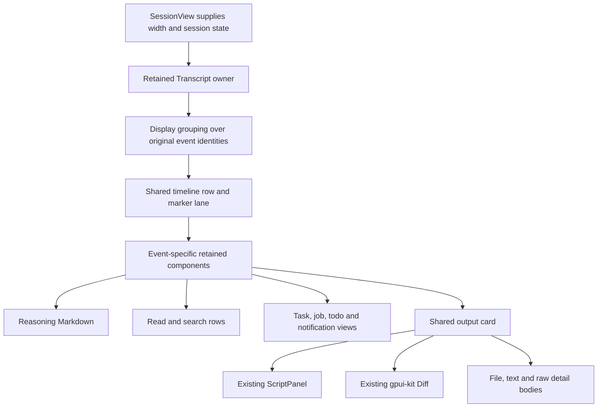
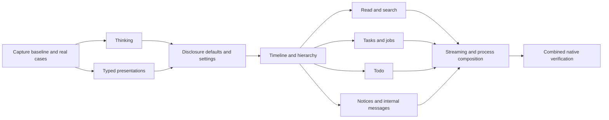

# Conversation transcript improvement plan

Status: approved for execution by the user on 2026-11-05, including capability-based disclosure defaults and local settings. Implementation is in progress. No publication, commit or merge is authorized.

Give Alvin the readable, varied conversation timeline shown in the supplied Tern screenshots and described in the [LobeHub reference](../docs/reference/LOBEHUB-TRANSCRIPT-REFERENCE.md). Improve native component composition without replacing working behavior or growing session orchestration into a renderer catalogue.

## Keep the working baseline

Preserve the measured 120-monospace-column reading cap, existing widescreen behavior, composer alignment, horizontal clearance, message actions, result-to-call pairing, retained block state, theme selection, and accessibility behavior.

Keep ScriptPanel's highlighted first four source lines, monochrome last twelve output lines, independent reversible disclosures, full-output copy, and state across result updates, raw viewing, and outer collapse. Keep gpui-kit Diff and its Verdant integration. Compact header actions, semantic status colors, and failure borders already exist. They are not missing features to rebuild.

Treat the user-reported centered thinking trigger as confirmed. Its text must align left with the shared content column. Expanded thinking must render Markdown with muted prose rather than the full foreground color.

The supplied screenshots establish the target experience, not current Alvin pixels. The previous source audit could not capture the sleeping display. Obtain a current baseline before implementation and do not approve visual parity from source alone.

## Establish component ownership

Keep the existing private `session/transcript` feature boundary for this work. Moving the whole feature to another directory does not itself improve composition. Keep `session.rs` responsible for session wiring and available width, not event-specific rendering.

Use this proposed ownership structure. New names are design proposals, not claims that those modules already exist.

Apply these boundaries during each functional slice.

- Replace `Presentation { summary, content, file, diff }` with a typed presentation that retains structured paths, ranges, search results, agent rows, and body kinds. Keep one dispatch point. Do not replace the match with a plugin framework or string-keyed service registry.
- Let each event or tool family own its adapter and view. Parse a known payload once at that adapter boundary. Preserve the original payload for copy and raw inspection. Unknown payloads remain explicitly inspectable, not mislabeled as successful semantic cards.
- Extract shared card chrome from `tool.rs` as its responsibilities become clear. It owns disclosure, compact actions, body containment, and tool execution status. It does not acquire read, todo, job, or notification-specific formatting.
- Put marker geometry, content placement, and metadata placement in one row component. Put inline summaries and output panels inside that row. Do not force every row through a bordered card.
- Keep semantic state in `alvin-conversation`, which has no GPUI dependencies. Keep presentation and disclosure state in retained UI entities. Never parse omp data again inside a render method.
- Group display rows without merging or discarding source events. Retain the underlying tool entities and their state. Do not identify a call by filename, display text, or status. Repeated reads of the same path remain separate operations.
- Preserve current snapshot invalidation semantics initially. Do not promise disclosure persistence across history replacement when the source lacks stable identity. Grouping must not introduce additional resets during streaming or ordinary updates.
- Keep message usage, tool execution metrics, and session metrics separate. Place each value once on its actual owner.

No new crate, dependency, public renderer SDK or JavaScript runtime is required. Add only the local disclosure preferences specified below through the existing desktop settings mechanism. A future plugin can feed an explicit presentation boundary, but implementing that runtime is outside this plan.

## Set disclosure defaults by tool capability

Keep each event's header, summary and status visible. These defaults control its detail body, not whether the event appears in the timeline.

| Local conversation preference | Initial value | Applies to |
| --- | --- | --- |
| Expand potentially mutating tools | On | Bash, Python/eval/scripts, write, edit, AST edits and other calls capable of changing local files |
| Expand read-only tools | Off | Known read, search, glob and other read-only calls, including grouped reads |
| Expand thinking | Off | Each reasoning block, including while reasoning streams |

Classify capability once in the tool-family presentation descriptor. Do not inspect a Bash command's text to guess that it is safe or read-only. Delegated or unknown tools count as potentially mutating unless an explicit capability establishes otherwise. This classification changes presentation only. It must not introduce approval prompts, permissions, execution restrictions or an authentication policy.

Keep the outer card disclosure separate from source/output extent. An initially open Bash or script card still shows only the first four source lines and last twelve output lines until those sections are expanded. An initially open edit retains its bounded diff preview. Collapsed read-only calls still expose their resource summary and reported status.

Put the three preferences in a Conversation section within the existing General settings topic, not a new top-level destination. Propose application-wide local persistence through the desktop's existing configuration and save/error handling. The face loads and saves typed preferences; the UI owns capability classification and disclosure behavior. Nothing is saved to omp session files or gateway configuration.

Resolve disclosure from the current category default until the user explicitly opens or closes that block. An explicit local choice takes precedence and survives streaming, result arrival, regrouping, theme changes and preference changes. A settings change updates blocks still following the default without overriding manually toggled blocks. Preserve the separate source/output choices as well.

## Map each event to an appropriate view

| Family | Presentation target | Existing data and prerequisite |
| --- | --- | --- |
| Assistant answer | Unboxed Markdown, readable headings and links, compact message actions and usage | Existing text renderer and message chrome |
| Thinking | Small left-aligned disclosure and muted expanded Markdown, independent state | Existing reasoning entity. No reported per-thought duration |
| Read | Lightweight file/resource summary, styled path parts, expandable content | Preserve `displayContent` and reported target metadata instead of flattening |
| Grouped reads | One summary with individual target rows and independent details | Prefer omp's multi-target metadata. Also group adjacent compatible calls without crossing intervening events |
| Bash, eval, Python | Existing highlighted source plus monochrome output-tail panel, compact actions and execution footer | Preserve ScriptPanel. Add readable known stream updates without duplication |
| Edits | Collapsible gpui-kit diff with syntax, file identity, ranges and change statistics | Existing diff renderer and source payload |
| Search | Search summary and structured file/match rows, reported counts and truncation | Preserve reported search details |
| Task progress and job delivery | Agent rows and lifecycle card with status, description and reported duration | Task progress plus `CustomMessage` type `async-result`, including `details.jobs` |
| Todo | Phase title, completed/total, semantic states, completed strikethrough, blocked reason | Wire types exist. Store dropped state and events, then render the current plan and relevant updates |
| Notices, including internal messages, hooks and custom messages | Compact provenance/title, appropriate prose or code, level-specific warning/error treatment | Preserve source identity and original content. Internal agent messaging is a notice kind; omp IRC is one provider representation. Honor source visibility |
| Images and other content | Render supported media rather than describing image bytes as if displayed | Existing attachment path. Verify inline image support with a real captured payload before selecting its adapter |
| Unsupported content | Clearly identified details with original content available | Preserve raw access and decoding errors. Never silently drop or invent a semantic representation |

Do not split a read argument on punctuation to invent a target list. Paths and selectors can contain punctuation. Use omp's reported display targets and links. Preserve a single-path representation where that is what the source reports.

Todo state is not a new gateway feature. SessionState and todo events already expose it. Reconcile initial state, todo tool results, reminders, and auto-clear according to omp's actual semantics. A reminder must not create a duplicate historical plan card.

## Approved acceptance adjustments

The user explicitly excluded interface zoom from this transcript change, approved temporary native Reduce motion verification with restoration of the original macOS preference, and accepted existing behavioral capture coverage instead of fresh provider-specific edit/diff and automatic-clear producers. Keep the supported feature behavior and its existing recorded/typed-event coverage. Do not add a zoom setting, force provider events, or waive the two native motion-state checks.

## Execute small, complete slices

Execution uses the repository's existing implementation workflow after explicit approval. The lead owns integration and acceptance. Delegate independent family components only after shared contracts are settled. No agent runs build, lint, or test suites concurrently with another owner.

### T0. Freeze evidence and capture missing real scenarios

Dependencies: none.

Files and artifacts: existing UI fixtures, the gateway's conversation recorder, a reference-to-acceptance checklist, and current native screenshots.

- Record the current app revision, launch recipe, selected theme, font, zoom and window geometry. Capture actual normal and narrow transcript states without taking over the user's active work environment.
- Reuse `tools_turn.messages.json` and `task_turn.messages.json`, including the existing async-result delivery. Record real multi-target reads, todo transitions, notices, known stream updates, and inline images where coverage is missing. Use the existing gateway and machine configuration. Internal-message coverage may use existing omp IRC data without making that producer a shared transcript prerequisite. Do not read secrets or manufacture fixture payloads.
- Write expected visible outcomes for each recording before editing. Include interrupted, failed, empty and unknown payload cases. A missing real capture blocks its dependent acceptance check, not the unrelated thinking fix.

Acceptance: each planned family has an existing recording or an explicit capture prerequisite; screenshots are labeled by revision and settings; no reference screenshot is presented as current Alvin output.

### T1. Correct thinking presentation

Dependencies: T0 baseline for this path only.

Likely files: `session/transcript/content/reasoning.rs`, its containing content adapter if needed, and `session/markdown.rs` only if a scoped Markdown style is required.

- Use the supported Button child composition so the visible label is left-aligned. Styling only the outer Button is insufficient because its internal label row centers content. Keep a native Button with an accessible name and keyboard operation.
- Render expanded content through the existing Markdown and Verdant pipeline. Apply muted prose styling to the Markdown component itself, including prose descendants, rather than assuming a parent color overrides its defaults. Preserve readable links and syntax distinctions.
- Use the compact thinking treatment instead of an information-alert appearance. Start collapsed, including while streaming, unless the user enables Expand thinking or explicitly opens this block. Preserve independent reversible expansion through streaming, theme changes, and outer message collapse. Do not add an invented duration or automatically reopen thinking when another delta arrives.

Acceptance: trigger label and body share the leading content alignment; expanded paragraphs, lists and fences render correctly in subdued text; reasoning starts collapsed and two blocks retain independent keyboard/pointer choices during streaming.

### T2. Introduce typed tool presentations without losing behavior

Dependencies: T0 recorded tool scenarios. Can proceed independently of T1 with separate file ownership.

Likely files: `session/transcript/tool.rs`, its existing family adapters and `tool/tests.rs`. This is one bounded cross-family migration, not a compatibility layer.

- Replace the file/diff booleans and flattened result strings with explicit body variants and structured summaries. Retain full source content for copy and raw views.
- Separate dispatch/adaptation from shared card rendering. Migrate all existing family callers in the same slice and delete the superseded representation. Reuse ScriptPanel and Diff entities rather than creating replacements.
- Preserve existing public exports, test selectors, result pairing, unsupported-payload visibility, execution status and disclosure state. Do not reparse, rebuild diffs, or recreate child entities on every frame.

Acceptance: every existing family still renders and copies its original complete content; streaming and theme changes retain block state; no legacy presentation branch or second dispatch convention remains.

### T2a. Apply disclosure policy and persist its settings

Dependencies: T1 and T2.

Likely files: the tool-family descriptor/shared disclosure state, reasoning state, `crates/alvin-app/src/config.rs`, `crates/alvin-app/src/settings.rs`, and the minimal existing app/workspace preference handoff. Keep the policy in the UI, not the face.

- Replace unconditional tool-card opening with the capability policy above. Share default-versus-explicit-choice behavior with reasoning without coupling the independent blocks or their source/output extents. Unknown/delegated capabilities are potentially mutating, not assumed read-only.
- Add the three controls to General's Conversation section and persist them using the existing desktop settings mechanism. Reuse existing save-error feedback. Pass typed preferences into the UI through the normal app/workspace wiring; update all affected callers and deliberate crate-root exports together.
- Cover initial defaults, user overrides, settings changes, restart persistence and streaming/result updates with behavioral tests. Do not change the current width/widescreen settings or reset individual block choices when capability/status data refreshes.

Acceptance: mutating-capable calls start open, known read-only calls and thinking start closed; saved category preferences survive application restart; preference changes affect default-following blocks while manual choices and bounded script/diff previews remain intact.

### T3. Compose the connected timeline and semantic text hierarchy

Dependencies: T2a.

Likely files: a new private `session/transcript/lane.rs`, `transcript.rs`, `content.rs`, shared tool chrome, and the existing theme owner only where a missing visual role requires it.

- Establish one marker lane, one content lane and one subordinate metadata lane for tools, thoughts, notifications, tasks and assistant identity. Draw connecting segments across ordinary events and terminate them deliberately at conversation boundaries. Verify continuity across virtualized row boundaries.
- Keep simple activity inline. Reserve contained panels for actual output, diffs and structured result groups. Remove duplicated header markers and accidental extra nesting as each family adopts the shared row.
- Define shared text roles for operation label, intent, path directory, basename, range, metadata and warning/status. Use selected theme colors and existing syntax/theme roles. Add a small transcript-specific palette projection only where current tokens cannot express the distinction. Do not hardcode a Catppuccin theme or color every event with the same primary accent.

Acceptance: all marker centers and peer content edges align; markers never overlap content at narrow, normal or widescreen sizes; light, dark and custom themes retain visible distinctions among primary content, secondary text, metadata and semantic states.

Keep the 120-column width policy and current widescreen choice unchanged. Allocate marker clearance from the existing gutters while retaining transcript/composer alignment. Avoid solving overlap by silently narrowing the reading column again.

User refinement during execution: treat query navigation as a reserved gutter, not an overlay that content can slide underneath. Reserve a 2.5rem navigation column and clip the transcript viewport separately. Activity markers keep their existing inset. Keep the 120-column cap and composer alignment; explicitly account for the navigation column in available width.

### T4. Render lightweight read and search results

Dependencies: T2 and T3, plus T0 multi-target recording.

Likely files: `tool/read.rs`, `tool/search.rs`, a shared private resource-summary component, and a small display-grouping module owned by the transcript projection.

- Render path directories quietly, the basename distinctly, and reported ranges as a subordinate suffix. Preserve non-file resources such as `agent://` and `artifact://` instead of treating every target as a filesystem path.
- Present a multi-target read as a summary and individual target rows. Group adjacent compatible reads without crossing thinking, narration, another tool family or a turn boundary. Keep full results and independent per-target detail access. Appending a read must not reset earlier disclosures.
- Render search results as structured files and matches with reported counts and truncation. Do not replace useful original output with an incomplete summary.

Acceptance: the captured three-target read yields three correct rows; an intervening event prevents grouping; full content, ranges and copy remain correct for duplicate paths, Unicode, long paths and narrow windows.

### T5. Show task progress and background-job lifecycle

Dependencies: T2 and T3. Existing task and async-result fixtures cover the initial path.

Likely files: `tool/task.rs`, `events/custom.rs`, new private job/task components and their local tests.

- Replace the task text blob with agent rows that retain reported identity, assignment, status and available progress. Update the matching row rather than appending duplicate completion cards.
- Render `async-result` from its reported `details.jobs` into the lifecycle card shown in the reference. Keep the delivered result accessible. Use reported duration, not guessed start time or an unrelated message latency.
- Keep running, completed, failed and cancelled distinct. Preserve unknown custom types and statuses honestly, and honor `display:false` without presenting hidden content as a normal transcript message.

Acceptance: the existing job recording shows the correct completed job and reported duration; live progress settles into the same operation; failed/cancelled and unknown delivery cases lose no result content.

### T6. Carry todo state into a structured plan view

Dependencies: T0 todo captures, T2 and T3.

Likely files: `alvin-conversation/src/live.rs`, its local tests, a dedicated UI todo component and the minimal event/tool adapters that feed it.

- Retain todo phases from SessionState. Apply tool results, reminders and auto-clear using existing typed wire fields. Keep this semantic reduction in `alvin-conversation`, not in the GPUI renderer.
- Render phase name, completed/total, current activity and individual pending, in-progress, completed, abandoned and blocked states. Show the reported blocker inline and strike completed text. Do not invent item IDs or assume content strings are globally unique.
- Separate a current-plan projection from historical todo operations. Reconnect, reminders and state refresh must not produce duplicate cards or resurrect cleared tasks.

Acceptance: initial and live state agree; the captured blocked/completed transitions render correctly; clearing and reconnecting preserve the actual current plan without duplicate events.

### T7. Present notices, internal messages and errors

Dependencies: T0 relevant captures and T3.

Likely files: `alvin-conversation/src/live.rs` and the corresponding private transcript event components.

- Present internal agent messages as a kind of notice, preserving sender/source and full content. Use reported severity; an internal message is not inherently a warning. Provider adapters retain their source semantics: omp IRC is one representation, not a shared transcript primitive. Reconcile live delivery with committed history without duplicate rows or a separate provider-specific presentation policy. Keep the messaging capability; do not require an IRC producer to accept the shared notice presentation.
- Render notification source, subject and outcome with distinct text treatment. Use compact warning/error rows for actual warnings and errors, not an alert container for every custom message. Render prose as Markdown rather than automatically fencing all note bodies as code.
- Preserve unknown data, raw frame errors and source details through an explicit detail disclosure. Do not scan arbitrary message strings for invented event kinds.
- Model **System activity** as one private presentation category shared by session notices and transcript injections/context. Apply compact defaults, severity/provenance, retained disclosure and full original inspection at that category boundary, including unknown members. Named events supply data, not separate presentation policies. Do not classify arbitrary user text by tag-like strings or turn transport bookkeeping into duplicate cards.
- Keep session-level System activity behind one collapsed summary with bounded, independently scrolling details. Routine informational notices must not create notification overlays; warning/error notifications use a brief preview while complete original content remains inspectable.
- Verify the category across notices, interrupts, reminders, injections and other source-defined system activity. TTSR is one regression case: retain actual rule citations/content from `ttsr_triggered`, keep the separate `display:false` injection hidden, and do not claim interruption without producer evidence.

Acceptance: internal messages use the shared notice presentation with source identity and complete content; live and historical forms reconcile without duplication where supplied. Warning and decode-error recordings retain their actual level and details; hidden custom messages stay hidden and expansion/copy expose complete original content. A missing omp IRC capture does not block generic notice acceptance.

### T8. Complete streaming, activity metadata and process composition

Dependencies: T2 through T7 as their families become available.

Likely files: `alvin-conversation/src/tools.rs` only if a projection distinction is required, transcript owner/content composition, family stream adapters, and `session/message_chrome.rs`.

- Interpret known tool-stream update shapes into their existing readable body while retaining raw access. Treat partial snapshots and deltas according to their contracts, so streamed text is neither duplicated nor replaced by stale output when the final result arrives.
- Place message usage once beneath its owning activity and keep tool exit/duration with tool execution. Retain detailed usage in the existing popover. Do not copy one message's token totals underneath every tool. Per-call token accounting and reported thinking duration do not exist in the current wire contract.
- Distinguish intermediate process from the final answer in composition. Keep compact activity visible by default, matching the supplied Tern example, with an explicit reversible process disclosure that never hides the final answer. Do not introduce automatic completion-time folding. Keep message copy, restore-to-empty-composer, collapse, metadata, tool copy and raw actions reachable through compact controls and native menus.

Acceptance: a real streamed command displays updates before completion without duplicates; metadata retains its actual ownership; collapsing process leaves the final answer and its actions visible and restores the prior child disclosure state when reopened.

### T9. Verify the combined native experience

Dependencies: T1 through T8.

- Exercise mixed real conversation content containing prose, thinking, grouped reads, search, Bash/eval, failure, task/job delivery, todo transitions and notices. Use existing recorded diffs and typed-event clear coverage as explicitly accepted by the user; a fresh single-conversation file mutation and live automatic-clear producer are not required. Include supported inline media. Internal messaging remains a notice kind, not an omp IRC producer exercise.
- Compare against the reference screenshots and T0 baseline at narrow, normal and wide layouts, Catppuccin Latte and Mocha, and another selected theme. Check scrolling, output growth, reversible expansion, keyboard operation, selection/copy, focus visibility and both native reduced-motion states. Interface zoom is explicitly excluded from this change.
- Obtain visual review of the composed transcript, not isolated cards. Update DESIGN.md's transcript description and the appropriate feature documentation to the actual result. Leave the LobeHub source reference unchanged.

Acceptance: every event-family criterion above is exercised; markers and controls remain usable across sizes and themes; all evidence names the tested revision and no visual gate is marked complete from tests alone.

## Verify every implementation slice

Run `mise format`, read its report output, then run `mise run --force test` for Rust changes. Never use targeted tests, direct `cargo test`, ignored tests, added deadlines, sleeps, or timing retries. Run checks once per completed integration slice, not concurrently in agents.

Use the existing `#[gpui_kit::test]` modules with real components and recorded real omp data. Keep tests inside their owning modules. Assert consumer-visible behavior, semantic state, actual resolved alignment, Markdown structure, full copy, event pairing, grouping boundaries and independent disclosure. Do not pin source text or implementation-specific booleans.

Tests do not replace native verification. Build using `mise run build:debug`. Run `mise dev` as a managed nonblocking service or through the existing native application launch workflow. It already declares the standalone gateway daemon. Never launch the GUI as an unbounded blocking shell call. Drive the actual Alvin window with the computer tools and capture fresh evidence after interaction. Do not route native inspection through Tern, steal foreground focus, or change permissions. If the display or dedicated verification host is unavailable, report the visual gate as blocked.

Compare streaming and large-output behavior with the same T0 workload. Confirm updates remain local to the affected retained component, expanded diffs/scripts remain usable, and virtualized measurements preserve scroll position. Use existing diagnostics or a throwaway profiler probe if needed. Do not add permanent telemetry or claim a performance improvement without measurements.

## Dependencies and review gates

Review Gate A after T1, T2a and T3. Approve thinking alignment, muted Markdown, category disclosure defaults/settings, shared geometry and palette on real renders before extending every family.

Review Gate B after T4 through T7. Approve the lightweight versus contained presentations together using actual mixed content.

Review Gate C after T8 and T9. Approve complete behavior and current screenshots before marking the work finished.

These are implementation checkpoints. The user authorized execution on 2026-11-05, not publication, commits, PRs or merges.

## Record risks and constraints

- The native Button centers its internal label row. Correct the child composition, not an arbitrary offset. The inspected dependency is `gpui-component-0.9.0/src/button/button.rs`, lines 774-805.
- Virtualization, grouping and changing heights can move the viewport or recreate entities. Keep call/result pairing and retained child identities intact. Test duplicate call IDs and repeated paths without guessing ownership.
- Markdown may apply its own foreground styles. Muted reasoning needs explicit component-level styling and real light/dark inspection, not only a muted parent container.
- Real multi-target and todo recordings need to be captured. A real async-result already exists in `fixtures/task_turn.messages.json`. Do not substitute fabricated payloads for missing recordings. Preserve existing internal-message data, but do not make an omp-only producer a generic acceptance prerequisite.
- TodoReminder, TodoAutoClear and IrcMessage were ignored at the initial inspection. Preserve typed provider reduction without treating provider event names as shared UI categories.
- Per-thought duration and per-tool token usage are not reported fields. Omit those unsupported values. Preserve all genuinely reported message, tool and session metrics with correct labels and ownership.
- Existing plan files describe the original v1 build and contain incomplete work. Leave `tasks/plan.md` and `tasks/todo.md` untouched. This plan uses its own [checklist](conversation-transcript-todo.md).
- PRODUCT.md contains stale embedded-gateway language and the design-context loader misclassifies this desktop platform as web. The current AGENTS.md and native gpui-kit rules take precedence. Do not repair unrelated product-context artifacts during this work.
- Tern source is private and unavailable. Screenshots are the Tern design evidence. Do not search for or download alternative source snapshots.

## Review the proposed choices

Approved execution choices:

1. Keep compact completed activity headers visible by default, with manual process folding rather than automatic folding after completion. Detail bodies follow the mutating/read-only/thinking defaults above.
2. Keep grouping limited to semantically compatible adjacent reads and omp-reported multi-target reads. Do not group across intervening narrative or thinking.
3. Keep the current width, widescreen and composer behavior. This work changes transcript composition and its state mappings, not the composer feature set.

Execution starts from working-copy change `vzknxykn`, revision `9b1f6b37`, on parent `d39085e9`. Preserve the existing uncommitted work. The initial native window is 1200 by 800 logical pixels at 2x scale; the loaded ScriptPanel baseline is `/tmp/omp-computer-15c2c988ae63ea80.png`.

Throughput checkpoint: T1 and T2 have separate file owners while T0 captures real scenarios. The parent integrates and runs serialized full checks before dependent slices. T2a then supplies the shared disclosure preferences; T3 establishes geometry before family work fans out. The existing approved architecture replaces a competing-design exercise. No extra framework, checkout or dependency is needed. Completion requires all family criteria, full repository checks and current native evidence; a missing visual/capture check remains explicitly open.

## Execution evidence

The T1/T2 checkpoint passed `mise format` and all 296 tests. T2a passed `mise format` and all 300 tests (nextest `4d83baf4-e522-47aa-bbd4-a5862d45f3ce`); `mise run build:debug` reported the artifact current. Existing retention tests explicitly select expanded read-only details rather than relying on the superseded default.

Native evidence uses an isolated gateway at `ws://127.0.0.1:65332` and temporary desktop configuration, not the user's settings. The original and verification windows are 1200 by 800 logical pixels at 2x scale, System appearance with Catppuccin Latte/Mocha and widescreen off. `/tmp/omp-computer-15c2cc9a21e3ea84.png` shows expanded muted Markdown thinking. The visible read-copy action copied all 161 recorded characters exactly; the prior clipboard was restored. `/tmp/omp-computer-15c2d40dfa63ea8e.png` records the saved non-default switches after restarting the desktop. Manual closure of the final thinking block survived changing its category default away and back, while other blocks followed the default. These observations do not close the multi-theme/layout gates.

| Recording | Visible acceptance target |
| --- | --- |
| UI `real_mixed_read_stream.{events,messages}.json` | Three reported read targets and links, complete copy, actual Bash updates without duplication, exit-42 failure, thinking and final Markdown |
| Conversation `real_todo_transitions.{events,messages,state_before,state_blocked,state_completed}.json` | One current phase, exact statuses, blocked reason and completed tasks; reminder does not duplicate the plan |
| Conversation `real_todo_reminder_repeated.{events,messages,state}.json` | Repeated real reminders retain one current plan |
| Existing UI `task_turn.messages.json` | Agent progress, delivered result and reported async-result duration |
| UI `real_image_read_metadata`, `real_svg_read_metadata`, `real_media_producer_unavailable` recordings | Actual metadata/failure remains honest; none contains inline ImageContent |
| Conversation `real_irc_producer_unavailable` recordings | Failed producer only, not a live/history IRC pair; later nested-transcript inspection established the actual filesystem-policy denial |
| UI `real_single_call_stream.{events,messages}.json` | Actual partial snapshots and final output for one Bash call; settlement keeps the complete final output without stale duplication |
| UI `real_task_wait.messages.json` | A direct `wait` delivery settles its original reported task/job rather than requiring an `async-result` message |
| UI `real_system_category.{events,messages}.json` | Actual warning plus visible unknown and hidden custom messages; category-wide compact presentation and complete inspection |
| UI `controlled_decoder_fault.events.json` | Deliberately malformed producer frame, not an organic failure; gateway retains original JSON and decoder reason |
| UI `real_complete_mixed*` recordings | Search, reads, Bash/eval, real URL image and todo transitions across separate captures; edit denial means these do not establish the complete T9 conversation. Missing omp IRC is not a generic acceptance blocker |

Fixture prefixes above are under the corresponding crate's `fixtures/` directory. The four todo state snapshots omit `systemPrompt` and `dumpTools` for privacy; they are not byte-exact raw responses. Event and message recordings retain actual payloads.

Historical capture gaps were a genuine live/history IRC pair, a live automatic-clear producer and a fresh single-conversation edit/diff. The user removed IRC-specific acceptance and later accepted existing behavioral coverage instead of those fresh provider-specific captures. Do not claim the missing producers were observed. The earlier nested `write agent://capture-hello-irc` was denied by Heimdall and its approval attempt had no interactive UI. A read-only `/sandbox` request in the isolated gateway reported active configuration, separately from the current-session disabled status reported by the user. No provider configuration, permission grant or denied-write retry was used to manufacture coverage.

User clarification: internal agent messaging remains supported as a notice kind; IRC is an omp representation, not a generic transcript feature. Source inspection confirms both internal custom messages and session notices use `SystemActivity`. The visible internal-message title now names the capability rather than IRC, retains sender identity, and preserves original provider data in raw inspection. Full verification run `16f8dd5c-7494-43e9-b49f-a0fa5e680186` passed all 367 tests with zero skipped; `mise format` and `mise run build:debug` completed. Native review of this title change is pending because the host reports its display asleep; no current-render claim is made.

Gate A evidence: normal 1200×800 Mocha (`/tmp/omp-computer-15c2d5712523ea91.png`), maximized 3840×1500 Latte with expanded thinking (`/tmp/omp-computer-15c2d72ca123ea93.png`), and 640×800 `one::cool` with the sidebar folded (`/tmp/omp-computer-15c2dafe79a3ea97.png`). Peer markers, reasoning and composer remain aligned without narrowing the reading policy. The existing workspace main-panel minimum is 30rem; forcing 640px with the sidebar open clips that panel, so the narrow check folds the sidebar. Native window-menu access failed because Alvin exposes no AXMenuBar; background accessibility resized only the isolated verification window.

Actual inline media is captured in UI `real_image_url_read.{events,messages}.json`: a URL read returns image/webp bytes with the approved text-only Ling model; local image reads return metadata. The fixture retains the actual base64 bytes and its source server is closed. The user approved direct `base64` on 2026-11-05; latest stable 0.23.1 and hakari regeneration were applied. Native full-image fit, including the bottom edge without stretching, is verified in `/tmp/omp-computer-15c37d3939107354.png` on artifact `7d8101418c73ab11f19f790061be9333f37ce0bc77c49803bccb30d2026f50ca`.

Earlier integration checkpoint (2026-11-06): full nextest run `521f044d-2a83-4fcc-b16d-0cc0cca55ccc` passed all 367 tests, zero skipped; format/build passed. Artifact SHA256 was `2f6f905336bfe9680448933922c11b203c135cfe5aec590a978d65cd41ce42c6`. The earlier real-session startup failure was fixed through fixture/executor ownership, without increasing timeouts, sleeps, retries or ignores. The pointer/keyboard acceptance test was present, but native metadata inspection was still open at this checkpoint; the continuation below resolves it.

Fresh native evidence was recreated after the earlier execution-host reset. Artifact `7d8101418c73ab11f19f790061be9333f37ce0bc77c49803bccb30d2026f50ca` shows actual reminder activity with exact original copy (`/tmp/omp-computer-15c3702d9d50734b.png`), neutral user interruption with full raw inspection (`/tmp/omp-computer-15c3711c89d0734d.png`), reversible process folding with the final answer retained (`/tmp/omp-computer-15c38078a1507358.png`), normal Mocha (`/tmp/omp-computer-15c3822f2490735c.png`), settled 640×800 Mocha (`/tmp/omp-computer-15c384fa31907361.png`) and 1920×750 widescreen Mocha (`/tmp/omp-computer-15c384019d507360.png`). An immediate post-resize capture showed the previous backing frame scaled; it is not narrow-layout acceptance evidence. Only the later settled capture is used.

Task/job native evidence includes late progress from two running calls to three completed calls and reported duration 47,706ms, followed by exact delivered-result copy (`/tmp/omp-computer-15c368dcaa10734a.png`, artifact `2b6b596a0278b8f898248a06018ea7571a7773b37767681d58b9c7fdb50874c7`). Clearing the real todo plan removed the current-plan view; a fresh client was allowed to load numeric context usage before confirming it stayed absent. Reminder rendering uses the shared System activity category rather than duplicating the current plan.

The large-stream comparison rebuilt exact T0 revision `9b1f6b37c6aa5f6ac179706672f43152a30b7c1e` separately (baseline artifact `d7bb863ffdc52f6846dde816d9255f5d3a51595fb2d2944e66d5323cdcd47feb`). Both baseline and final artifact `7d810141…` subscribed to the same real Bash call: four gated producer chunks, three observed update frames, successful final output of 18,388 characters. Full copy matched on both clients; manually closing the final card during growth stayed closed and copy remained complete. Actual scoped envelopes are retained at `local://conversation-shared-large-stream.events.json`. Long lines wrapped; horizontal displacement was not observed. This proves behavior against the same workload, not a speedup or recovered historical performance measurement. The first buffered-curl probe failed when its own server/runtime ended; it is not an app regression.

The reserved query rail is a 32px column plus 8px separation at the observed normal scale; transcript content is a clipped sibling, not an overlay beneath the rail. Native restored-draft selection and complete clipboard copy succeeded through window-scoped keyboard input after clicking the actual editor; the owned test draft was then cleared and the prior clipboard restored. Semantic AX key activation on that custom editor was not a working route.

At the earlier checkpoint Gates B/C remained open and native metadata inspection was unresolved. The continuation below closes Gate B and native metadata inspection. Larger interface zoom still has no exposed CLI/config/menu/keyboard route in the app; terminal font zoom is not interface zoom. Reduced motion is initialized by GPUI Base from macOS at startup, but native verification in the alternate OS preference state has not been performed and no OS preference was changed. Adding interface-scale scope or changing those prerequisites requires an explicit decision, not a fabricated pass.

### Native acceptance continuation

The display became available again. Current artifact `379d2f02a3f926f591f07190ad396c353d9bceef0dfd46e90ce83056d349603f` was launched against the existing isolated gateway, with no appearance overrides. The comparison-only T0 window was closed. Message metadata is visibly open in `/tmp/omp-computer-15c3b600ea107369.png`, including cache counts, cost and time to first token. Escape dismisses it (`/tmp/omp-computer-15c3b6211190736b.png`) and native AX reports the prior outline focus restored. The existing full-suite pointer/Tab/keyboard tests remain green. No speculative popover source fix was needed; earlier missing AX content was not proof of a missing rendered popup.

A real informational notification containing 2,155 characters produces one initially collapsed System activity summary, measuring 20 logical pixels high, without a notification overlay. Full copy matches the original notification exactly; the previous clipboard was restored. Opening the summary and its entry gives a 212px total activity region: a 20px summary and a 192px independently scrolling inspection area, while the full notice measures 334.5px. Reopening after the native palette change preserves the entry's explicit expanded choice. The read-only producer query changed no provider configuration or permissions; its private body is not reproduced here.

Current-build layout evidence includes settled 640×800 `one::cool` with the sidebar folded (`/tmp/omp-computer-15c3b7811450736f.png`), 1200×800 Catppuccin Latte (`/tmp/omp-computer-15c3b872b2d07373.png`), 1920×750 Latte in widescreen and capped reading modes (`/tmp/omp-computer-15c3b8f556d07374.png`, `/tmp/omp-computer-15c3b970d8907375.png`) and restored 1200×800 Catppuccin Mocha (`/tmp/omp-computer-15c3ba60ff107376.png`). The narrow view substitutes the Queries control for the query rail; normal/wide views reserve the rail separately from transcript content. Interruption details stay explicitly collapsed, informational activity stays compact and the composer remains usable. Real warning activity also remains compact; the zoomed preview (`/tmp/omp-computer-15c3bb3c95907377.png`) fits the activity region. The existing volume test now checks long-warning horizontal containment and complete copy; full run `c7345c67-5d3e-4cbb-9d95-4a6a4f0df6ee` passed all 367 tests before any layout change. No layout fix was justified or applied.

T7, Gate B and T8 were accepted on the exercised shared notice and interaction behavior. At that checkpoint T0, T9, Gate C and final handback remained open for capture and zoom/motion prerequisites. The approved acceptance adjustments above subsequently resolve the capture/zoom scope; native motion evidence and final acceptance are recorded below.

The isolated producer successfully initialized and completed a one-item plan using exactly two todo calls. The native view reports `Plan · 1/1 completed`; actual tool-end envelopes and prompt outcome are retained in `local://conversation-completed-plan.events.json`. Neither completion nor a subsequent tool-free turn emitted `todo_auto_clear`; `live/state` still reports the completed phase. This is genuine completed-plan coverage, not automatic-clear producer evidence. No provider behavior was changed to manufacture the missing event.

### Final acceptance

The user's acceptance decisions are recorded above: no interface-zoom feature, existing behavioral capture coverage accepted, and both native motion states required. No fresh provider permission or configuration change was used to obtain diff or automatic-clear data.

The original macOS Reduce motion value was `0`. Native System Settings changed it to `1`, verified the value, and the isolated current build was relaunched as PID 46083/window 524. The preference was restored to `0` in `finally` and read back. GPUI Base initializes this setting at startup on macOS; the app started with reduced motion was exercised through thinking disclosure (`/tmp/omp-computer-15c3dc7d4ed07379.png`) and reversible process folding with the final answer/actions retained (`/tmp/omp-computer-15c3dcaaf0d0737a.png`). The app was then relaunched as PID 49822/window 537 after restoration and the same paths were exercised (`/tmp/omp-computer-15c3dd211390737b.png`, `/tmp/omp-computer-15c3dd374050737c.png`). These are functional native checks, not animation-frame-time measurements.

Final full gate: `mise format`, `mise run --force test`, and `mise run build:debug` passed. Nextest run `531a608a-e631-44d3-a0ad-cf040a9f5a84` ran 367 tests with zero failures or skips. Native artifact SHA256 remains `379d2f02a3f926f591f07190ad396c353d9bceef0dfd46e90ce83056d349603f`. The long-warning test verifies horizontal containment and complete copy without adding an unneeded production layout change.

T0 through T9 and Gates A/B/C are complete under the approved scope. The isolated GUI and gateway were stopped, and an exact temporary-project process search found no remaining verification processes. Reference captures and local evidence remain available; omp session files were not edited or deleted. No commit, publication or change to the original task plan/checklist was performed.
