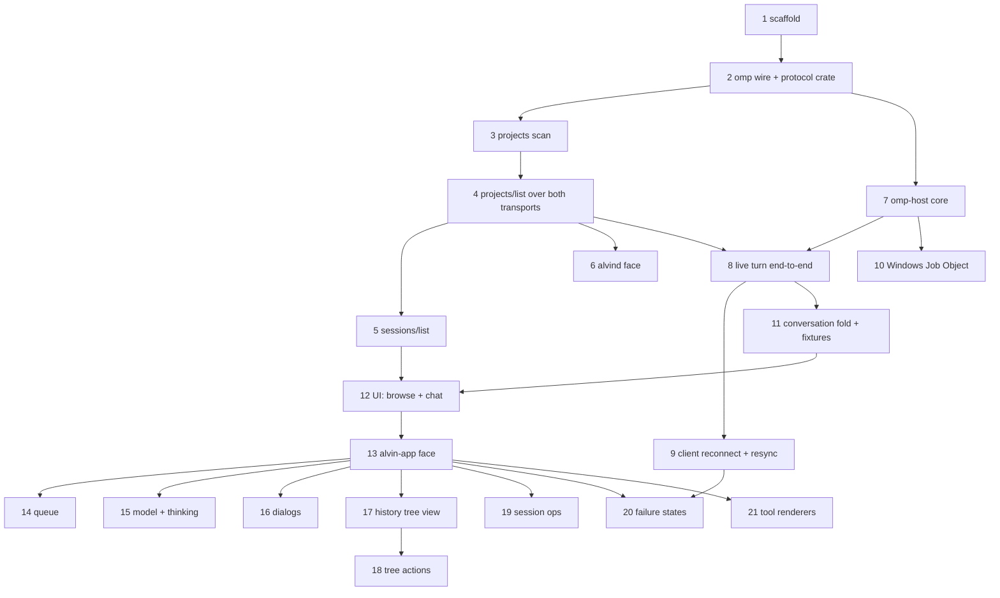

# Implementation Plan: alvin v1

Status: draft for human review (2026-10-30). Specs: `SPEC.md` and `SPEC-<module>.md`. Law: `AGENTS.md`. Task list with checkboxes: `tasks/todo.md`.

## Overview

alvin is a desktop client for omp. A gateway runs one `omp --mode rpc-ui` process per live session and reads omp's session files for project and session lists. The UI talks to the gateway through one typed client over the channel transport or `ws(s)://`. The repo has no code yet: it holds specs, `mise`/`hk` tooling left over from heyday, and agent config. The codebase-memory index of the repo has 0 Rust symbols. omp `18.14.0` is installed.

The plan builds the crates in thin vertical paths. It does not finish one crate before starting the next. Each slice adds the protocol types, lower-crate code, gateway methods, client surface, and (once the UI exists) state and views for one user-visible capability. Each slice also extends the pinned method list. The spec's build order (`scaffold → protocol → session-index, omp-host → gateway, client, conversation → conversation-ui → app`) still holds within each slice.

## Architecture Decisions

- **Vertical slices over module order.** `alvin-protocol` grows one slice at a time. Each slice ships its methods round-tripped over both transports and adds them to the pinned list. The pin test exists from the first gateway slice onward, so a method can't land without the pin changing.
- **Highest risks come first.** The omp wire generation (Task 2) and the omp process host (Task 7) can fail for reasons outside alvin's control. Both run before anything stacks on them.
- **omp version pin = latest stable release.** Every version question gets the same answer: the latest stable release. At planning time that is `18.14.0`: it is npm's `latest` dist-tag, the `v18.14.0` git tag exists, and it is also the installed binary. `package.json` pins `@oh-my-pi/pi-coding-agent` at it, and `omp-rpc` uses the matching `tag = "v<version>"`. If a newer stable release is out when Task 2 starts, use that one. `mise check` fails if the pins disagree with each other or with `omp --version` (`SPEC-protocol.md`).
- **Windows work runs on a Windows VM through briefs.** The VM's agent has no access to this conversation or to long-term memory. Every Windows step is therefore a self-contained brief at `tasks/briefs/<task>-windows.md`: the jj revision to check out, prerequisites, the exact commands, what to look for, and the report format. The user carries the brief to the VM and brings the report back. A brief carries no secrets.
- **Fixtures are recorded, never hand-written.** `generate:conversation-fixtures` records event streams, `live/messages` pages, and tree/entry output from real omp through the gateway. Conversation and host translation tests read those recordings.
- **UI arrives after the CLI path is proven.** The UI phase starts only once a full prompt turn works from client to gateway to omp and back over `ws://` (Checkpoint 2).

## Dependency Graph

Execution is strictly sequential, one task at a time, in task-number order. Rust compilation of this workspace already uses most of the machine, so running tasks in parallel would only slow each one down. The graph above shows what each task needs, not what can run at the same time.

## Task List

### Phase 1: Foundation

#### Task 1: Scaffold workspace and prune heyday tooling
**Description:** Create the root `Cargo.toml` (resolver 3, `crates/*`, edition 2024), `.config/hakari.toml`, and `crates/alvin-workspace-hack`. Prune `.mise/tasks` as `SPEC-scaffold.md` lists, rewrite `test/_default` so it calls only nextest (no `server.sh`, no NSH host fan-out), retarget `hakari` to `alvin-workspace-hack`, and remove NSH from `hk.pkl` and `mise.toml`. Removing `sqlc`, `java`, and the iOS/Android targets is already approved. Add `bun`, which is approved.
**Acceptance criteria:**
- [x] `mise format` and `mise test` exit clean on the empty workspace. Each step's output has been read.
- [x] A second `mise hakari` run produces no diff.
- [x] `grep -ri 'nsh\|heyday'` over `hk.pkl`, `mise.toml`, `.mise/tasks` finds nothing.
**Verification:** `mise format`; `mise test`; `mise hakari` ×2 then `jj diff` empty.
**Dependencies:** None. **Files:** `Cargo.toml`, `.config/hakari.toml`, `crates/alvin-workspace-hack/*`, `.mise/tasks/**`, `hk.pkl`, `mise.toml`. **Scope:** M.

#### Task 2: Generate omp wire types into `alvin-protocol` (risk spike)
**Description:** Add root `package.json` + `bun.lock` that pin `@oh-my-pi/pi-coding-agent@18.14.0`. Write `crates/alvin-protocol/schema/rust.ts.patch` (our derives, `validate` attributes, no `#![allow]`, unused items dropped) and the `generate:omp-wire` task, which writes `src/omp_wire.rs`. Create the `alvin-protocol` crate shell (`lib.rs`, `error.rs`, `error_codes.rs` with the full code table, `ids.rs`) and the `server` feature. Extend `mise check` with the native and `wasm32` builds of `alvin-protocol` and the version-agreement check across `package.json`, the `omp-rpc` tag, and `omp --version`.
**Acceptance criteria:**
- [x] The generated `omp_wire.rs` compiles native and `wasm32-unknown-unknown` without `server`, and contains no `allow` attributes.
- [x] `mise check` fails when the pins disagree, or when the committed `omp_wire.rs` differs from a fresh generation.
- [x] Tests: UUIDv7 version bit set and mint ordering; the error-code table is pinned.
**Verification:** `mise run generate:omp-wire` then `jj diff` empty; `mise check`; `mise format`; `mise run --force test`. Write a short findings note in this plan covering whether the patch applied cleanly and whether validation keywords exist.
**Dependencies:** 1. **Files:** `package.json`, `bun.lock`, `.mise/tasks/generate/omp-wire`, `.mise/tasks/check`, `crates/alvin-protocol/{Cargo.toml,schema/rust.ts.patch,src/{lib,error,error_codes,ids,omp_wire}.rs}`. **Scope:** M.

**Spike findings (omp 18.14.0):**
- The patch applies cleanly with `patch --fuzz=0`. It makes three changes to `rust.ts`: the header (drops `#![allow(dead_code, clippy::all, rustdoc::all)]`, names the release), helper emission (the generator always emitted `scalar_or_array_option`, which no field uses; now only used decoders are emitted), and boxing of oversized union variants so `clippy::large_enum_variant` stays clean under `-D warnings`: `AgentMessage::Assistant`, `RpcAgentEvent::{MessageUpdate, CacheWarmingEnd}`, `RpcNotification::ConfigUpdate`, `RpcServerFrame::RpcNotification`. Consumers (`alvin-omp-host`) construct these with `Box::new`. A size change on an omp bump fails `mise check`; the `BOXED` table in the patch is then revisited.
- **No validation keywords exist** in `rpc-wire.schema.json` (no `minLength`, `maxLength`, `minimum`, `maximum`, `pattern`, item counts). `#[validate(...)]` attributes cannot be generated. Deviation from the task text: the patch adds no `Validate` or `JsonSchema` derives either, because nothing consumes them yet and they would apply to a 7.4k-line file. Decision for the human at Checkpoint 1.
- The package `exports` map blocks deep imports, so the task imports the generator by path from `node_modules` and applies the patch to a temporary `rust.alvin.ts` beside `rust.ts` (removed in `finally`; the installed package stays untouched).
- `mise check` runs the wasm build and the pin/drift check. The `omp-rpc` tag comparison is not wired yet: no `omp-rpc` dependency exists until Task 7, which adds it to the check.
- `wasm32-unknown-unknown` is now a hakari platform (as `SPEC-scaffold.md` states). Hakari unified jsonrpsee's `server-core`/`server` features into the hack crate, pulling `rand`/`getrandom` 0.3, which does not build on wasm32. `jsonrpsee` is therefore a `traversal-excludes` entry in `.config/hakari.toml`. `uuid` gets its `js` feature through a wasm32-only target dependency.
- The `server` feature is declared (`jsonrpsee/server-core`) but its build was not exercised: direct `cargo build` is blocked by repo policy and `mise build` does not enable it.
- `mise format` exited clean while `cargo-check` would have failed on the dead helper (`hk fix --quiet` hides report output); `mise check` surfaced it. Read `mise check`, not `mise format`, for lint evidence.

### Checkpoint 1: Foundation
- [ ] `mise format`, `mise run --force test`, `mise check` clean
- [ ] Spike findings recorded. The human approves continuing with the generated types.

### Phase 2: Read-only path (projects and sessions over the wire)

#### Task 3: Scan session headers and group projects
**Description:** Create `alvin-session-index` with `scan.rs` (directory walk, `*.jsonl` only, 4 KiB head reads), `header.rs` (title slot + header), and `grouping.rs` (`Workspace::discover` cached per `cwd`, blake3 ids; a `cwd` that no longer resolves belongs to no project). Add `ProjectSummary`/`CheckoutSummary` and `ProjectId`/`CheckoutId` to `alvin-protocol` (`projects.rs`). Check the omp file facts against real files first and record any differences in `SPEC-session-index.md`.
**Acceptance criteria:**
- [x] Real omp sessions under a git repository with 2 worktrees and a jj repository with 2 workspaces group into 2 projects with the right checkouts.
- [x] A session whose `cwd` was deleted is not listed under any project.
- [x] A torn last line does not fail the scan.
**Verification:** `mise format`; `mise run --force test`.
**Dependencies:** 2. **Files:** `crates/alvin-session-index/{Cargo.toml,src/{lib,error,scan,header,grouping}.rs}`, `crates/alvin-protocol/src/projects.rs`, `AGENTS.md` (no row change). **Scope:** M.

#### Task 4: `projects/list` end to end over channel and `ws://`
**Description:** First gateway and client slice. Gateway: `config.rs` (`GatewayConfig`), `gateway.rs`, `rpc.rs` (merged `RpcModule`), `channel.rs` (`connect_channel`, tin `memory.rs` pattern), `listener.rs` (ws on any `AsyncRead + AsyncWrite`), and the `ProjectsApi` server. Client: `endpoint.rs`, `client.rs`, `channel.rs`, `ws.rs`, and `error.rs` (typed `ErrorData`, `UnknownCode`, `Disconnected`). Acceptance tests in `crates/alvin-gateway/tests/` cover both transports plus the pinned method list.
**Acceptance criteria:**
- [x] `projects/list` returns the same projects over the channel and over `ws://127.0.0.1:0`.
- [x] A gateway error reaches the client as a typed error with its protocol code. No `String` flattening.
- [x] `alvin-client` builds for `wasm32` (in `mise check`) and does not depend on `alvin-gateway` or the jsonrpsee server crates.
**Verification:** `mise format`; `mise run --force test`; `mise check`.
**Dependencies:** 3. **Files:** `crates/alvin-gateway/{Cargo.toml,src/{lib,error,config,gateway,rpc,channel,listener}.rs,tests/*}`, `crates/alvin-client/{Cargo.toml,src/{lib,error,endpoint,client,channel,ws}.rs}`. **Scope:** L, unavoidable for the first end-to-end path. Keep `rpc.rs` minimal.

#### Task 5: `sessions/list` with status and paging
**Description:** Add `status.rs` (last 32 KiB tail, omp's status rules), display titles (slot → header → compaction summary → first user message), empty-session filtering, and the (modified, id) cursor. Add `SessionSummary` and paging types to `alvin-protocol`, plus the `SessionsApi` server and its pinned-list entry.
**Acceptance criteria:**
- [x] Paging over many real session files returns each session exactly once, newest first.
- [x] A multi-MB session file is scanned by reading only the head and tail windows (read offsets asserted).
- [x] Round-trips over both transports.
**Verification:** `mise format`; `mise run --force test`.
**Dependencies:** 4. **Files:** `crates/alvin-session-index/src/{status,scan,header}.rs`, `crates/alvin-protocol/src/sessions.rs`, `crates/alvin-gateway/src/rpc/*`, gateway tests. **Scope:** M.

#### Task 6: `alvind` face with telemetry
**Description:** Add the `alvind` binary target: confique + clap config (`alvind.toml`), telemetry (`telemetry.rs`, OTLP via `init-tracing-opentelemetry`, `ALVIN_LOG`), graceful shutdown that flushes telemetry (and closes live sessions once Task 7 adds them), the sessions-directory resolution from omp's rules, and RPC method spans plus the `alvin.rpc.duration` metric.
**Acceptance criteria:**
- [x] `alvind` serves `projects/list` on `ws://`. (`wss://` is dropped: no TLS in the gateway.)
- [x] Ctrl-C exits cleanly and the flush runs. A flush error is logged, not dropped.
**Verification:** `mise format`; `mise run --force test`; manual: run `alvind`, connect with `websocat`, call `projects/list`, then send SIGINT.
**Dependencies:** 4. **Files:** `crates/alvin-gateway/src/{main,settings,telemetry,omp_dirs}.rs`, `Cargo.toml` (bin target). **Scope:** M.

### Checkpoint 2a: Read path
- [x] Projects and sessions list over channel and `ws://`. The pinned list matches.
- [x] Human review of the protocol shapes before live methods build on them.

### Phase 3: Live sessions (CLI-proven)

#### Task 7: omp-host core: start, events, prompt, abort, bash, teardown (risk)
**Description:** Create `alvin-omp-host`: `host.rs` (`Host`, `HostConfig`, `StartRequest`, launch flags, `set_ask_dialog` on ready), `session.rs` (async methods over `spawn_blocking`), `bridge.rs` (bounded mpsc pump, never drops), `translate.rs` (frame → `EventBody` | `Untranslated`). Unix teardown aborts running work, then closes omp's process group. Add `EventBody` to `alvin-protocol` (`events.rs`). Request types for `live/*` methods arrive with the gateway methods in Task 8.
**Acceptance criteria:**
- [x] A real prompt streams text deltas in order and ends with its prompt result. Abort stops a running turn. `bash` returns its output.
- [x] After close or drop, the omp pid and a running `bash` command's process are gone. (A process a command left running in the background after it returned is not reachable on Unix; see `SPEC-omp-host.md`.)
- [x] Killing omp from a test yields a process-exited event, and the next call returns a typed error. A slow consumer loses no events.
**Verification:** `mise format`; `mise run --force test`; `mise check`.
**Dependencies:** 2. **Files:** `crates/alvin-omp-host/{Cargo.toml,src/{lib,error,host,session,bridge,translate,test_support}.rs,fixtures/frames.jsonl}`, `crates/alvin-protocol/src/{events,lib}.rs`, `.mise/tasks/check` (omp-rpc tag pin). **Scope:** L.

#### Task 8: Live turn end to end: open, prompt, subscribe, close
**Description:** Gateway `live.rs` holds the registry (two indexes, idempotent open), the event log (stamp UUIDv7, broadcast, clear on settle), and `events/subscribe` replay under the lock with stale-cursor handling. Methods: `live/open` (new and listed), `close`, `list`, `state`, `messages`, `prompt`, `abort`, `bash`, `abortBash`. Semantic validation lives in the gateway only. `Client::events(live)` returns a stream with no reconnect yet. Add the live metrics.
**Acceptance criteria:**
- [x] Over both transports: open → prompt → streamed events → settled. `live/messages` then returns the turn.
- [x] Opening the same session file twice (concurrently too) returns one `LiveSessionId` and one omp process.
- [x] Subscribing with `after` replays later events exactly once. An `after` older than the retained log returns the stale-cursor code. After gateway shutdown no omp process remains.
**Verification:** `mise format`; `mise run --force test`; manual: `alvind` + a small client call sequence (throwaway script, deleted after use).
**Dependencies:** 4, 7. **Files:** `crates/alvin-gateway/src/{live,gateway,rpc,config,error,telemetry}.rs`, `crates/alvin-gateway/tests/wire.rs`, `crates/alvin-protocol/src/{live,events,error_codes}.rs`, `crates/alvin-omp-host/src/{host,session}.rs` (resume, state, messages), `crates/alvin-client/src/events.rs`. **Scope:** L.

#### Task 9: Client reconnect and `Resync`
**Description:** `reconnect.rs`: a state machine (`Connecting`/`Connected`/`Reconnecting`/`Lost`) driven by `on_disconnect`, with backoff from 250 ms to 30 s plus jitter (`jiff::SignedDuration`). `gloo-timers` provides timers on wasm. The event stream resumes from the last id. A second stale cursor or an unknown live session yields one `Resync`. A closed channel goes straight to `Lost`. Calls never retry.
**Acceptance criteria:**
- [x] Stop and restart the ws listener mid-turn: the state goes `Reconnecting` → `Connected`, and the stream continues with no gap and no duplicate (checked against a second subscriber over the channel).
- [x] Restart with an empty registry: exactly one `Resync`.
- [x] A call in flight during an abrupt drop fails with `Disconnected` and is not re-sent. A call made while reconnecting fails at once.
**Verification:** `mise format`; `mise run --force test`; `mise check` (wasm).
**Dependencies:** 8. **Files:** `crates/alvin-client/src/{reconnect,events,client,error}.rs`, `crates/alvin-gateway/tests/wire.rs`. **Scope:** M.

#### Task 10: Windows Job Object teardown
**Description:** `job.rs` (`cfg(windows)`, `windows-sys`): spawn suspended, assign to the kill-on-close job, resume, then `Client::from_io`. The unsafe boundary is documented with `# Safety` / `// SAFETY:`.
**Acceptance criteria:**
- [ ] On Windows, the Task 7 teardown tests pass, including the grandchild `bash` case.
- [ ] macOS and Linux behavior is unchanged.
**Verification:** `mise format` on macOS. Then write `tasks/briefs/task-10-windows.md`. It covers: the revision; prerequisites (mise, omp at the pinned version, an omp config that can reach `zai/glm-5.3-flash`); running `mise run --force test`; the teardown tests to watch, which must leave no `omp.exe` and no grandchild `bash`, confirmed with `Get-Process`; and a report format (pass/fail per test, full failure output, `omp --version`, `rustc --version`). The user runs the brief on the Windows VM and relays the report. Fixes found there go through the same loop. If the VM is not ready, Task 10 stays blocked. Task 11 onward does not depend on it, so work continues, and Task 10's verification is due before the final checkpoint.
**Dependencies:** 7. **Files:** `crates/alvin-omp-host/src/{job,host}.rs`, `Cargo.toml`. **Scope:** S.

### Checkpoint 2b: CLI end to end
- [ ] Full turn through `alvind` over `ws://` with reconnect proven. All tests and `mise check` green.
- [ ] Human review before the UI phase.

### Phase 4: UI walking skeleton

#### Task 11: Conversation fold core plus recorded fixtures
**Description:** Add the `generate:conversation-fixtures` task (it records events and `live/messages` from real omp through the gateway). Create `alvin-conversation`: `workspace.rs` (projects and session pages), `live.rs` (fold: run state, title, exited, notices), `streaming.rs` (assembly keyed by `message_id`), `tools.rs`, and `resync`.
**Acceptance criteria:**
- [x] Folding a recorded run's events produces the transcript that `live/messages` returned for that session. (Compared modulo two fields omp adds when it persists a message after `message_end`: `errorId` and `contextSnapshot`.)
- [x] Fold tests cover a plain turn, a turn with tool calls, an abort, and a process exit. Resync clears the live parts and keeps the session listed. (Queue, dialog and model folds are implemented; their tests arrive with their own recorded fixtures in Tasks 14 to 16.)
- [x] Builds for wasm32.
**Verification:** `mise format`; `mise run --force test`; `mise check`.
**Dependencies:** 8. **Files:** `.mise/tasks/generate/conversation-fixtures`, `crates/alvin-gateway/examples/record_conversation.rs` (the recorder), `crates/alvin-conversation/{Cargo.toml,src/{lib,conversation,workspace,live,streaming,tools,queue,dialogs}.rs,fixtures/*}`. **Scope:** M.

#### Task 12: UI browse and chat: sidebar, open, transcript, composer
**Description:** `alvin-conversation-ui`: `model.rs` (`Entity<Model>`), `workspace.rs` (tabs), `sidebar.rs` (projects → checkouts → sessions, paged), `session.rs`, `transcript.rs` (`MessageScroller`, older pages on scroll), a generic JSON `tool_card.rs`, `composer.rs` (Enter → `live/prompt`, `!` → `live/bash`, Escape → abort/abortBash), `actions.rs` + `init`, and an event task per tab. Read each gpui-kit component page before using it.
**Acceptance criteria:**
- [x] Headless tests against an embedded gateway with real omp: open a listed session and page its transcript; new session → prompt → streamed reply → settled; `!echo hi` runs bash; abort mid-turn.
- [x] Element ids come from domain ids. The view holds no domain state.
- [ ] Builds for wasm32. **Not met.** gpui-kit's browser backend pulls in `wasm_thread 0.3.3`, which uses `#![feature(stdarch_wasm_atomic_wait)]` and so needs a nightly compiler; the project is on stable. The crate has no wasm-specific code. `mise check` instead guards that it depends on no gateway, omp host or session index outside dev-dependencies. Revisit when gpui-kit's web stack builds on stable.
**Verification:** `mise format`; `mise run --force test`; `mise check`.
**Dependencies:** 5, 11. **Files:** `crates/alvin-conversation-ui/src/{lib,actions,model,workspace,sidebar,session,transcript,tool_card,composer,test_support}.rs`. **Scope:** L.

#### Task 13: `alvin-app` face: config, embedded/remote, quit
**Description:** `config.rs` (confique layers, `Settings` conversion, sessions-dir resolver that takes env as arguments), `app.rs` (runtime, embedded gateway or ws client, gpui-kit window, `on_app_quit` shutdown + telemetry flush), and the `mise dev` task.
**Acceptance criteria:**
- [ ] Config tests: precedence, unknown key, endpoint + gateway keys conflict, non-ws scheme, zero-source defaults, sessions-dir rules.
- [ ] Startup test: the embedded window shows the temporary project and opens a live session. After quit, no omp remains.
- [ ] `mise dev` opens a window listing this machine's projects. `--endpoint ws://…` against `alvind` shows the same UI.
**Verification:** `mise format`; `mise run --force test`; manual: `mise dev`, plus `alvind` + `alvin-app --endpoint`.
**Dependencies:** 12, 6. **Files:** `crates/alvin-app/{Cargo.toml,src/{main,config,app}.rs}`, `.mise/tasks/dev`. **Scope:** M.

### Checkpoint 3: Usable app
- [ ] Prompt a real turn in `mise dev` on macOS. Human review of UX before the feature slices.

### Phase 5: Feature slices (each touches protocol + host + gateway + conversation + UI)

#### Task 14: Queue: steer, follow-up, and queue edits
**Description:** Methods: `live/steer`, `followUp`, `abortAndPrompt`, `queue/remove|promote|restore`. Add the `queue_update` fold, `QueueView`, and the composer's streaming behavior.
**Acceptance criteria:** [ ] steering while running shows the queue update, and removing an entry takes it out of the queue; [ ] `live_steered` entries show without actions; [ ] after an abort, `queue/restore` puts the withdrawn text back in the composer.
**Verification:** `mise format`; `mise run --force test`. **Dependencies:** 13. **Files:** `alvin-protocol/src/queue.rs`, `alvin-omp-host/src/session.rs`, gateway rpc + tests, `alvin-conversation/src/queue.rs`, `alvin-conversation-ui/src/{queue,composer}.rs`. **Scope:** M.

#### Task 15: Model and thinking pickers
**Description:** Methods: `model/list|set|cycle` and `thinking/levels|set|cycle`. Fold `model_changed`, `thinking_level_changed`, and `config_update`. Add `pickers.rs` and the cycle actions.
**Acceptance criteria:** [ ] changing the model and thinking level in the UI shows up in `live/state`; [ ] cycle actions work; [ ] round-trips over both transports.
**Verification:** `mise format`; `mise run --force test`. **Dependencies:** 13. **Files:** `alvin-protocol/src/model.rs`, host session, gateway rpc + tests, `alvin-conversation/src/live.rs`, `alvin-conversation-ui/src/pickers.rs`. **Scope:** M.

#### Task 16: Extension dialogs
**Description:** `dialog/respond`; extension UI request and `cancel` events; `DialogHost` (one dialog at a time per session, queued); `notify` → Notification; `setStatus` → status bar; `setWidget` → widget lines; `set_editor_text` → composer.
**Acceptance criteria:** [ ] an `ask` tool call opens a dialog and the answer reaches omp; [ ] a second test cancels the dialog and it closes; [ ] status and widget updates render.
**Verification:** `mise format`; `mise run --force test`. **Dependencies:** 13. **Files:** `alvin-protocol/src/dialog.rs`, host translate, gateway rpc + tests, `alvin-conversation/src/dialogs.rs`, `alvin-conversation-ui/src/{dialogs,status}.rs`. **Scope:** M.

#### Task 17: History tree: read and render
**Description:** Methods: `live/tree` and `live/entries`. The host parses `Entry`/`TreeNode`/`HistoryTree` and returns a typed error on a missing shared field. Conversation adds `set_tree`, `apply_entries`, `tree_cursor`, and `tree_stale`. Add the `HistoryTreeView` virtual list (single-child chains stay at one indent level).
**Acceptance criteria:** [ ] applying recorded entries since the cursor gives the same tree as a fresh `live/tree` (labels and leaf included); [ ] after a turn the tree refreshes by coalesced `live/entries`; [ ] the active path is highlighted.
**Verification:** `mise format`; `mise run --force test`. **Dependencies:** 13. **Files:** `alvin-protocol/src/live.rs` (tree types), `alvin-omp-host/src/session.rs`, gateway rpc + tests, `alvin-conversation/src/live.rs`, `alvin-conversation-ui/src/history_tree.rs`, fixtures. **Scope:** M.

#### Task 18: History tree actions
**Description:** Methods: `live/navigateTree`, `branch`, `branchMessages`, `fork`, `label`, `abortBranchSummary`. The gateway re-keys the session file after a branch or fork. The UI tab follows the new file and reloads the tree and the first transcript page.
**Acceptance criteria:** [ ] branch from a user message, navigate back, and set and clear a label, all reflected in the tree; [ ] fork moves the tab to the new file; [ ] round-trips over both transports.
**Verification:** `mise format`; `mise run --force test`. **Dependencies:** 17. **Files:** host session, gateway `live.rs` + rpc + tests, conversation, `history_tree.rs`, `workspace.rs`. **Scope:** M.

#### Task 19: Session operations and command catalog
**Description:** Methods: `live/rename`, `compact`, `stats`, `exportHtml`, `commands`. Fold the compaction and retry events, `session_info_update`, and `available_commands_update`. Add the session menu and the `/` completion in the composer (it inserts text and never runs the command).
**Acceptance criteria:** [ ] rename updates the tab and sidebar title; [ ] compact shows progress and a compaction summary row; [ ] `/` lists the session's commands.
**Verification:** `mise format`; `mise run --force test`. **Dependencies:** 13. **Files:** protocol `live.rs`, host session, gateway rpc + tests, conversation `live.rs`, UI `session.rs`/`composer.rs`. **Scope:** M.

#### Task 20: Failure states in the UI
**Description:** `ConnectionBanner` (`Reconnecting { attempt }`, `Lost`) and `SessionBanner` (reload-needed after `Resync`, process exited with a close action). Typed errors become Notifications naming the error code.
**Acceptance criteria:** [ ] killing omp shows the exited banner; [ ] dropping the channel shows `Lost`; [ ] a rejected command shows its error code; [ ] no stale content stays visible after `Resync`.
**Verification:** `mise format`; `mise run --force test`. **Dependencies:** 9, 13. **Files:** `alvin-conversation-ui/src/{status,session,workspace}.rs`. **Scope:** S.

#### Task 21: Built-in tool renderers
**Description:** Per-tool `ToolCard` renderers: bash output, read, edit/write as `Diff` when the result carries a patch (field names taken from recorded fixtures), grep/find/glob match lists, and task subagent summaries. Unknown tools keep the JSON renderer.
**Acceptance criteria:** [ ] each built-in tool renders its specific view from a recorded fixture; [ ] an unknown tool renders its args and result as JSON; [ ] streamed output updates the running card.
**Verification:** `mise format`; `mise run --force test`. **Dependencies:** 13. **Files:** `alvin-conversation-ui/src/tool_card.rs`, fixtures. **Scope:** S.

### Checkpoint: Complete
- [ ] Every protocol method has a UI path and every `EventBody` variant has a visible effect, both tested.
- [ ] `mise format`, `mise run --force test`, `mise check` clean. Windows teardown verified on the Windows VM, and the full suite has run there through a final brief (`tasks/briefs/final-windows.md`).
- [ ] `AGENTS.md` "Before Committing Checklist" holds. Human sign-off.

## Risks and Mitigations

| Risk | Impact | Mitigation |
|---|---|---|
| omp's `emitRust` output or our patch doesn't produce compiling, wasm-safe, `allow`-free code | High | Task 2 is a spike with a findings note and a checkpoint before anything depends on it |
| omp file facts (title slot, status windows) differ in 18.14.0 | Med | Task 3 confirms them against real files first and updates the spec |
| Real-omp tests are slow or flaky (model latency, `zai/glm-5.3-flash` availability) | Med | Use deterministic prompts (`!cmd`, short replies). No retries added to tests. Flakes get reported, not masked |
| Windows feedback loop is slow and goes through the user | Med | Briefs are self-contained, with exact commands and a fixed report format, so one relay round trip gives a full result. Windows-only code stays in `job.rs` |
| gpui-kit `MessageScroller` / headless test gaps | Med | Task 12 reads the component docs first. Any missing test support is escalated, not worked around |

## Decisions Recorded (2026-10-30)

1. **Windows:** run Windows verification on a Windows VM that the user will provide, using briefs relayed by the user (see Architecture Decisions).
2. **Versions:** latest stable for every version question, now and later. No pinning to older versions.
3. **Order:** the CLI path goes first, then the UI. Tasks run one at a time, in task-number order.

## Open Questions

None.
